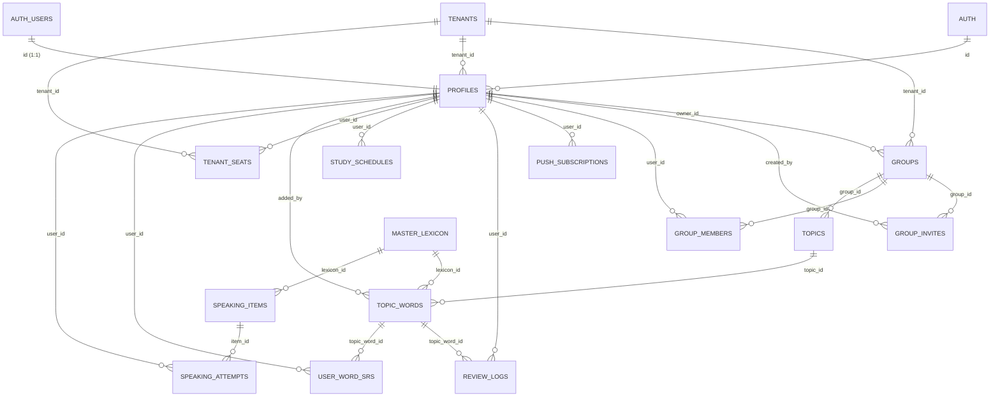

# 🗄️ Dygo Academy: Database Dictionary (DBA Reference)
**Document Version**: 1.0  
**Generated**: introspected from a live PostgreSQL instance with migrations `001`–`004` applied  
**Generated at**: 2026-08-30 15:07 UTC  
**Target engine**: PostgreSQL 17 (`supabase/postgres:17.6.1.136`)  
**Corrected**: 2026-09-25 — `user_word_srs` and `review_logs` hand-corrected against
`database/schema/02_tables.sql`/`05_indexes.sql` (the 2026-09-25 FSRS schema squash;
see `phase 10 implementation plan.md`) to remove stale SM-2 content. This was a
targeted fix, not a full re-introspection — the rest of the document (including the
"live PostgreSQL instance" provenance above) still reflects 2026-08-30 and should be
regenerated against a live instance before being trusted for anything outside SRS.

---

## 1. Scope and how to read this

Every column, constraint, index and policy below was read out of `pg_catalog` on a database with the project's migrations applied — not transcribed from the migration files. Where this document and `database/migrations/` disagree, the migrations are the source of truth and this document is stale.

**Regenerate rather than hand-edit.** The narrative sections (purpose, written by, gotchas) are authored; everything in the column, constraint, index and policy tables is machine-generated.

| | |
| :--- | ---: |
| Base tables | 13 |
| `review_logs` partitions | 6 named + 1 default catch-all |
| RLS policies | 33 |
| Enumerated types | 6 |
| Helper functions | 9 |
| Tables without RLS | 0 — none |

---

## 2. Table map

| Table | Group | Purpose | Rows |
| :--- | :--- | :--- | :--- |
| `tenants` | Tenancy & identity | Workspace and billing boundary — one per solo learner, tutor, or academy. | one per workspace |
| `profiles` | Tenancy & identity | Application-level user record, 1:1 with `auth.users`. | one per user |
| `tenant_seats` | Tenancy & identity | Which users occupy a paid seat in which tenant. | ≤ seats sold |
| `groups` | Content & collaboration | A class or collaborative workspace inside a tenant. | one per class |
| `group_members` | Content & collaboration | RBAC join table. The single source of truth for who can do what. | users × classes |
| `group_invites` | Content & collaboration | Magic invitation links with cryptographic join tokens. | low |
| `topics` | Content & collaboration | A vocabulary set inside a group. | one per vocabulary set |
| `topic_words` | Content & collaboration | A lexicon entry placed into a topic, with its enrichment status. | words × topics |
| `master_lexicon` | Global lexicon | Global, deduplicated linguistic cache. Not tenant-scoped. | one per unique word — **bounded by vocabulary, not users** |
| `user_word_srs` | Learning state | Per-user spaced-repetition scheduling state. | users × words — **largest OLTP table** |
| `review_logs` | Learning state | Append-only review history, partitioned by month. | every review ever — **largest table overall** |
| `study_schedules` | Notifications | Daily habit reminder configuration. | ≤ few per user |
| `push_subscriptions` | Notifications | VAPID Web Push endpoints per device. | one per device |
| `speaking_items` | Speaking (Phase 13) | One sentence per word, with native UK/US audio keys and word timings. Shared by every bed with the word. | ≤ one per word |
| `speaking_attempts` | Speaking (Phase 13) | One row per speaking Compare: score, stage, word marks. No audio. | append-only, grows with use |
| `api_usage_daily` | Operations (Phase 13 S13) | Paid API usage per provider per UTC day, checked against the daily spend caps. | 2 rows a day |
| `media_load_events` | Telemetry | Audio start time per play (tap → sound), cache hit, network, Cloudflare country/city. | one per play — prune old rows when no longer needed |

## 3. Entity relationships



`master_lexicon` is intentionally not connected to `tenants` — it is a global cache shared by every workspace.

---

## 4. Enumerated types

| Type | Values | Used by |
| :--- | :--- | :--- |
| `cefr_level` | `A1` · `A2` · `B1` · `B2` · `C1` · `C2` | `master_lexicon.cefr_level` |
| `group_role` | `ADMIN` · `WRITE` · `READ` | `group_members.role`, `group_invites.grant_role` |
| `seat_status` | `ACTIVE` · `REVOKED` | `tenant_seats.status` |
| `srs_rating` | `AGAIN` · `HARD` · `GOOD` · `EASY` | `review_logs.rating` |
| `fsrs_state` | `New` · `Learning` · `Review` · `Relearning` | `user_word_srs.fsrs_state` |
| `word_status` | `ENRICHING` · `READY` · `FAILED` | `topic_words.status` |

Adding a value is online (`ALTER TYPE ... ADD VALUE`); **removing or reordering one is not** — it requires recreating the type and rewriting every dependent column. Treat these as append-only.

---

## 5. Tables

### Tenancy & identity

#### `tenants`

Workspace and billing boundary — one per solo learner, tutor, or academy.

> Workspace and billing boundary. One per solo learner, tutor, or academy.

**Written by** — Signup flow creates the row. `purchased_seats` / `active_seats_used` are written **only** by the Stripe webhook handler running as `service_role` — there is no user-facing UPDATE policy.

| Column | Type | Null | Default |
| :--- | :--- | :---: | :--- |
| `id` | `uuid` | NO | `gen_random_uuid()` |
| `name` | `text` | NO | — |
| `purchased_seats` | `integer` | NO | `0` |
| `active_seats_used` | `integer` | NO | `0` |
| `price_per_seat_cents` | `integer` | NO | `0` |
| `created_at` | `timestamp with time zone` | NO | `now()` |
| `updated_at` | `timestamp with time zone` | NO | `now()` |

**Keys**

- `tenants_pkey` — PRIMARY KEY: `PRIMARY KEY (id)`

**Checks**

- `tenants_active_seats_used_check` — `CHECK ((active_seats_used >= 0))`
- `tenants_price_per_seat_cents_check` — `CHECK ((price_per_seat_cents >= 0))`
- `tenants_purchased_seats_check` — `CHECK ((purchased_seats >= 0))`
- `tenants_seats_within_purchased` — `CHECK ((active_seats_used <= purchased_seats))`

**RLS policies** — RLS enabled

| Policy | Cmd | Roles | Condition |
| :--- | :--- | :--- | :--- |
| `tenants_select_own` | SELECT | {authenticated} | `(id = current_user_tenant_id())` |

**Referenced by** — `groups`, `profiles`, `tenant_seats`

**Operational notes**

- `tenants_seats_within_purchased` enforces `active_seats_used <= purchased_seats` **in the database**. A race in the invite flow cannot oversubscribe a tenant, which application-level checking would not prevent.
- No UPDATE policy is granted to `authenticated`. Billing writes must go through `service_role`; adding a user-facing policy here would let a tenant grant itself seats.

---

#### `profiles`

Application-level user record, 1:1 with `auth.users`.

**Written by** — Created automatically by the `handle_new_auth_user` trigger on `auth.users` INSERT. Users may update only their own row.

| Column | Type | Null | Default |
| :--- | :--- | :---: | :--- |
| `id` | `uuid` | NO | — |
| `tenant_id` | `uuid` | yes | — |
| `email` | `text` | NO | — |
| `display_name` | `text` | yes | — |
| `daily_srs_goal` | `integer` | NO | `20` |
| `timezone` | `text` | NO | `'UTC'` |
| `created_at` | `timestamp with time zone` | NO | `now()` |
| `updated_at` | `timestamp with time zone` | NO | `now()` |
| `onboarded_at` | `timestamp with time zone` | yes | — (onboarding, `20261008_onboarding.sql`) |
| `cefr_level` | `cefr_level` | yes | — (OB1) |
| `study_goal` | `text` | yes | — (OB2) |
| `target_band` | `numeric(3,1)` | yes | — (OB2) |
| `first_topic_id` | `uuid` | yes | — (OB3) |

**Keys**

- `profiles_first_topic_id_fkey` — FOREIGN KEY: `FOREIGN KEY (first_topic_id) REFERENCES topics(id) ON DELETE SET NULL` (`20261008_onboarding.sql`)
- `profiles_pkey` — PRIMARY KEY: `PRIMARY KEY (id)`
- `profiles_id_fkey` — FOREIGN KEY: `FOREIGN KEY (id) REFERENCES auth.users(id) ON DELETE CASCADE`
- `profiles_tenant_id_fkey` — FOREIGN KEY: `FOREIGN KEY (tenant_id) REFERENCES tenants(id) ON DELETE SET NULL`

**Checks**

- `profiles_daily_srs_goal_check` — `CHECK (((daily_srs_goal >= 1) AND (daily_srs_goal <= 500)))`
- `profiles_email_lowercase` — `CHECK ((email = lower(email)))`
- `profiles_study_goal_check` — `CHECK (study_goal IN ('IELTS', 'PTE', 'LIFE'))` (`20261008_onboarding.sql`)
- `profiles_target_band_check` — null, or IELTS 4.0–9.0 in half bands, or PTE 30–90 whole points (none for LIFE) (`20261008_onboarding.sql`)

**Indexes** (beyond those backing keys)

- `idx_profiles_tenant_id` — `btree (tenant_id)`

**RLS policies** — RLS enabled

| Policy | Cmd | Roles | Condition |
| :--- | :--- | :--- | :--- |
| `profiles_select_self_or_tenant` | SELECT | {authenticated} | `((id = auth.uid()) OR ((tenant_id IS NOT NULL) AND (tenant_id = current_user_tenant_id())))` |
| `profiles_update_self` | UPDATE | {authenticated} | `(id = auth.uid())` |

**Referenced by** — `group_invites`, `group_members`, `groups`, `push_subscriptions`, `review_logs`, `speaking_attempts`, `study_schedules`, `tenant_seats`, `topic_words`, `user_word_srs`

**Operational notes**

- `id` references `auth.users(id)` with `ON DELETE CASCADE` — deleting a Supabase auth user removes the profile and, transitively, all their SRS state and review history.
- `tenant_id` is nullable and `ON DELETE SET NULL`: a user can exist before joining a tenant, and deleting a tenant orphans rather than destroys its people.
- `profiles_email_lowercase` rejects mixed-case email. Normalise before insert.
- `timezone` is an IANA string, not an offset. The notification cron matches local time against it so DST is handled by PostgreSQL rather than by stored arithmetic that silently drifts twice a year.
- Onboarding OB1–OB5 (`20261008_onboarding.sql`, 2026-10-08): `onboarded_at` null = the learner hasn't finished onboarding, and the garden home (`/garden`) sends them to OB1 (`/welcome/level`). The migration backfills every existing row with `onboarded_at = created_at`, so only accounts created afterwards start at null; `seeds/06_onboarded_fixtures.sql` does the same for seeded accounts on a fresh build. `cefr_level` (A2–C1 offered, Skip = B1), `study_goal` + `target_band`, `first_topic_id` are the OB1–OB3 choices, written by `PATCH /api/v1/profiles/me/onboarding` under `profiles_update_self`. Like every profile column, they are readable by people in the same tenant (`profiles_select_self_or_tenant`). The OB4 reminder lives in `study_schedules`, not here.

---

#### `tenant_seats`

Which users occupy a paid seat in which tenant.

**Written by** — Invite redemption (as `service_role`) and seat management in Module 7.

| Column | Type | Null | Default |
| :--- | :--- | :---: | :--- |
| `id` | `uuid` | NO | `gen_random_uuid()` |
| `tenant_id` | `uuid` | NO | — |
| `user_id` | `uuid` | NO | — |
| `status` | `seat_status` | NO | `'ACTIVE'::seat_status` |
| `assigned_at` | `timestamp with time zone` | NO | `now()` |
| `revoked_at` | `timestamp with time zone` | yes | — |

**Keys**

- `tenant_seats_pkey` — PRIMARY KEY: `PRIMARY KEY (id)`
- `tenant_seats_unique_user_per_tenant` — UNIQUE: `UNIQUE (tenant_id, user_id)`
- `tenant_seats_tenant_id_fkey` — FOREIGN KEY: `FOREIGN KEY (tenant_id) REFERENCES tenants(id) ON DELETE CASCADE`
- `tenant_seats_user_id_fkey` — FOREIGN KEY: `FOREIGN KEY (user_id) REFERENCES profiles(id) ON DELETE CASCADE`

**Checks**

- `tenant_seats_revoked_has_timestamp` — `CHECK (((status = 'REVOKED'::seat_status) = (revoked_at IS NOT NULL)))`

**Indexes** (beyond those backing keys)

- `idx_tenant_seats_tenant_status` — `btree (tenant_id, status)`
- `idx_tenant_seats_user_id` — `btree (user_id)`

**RLS policies** — RLS enabled

| Policy | Cmd | Roles | Condition |
| :--- | :--- | :--- | :--- |
| `tenant_seats_select` | SELECT | {authenticated} | `((user_id = auth.uid()) OR is_tenant_admin(tenant_id))` |

**Operational notes**

- `tenant_seats_revoked_has_timestamp` ties `status` and `revoked_at` together — a REVOKED row must carry a timestamp, and an ACTIVE row must not. This prevents the half-updated state that makes seat audits unreliable.

---

### Content & collaboration

#### `groups`

A class or collaborative workspace inside a tenant.

**Written by** — Any authenticated user may create one in their own tenant. Only a group `ADMIN` may modify or delete it.

| Column | Type | Null | Default |
| :--- | :--- | :---: | :--- |
| `id` | `uuid` | NO | `gen_random_uuid()` |
| `tenant_id` | `uuid` | NO | — |
| `owner_id` | `uuid` | NO | — |
| `name` | `text` | NO | — |
| `description` | `text` | yes | — |
| `is_public` | `boolean` | NO | `false` |
| `created_at` | `timestamp with time zone` | NO | `now()` |
| `updated_at` | `timestamp with time zone` | NO | `now()` |

**Keys**

- `groups_pkey` — PRIMARY KEY: `PRIMARY KEY (id)`
- `groups_owner_id_fkey` — FOREIGN KEY: `FOREIGN KEY (owner_id) REFERENCES profiles(id) ON DELETE RESTRICT`
- `groups_tenant_id_fkey` — FOREIGN KEY: `FOREIGN KEY (tenant_id) REFERENCES tenants(id) ON DELETE CASCADE`

**Checks**

- `groups_name_check` — `CHECK ((length(TRIM(BOTH FROM name)) > 0))`

**Indexes** (beyond those backing keys)

- `idx_groups_is_public` — `btree (id) WHERE is_public`
- `idx_groups_tenant_id` — `btree (tenant_id)`

**RLS policies** — RLS enabled

| Policy | Cmd | Roles | Condition |
| :--- | :--- | :--- | :--- |
| `groups_delete_admin` | DELETE | {authenticated} | `has_group_role(id, 'ADMIN'::group_role)` |
| `groups_insert` | INSERT | {authenticated} | `((owner_id = auth.uid()) AND (tenant_id = current_user_tenant_id()))` |
| `groups_select` | SELECT | {authenticated} | `(is_public OR has_group_role(id, 'READ'::group_role) OR is_tenant_admin(tenant_id))` |
| `groups_update_admin` | UPDATE | {authenticated} | `has_group_role(id, 'ADMIN'::group_role)` |

**Referenced by** — `group_invites`, `group_members`, `topics`

**Operational notes**

- `owner_id` is `ON DELETE RESTRICT`, deliberately: deleting a user who owns classes should fail loudly rather than silently orphaning them.
- `is_public` makes the group discoverable but does **not** grant write access — role checks are unchanged.

---

#### `group_members`

RBAC join table. The single source of truth for who can do what.

**Written by** — `ADMIN` of the group only. Redemption of an invite inserts as `service_role`.

| Column | Type | Null | Default |
| :--- | :--- | :---: | :--- |
| `id` | `uuid` | NO | `gen_random_uuid()` |
| `group_id` | `uuid` | NO | — |
| `user_id` | `uuid` | NO | — |
| `role` | `group_role` | NO | `'READ'::group_role` |
| `joined_at` | `timestamp with time zone` | NO | `now()` |

**Keys**

- `group_members_pkey` — PRIMARY KEY: `PRIMARY KEY (id)`
- `group_members_unique_user_per_group` — UNIQUE: `UNIQUE (group_id, user_id)`
- `group_members_group_id_fkey` — FOREIGN KEY: `FOREIGN KEY (group_id) REFERENCES groups(id) ON DELETE CASCADE`
- `group_members_user_id_fkey` — FOREIGN KEY: `FOREIGN KEY (user_id) REFERENCES profiles(id) ON DELETE CASCADE`

**Indexes** (beyond those backing keys)

- `idx_group_members_group_role` — `btree (group_id, role)`
- `idx_group_members_user_id` — `btree (user_id)`

**RLS policies** — RLS enabled

| Policy | Cmd | Roles | Condition |
| :--- | :--- | :--- | :--- |
| `group_members_delete_admin` | DELETE | {authenticated} | `has_group_role(group_id, 'ADMIN'::group_role)` |
| `group_members_insert_admin` | INSERT | {authenticated} | `has_group_role(group_id, 'ADMIN'::group_role)` |
| `group_members_select` | SELECT | {authenticated} | `((user_id = auth.uid()) OR has_group_role(group_id, 'WRITE'::group_role) OR is_tenant_admin(group_tenant_id(group_id)))` *(third branch added 009)* |
| `group_members_update_admin` | UPDATE | {authenticated} | `has_group_role(group_id, 'ADMIN'::group_role)` |

**Operational notes**

- **RLS recursion hazard.** A policy on this table that queries this table recurses infinitely. The `has_group_role` helper is `SECURITY DEFINER` so its internal read bypasses RLS and breaks the cycle. Do not enable `FORCE ROW LEVEL SECURITY` here without re-solving that.
- A `READ` member sees only their own membership row. Only `WRITE` and above can enumerate the roster — students cannot list classmates.

---

#### `group_invites`

Magic invitation links with cryptographic join tokens.

**Written by** — `ADMIN` of the group only.

| Column | Type | Null | Default |
| :--- | :--- | :---: | :--- |
| `id` | `uuid` | NO | `gen_random_uuid()` |
| `group_id` | `uuid` | NO | — |
| `created_by` | `uuid` | NO | — |
| `token_hash` | `bytea` | NO | — |
| `grant_role` | `group_role` | NO | `'READ'::group_role` |
| `max_uses` | `integer` | yes | — |
| `use_count` | `integer` | NO | `0` |
| `expires_at` | `timestamp with time zone` | yes | — |
| `revoked_at` | `timestamp with time zone` | yes | — |
| `created_at` | `timestamp with time zone` | NO | `now()` |

**Keys**

- `group_invites_pkey` — PRIMARY KEY: `PRIMARY KEY (id)`
- `group_invites_token_hash_unique` — UNIQUE: `UNIQUE (token_hash)`
- `group_invites_created_by_fkey` — FOREIGN KEY: `FOREIGN KEY (created_by) REFERENCES profiles(id) ON DELETE CASCADE`
- `group_invites_group_id_fkey` — FOREIGN KEY: `FOREIGN KEY (group_id) REFERENCES groups(id) ON DELETE CASCADE`

**Checks**

- `group_invites_max_uses_check` — `CHECK (((max_uses IS NULL) OR (max_uses > 0)))`
- `group_invites_use_count_check` — `CHECK ((use_count >= 0))`
- `group_invites_uses_within_max` — `CHECK (((max_uses IS NULL) OR (use_count <= max_uses)))`

**Indexes** (beyond those backing keys)

- `idx_group_invites_group_id` — `btree (group_id)`
- `idx_group_invites_token_active` — `btree (token_hash) WHERE (revoked_at IS NULL)`

**RLS policies** — RLS enabled

| Policy | Cmd | Roles | Condition |
| :--- | :--- | :--- | :--- |
| `group_invites_delete_admin` | DELETE | {authenticated} | `has_group_role(group_id, 'ADMIN'::group_role)` |
| `group_invites_insert_admin` | INSERT | {authenticated} | `(has_group_role(group_id, 'ADMIN'::group_role) AND (created_by = auth.uid()))` |
| `group_invites_select_admin` | SELECT | {authenticated} | `has_group_role(group_id, 'ADMIN'::group_role)` |
| `group_invites_update_admin` | UPDATE | {authenticated} | `has_group_role(group_id, 'ADMIN'::group_role)` |

**Operational notes**

- Only a SHA-256 **hash** of the token is stored. The raw token is shown to the inviter once and never persisted, so a database leak cannot be replayed into free access to private classes.
- Redemption cannot run under the joiner's own identity: they are not yet a member, so RLS cannot see the group for them. That endpoint must run as `service_role`.
- `group_invites_uses_within_max` caps redemptions at `max_uses`; a NULL `max_uses` means unlimited.

---

#### `topics`

A vocabulary set inside a group.

**Written by** — `WRITE` and above may create and edit. Deleting requires `ADMIN`.

| Column | Type | Null | Default |
| :--- | :--- | :---: | :--- |
| `id` | `uuid` | NO | `gen_random_uuid()` |
| `group_id` | `uuid` | NO | — |
| `title` | `text` | NO | — |
| `description` | `text` | yes | — |
| `is_public` | `boolean` | NO | `false` |
| `created_at` | `timestamp with time zone` | NO | `now()` |
| `updated_at` | `timestamp with time zone` | NO | `now()` |

**Keys**

- `topics_pkey` — PRIMARY KEY: `PRIMARY KEY (id)`
- `topics_group_id_fkey` — FOREIGN KEY: `FOREIGN KEY (group_id) REFERENCES groups(id) ON DELETE CASCADE`

**Checks**

- `topics_title_check` — `CHECK ((length(TRIM(BOTH FROM title)) > 0))`

**Indexes** (beyond those backing keys)

- `idx_topics_group_id` — `btree (group_id)`
- `idx_topics_is_public` — `btree (id) WHERE is_public`

**RLS policies** — RLS enabled

| Policy | Cmd | Roles | Condition |
| :--- | :--- | :--- | :--- |
| `topics_delete_admin` | DELETE | {authenticated} | `has_group_role(group_id, 'ADMIN'::group_role)` |
| `topics_insert_write` | INSERT | {authenticated} | `has_group_role(group_id, 'WRITE'::group_role)` |
| `topics_select` | SELECT | {authenticated} | `(is_public OR can_read_group(group_id))` |
| `topics_select_anon` | SELECT | {anon} | `is_public` |
| `topics_update_write` | UPDATE | {authenticated} | `has_group_role(group_id, 'WRITE'::group_role)` |

**Referenced by** — `topic_words`

**Operational notes**

- A topic can be public while its group is private — `topics_select` allows either condition. Check both when reasoning about visibility.
- `WRITE` can edit but **cannot** delete (tech spec §4.1). Deletion is `ADMIN`-only, enforced by separate policies rather than by application code.

---

#### `topic_words`

A lexicon entry placed into a topic, with its enrichment status.

**Written by** — `WRITE` and above. The enrichment worker updates `lexicon_id` and `status` as `service_role`.

| Column | Type | Null | Default |
| :--- | :--- | :---: | :--- |
| `id` | `uuid` | NO | `gen_random_uuid()` |
| `topic_id` | `uuid` | NO | — |
| `lexicon_id` | `uuid` | yes | — |
| `source_word` | `text` | NO | — |
| `language_code` | `text` | NO | `'en'` |
| `status` | `word_status` | NO | `'ENRICHING'::word_status` |
| `custom_note` | `text` | yes | — |
| `added_by` | `uuid` | yes | — |
| `failure_reason` | `text` | yes | — |
| `created_at` | `timestamp with time zone` | NO | `now()` |
| `updated_at` | `timestamp with time zone` | NO | `now()` |

**Keys**

- `topic_words_pkey` — PRIMARY KEY: `PRIMARY KEY (id)`
- `topic_words_unique_word_per_topic` — UNIQUE: `UNIQUE (topic_id, source_word, language_code)`
- `topic_words_added_by_fkey` — FOREIGN KEY: `FOREIGN KEY (added_by) REFERENCES profiles(id) ON DELETE SET NULL`
- `topic_words_lexicon_id_fkey` — FOREIGN KEY: `FOREIGN KEY (lexicon_id) REFERENCES master_lexicon(id) ON DELETE RESTRICT`
- `topic_words_topic_id_fkey` — FOREIGN KEY: `FOREIGN KEY (topic_id) REFERENCES topics(id) ON DELETE CASCADE`

**Checks**

- `topic_words_ready_requires_lexicon` — `CHECK (((status <> 'READY'::word_status) OR (lexicon_id IS NOT NULL)))`
- `topic_words_source_word_check` — `CHECK ((length(TRIM(BOTH FROM source_word)) > 0))`

**Indexes** (beyond those backing keys)

- `idx_topic_words_lexicon_id` — `btree (lexicon_id)`
- `idx_topic_words_status_enriching` — `btree (created_at) WHERE (status = 'ENRICHING'::word_status)`
- `idx_topic_words_topic_id` — `btree (topic_id)`

**RLS policies** — RLS enabled

| Policy | Cmd | Roles | Condition |
| :--- | :--- | :--- | :--- |
| `topic_words_delete_write` | DELETE | {authenticated} | `has_topic_role(topic_id, 'WRITE'::group_role)` |
| `topic_words_insert_write` | INSERT | {authenticated} | `has_topic_role(topic_id, 'WRITE'::group_role)` |
| `topic_words_select` | SELECT | {authenticated} | `can_read_topic(topic_id)` |
| `topic_words_select_anon` | SELECT | {anon} | `(EXISTS ( SELECT 1    FROM topics t   WHERE ((t.id = topic_words.topic_id) AND t.is_public)))` |
| `topic_words_update_write` | UPDATE | {authenticated} | `has_topic_role(topic_id, 'WRITE'::group_role)` |

**Referenced by** — `review_logs`, `user_word_srs`

**Operational notes**

- `lexicon_id` is **nullable on purpose**. `POST /words` must return `201 ENRICHING` in under 50 ms, before the worker has resolved or created a `master_lexicon` row.
- `topic_words_ready_requires_lexicon` guarantees a `READY` row always has a lexicon entry — the invariant that makes the nullable column safe.
- `status = 'FAILED'` is not in the original ERD. It was added so exhausted BullMQ retries have a terminal state; without it, a permanently failing word is indistinguishable from one still queued and the frontend polls forever.

---

### Global lexicon

#### `master_lexicon`

Global, deduplicated linguistic cache. Not tenant-scoped.

> Global deduplicated lexical cache. Checked before invoking Gemini/TTS.

**Written by** — The enrichment worker only, as `service_role`. Every authenticated user — and anonymous visitors — can read it.

| Column | Type | Null | Default |
| :--- | :--- | :---: | :--- |
| `id` | `uuid` | NO | `gen_random_uuid()` |
| `normalized_word` | `text` | NO | — |
| `language_code` | `text` | NO | `'en'` |
| `part_of_speech` | `text` | yes | — |
| `ipa_us` | `text` | yes | — |
| `ipa_uk` | `text` | yes | — |
| `cefr_level` | `cefr_level` | yes | — |
| `definition_en` | `text` | yes | — |
| `audio_url` | `text` | yes | — |
| `synonyms` | `jsonb` | NO | `'[]'::jsonb` |
| `antonyms` | `jsonb` | NO | `'[]'::jsonb` |
| `example_sentences` | `jsonb` | NO | `'[]'::jsonb` |
| `enriched_at` | `timestamp with time zone` | yes | — |
| `created_at` | `timestamp with time zone` | NO | `now()` |
| `updated_at` | `timestamp with time zone` | NO | `now()` |

**Keys**

- `master_lexicon_pkey` — PRIMARY KEY: `PRIMARY KEY (id)`
- `master_lexicon_unique_word_per_language` — UNIQUE: `UNIQUE (normalized_word, language_code)`

**Checks**

- `master_lexicon_antonyms_is_array` — `CHECK ((jsonb_typeof(antonyms) = 'array'::text))`
- `master_lexicon_examples_is_array` — `CHECK ((jsonb_typeof(example_sentences) = 'array'::text))`
- `master_lexicon_synonyms_is_array` — `CHECK ((jsonb_typeof(synonyms) = 'array'::text))`
- `master_lexicon_word_is_normalized` — `CHECK ((normalized_word = lower(TRIM(BOTH FROM normalized_word))))`

**Indexes** (beyond those backing keys)

- `idx_master_lexicon_normalized_word_trgm` — `gin (normalized_word gin_trgm_ops)`

**RLS policies** — RLS enabled

| Policy | Cmd | Roles | Condition |
| :--- | :--- | :--- | :--- |
| `master_lexicon_select_all` | SELECT | {authenticated} | `true` |
| `master_lexicon_select_anon` | SELECT | {anon} | `true` |

**Referenced by** — `speaking_items`, `topic_words`

**Operational notes**

- **Not tenant-scoped, by design.** This is the cache that delivers the >85% hit-rate KPI, so it must be shared across every tenant.
- Uniqueness is `(normalized_word, language_code)`, not `normalized_word` alone — the ERD's version would collide on words valid in more than one language ("pain" in English and French).
- `master_lexicon_word_is_normalized` requires `lower(trim())`. Insert a raw user string and it will be rejected.
- The three `jsonb` columns each carry a CHECK that they are arrays, so a malformed AI response fails at write time rather than surfacing as a frontend crash later.

---

### Learning state

#### `user_word_srs`

Per-user FSRS-6 spaced-repetition scheduling state.

> Per-user SRS state. RLS restricts every row to its owning user, so two students in the same class never see or affect each other's progress.

**Written by** — The owning user only. No teacher or admin exception exists.

| Column | Type | Null | Default |
| :--- | :--- | :---: | :--- |
| `id` | `uuid` | NO | `gen_random_uuid()` |
| `user_id` | `uuid` | NO | — |
| `topic_word_id` | `uuid` | NO | — |
| `fsrs_state` | `fsrs_state` enum (`New`/`Learning`/`Review`/`Relearning`) | NO | `'New'` |
| `stability` | `real` | yes | — |
| `difficulty` | `real` | yes | — |
| `reps` | `integer` | NO | `0` |
| `lapses` | `integer` | NO | `0` |
| `learning_steps` | `integer` | NO | `0` |
| `scheduled_days` | `real` | NO | `0` |
| `mastered_at` | `timestamp with time zone` | yes | — |
| `total_mistakes` | `integer` | NO | `0` |
| `recent_mistakes` | `integer` | NO | `0` |
| `is_leech` | `boolean` | NO | `false` |
| `last_reviewed_at` | `timestamp with time zone` | yes | — |
| `next_due_at` | `timestamp with time zone` | NO | `now()` |
| `created_at` | `timestamp with time zone` | NO | `now()` |
| `updated_at` | `timestamp with time zone` | NO | `now()` |

> **FSRS-6 native since the 2026-09-25 schema squash** (`database/schema/02_tables.sql`). `stability` (days, null for a New card), `difficulty` (1–10, null for a New card) and `mastered_at` (sticky: set once stability first reaches 21 days, cleared only by a graded AGAIN) are computed by `com.dygoacademy.backend/src/modules/srs/fsrs-scheduler.ts`. There is no `ease_factor`, `interval_days`, `repetitions` or `fsrs_backfilled` column — those only ever existed on the in-place SM-2→FSRS upgrade path (migrations `019`–`021`), which was superseded when the database was rebuilt from a clean, FSRS-native baseline. That upgrade history is preserved in `database/archive/2026-09-25_pre_squash/` and `phase 10 implementation plan.md`, not in this live table.

**Keys**

- `user_word_srs_pkey` — PRIMARY KEY: `PRIMARY KEY (id)`
- `user_word_srs_unique_user_per_word` — UNIQUE: `UNIQUE (user_id, topic_word_id)`
- `user_word_srs_topic_word_id_fkey` — FOREIGN KEY: `FOREIGN KEY (topic_word_id) REFERENCES topic_words(id) ON DELETE CASCADE`
- `user_word_srs_user_id_fkey` — FOREIGN KEY: `FOREIGN KEY (user_id) REFERENCES profiles(id) ON DELETE CASCADE`

**Checks**

- `user_word_srs_fsrs_ranges` — `CHECK ((stability IS NULL OR stability > 0) AND (difficulty IS NULL OR difficulty BETWEEN 1 AND 10) AND reps >= 0 AND lapses >= 0 AND scheduled_days >= 0)`
- `user_word_srs_recent_mistakes_check` — `CHECK ((recent_mistakes >= 0))`
- `user_word_srs_total_mistakes_check` — `CHECK ((total_mistakes >= 0))`

**Indexes** (beyond those backing keys)

- `idx_user_word_srs_topic_word_id` — `btree (topic_word_id)`
- `idx_user_word_srs_user_leech` — `btree (user_id) WHERE is_leech`
- `idx_user_word_srs_user_next_due` — `btree (user_id, next_due_at)`
- `user_word_srs_mastered_idx` — `btree (user_id) WHERE mastered_at IS NOT NULL`

**RLS policies** — RLS enabled

| Policy | Cmd | Roles | Condition |
| :--- | :--- | :--- | :--- |
| `user_word_srs_all_own` | ALL | {authenticated} | `(user_id = auth.uid())` |

**Operational notes**

- **Owner-only including from the group ADMIN.** A tutor cannot read or alter a student's scheduling state. This is FR-1.2's "strictly isolated" requirement, and it is verified by the RLS test suite.
- `recent_mistakes` is recomputed on every graded review from `review_logs` (graded `AGAIN` rows in the last 7 days) and drives `is_leech` (FR-3.3). It does not feed FSRS scheduling — `difficulty` already reacts to mistakes on its own.
- `mastered_at` is sticky by design: once a word's stability crosses `MASTERY_STABILITY_DAYS` (21) it stays mastered until a graded `AGAIN`, so "mastered" counts shown to the learner never drop without a mistake they actually saw.

---

#### `review_logs`

Append-only review history, partitioned by month.

**Written by** — The owning user only, INSERT and SELECT. No UPDATE or DELETE policy — the table is append-only by design.

| Column | Type | Null | Default |
| :--- | :--- | :---: | :--- |
| `id` | `uuid` | NO | `gen_random_uuid()` |
| `user_id` | `uuid` | NO | — |
| `topic_word_id` | `uuid` | NO | — |
| `rating` | `srs_rating` | NO | — |
| `was_correct` | `boolean` | NO | — |
| `response_ms` | `integer` | yes | — |
| `source` | `text` | NO | `'flashcard'` |
| `quiz_type` | `text` | yes | — |
| `hint_used` | `boolean` | NO | `false` |
| `graded` | `boolean` | NO | `true` |
| `state_before` | `text` | yes | — |
| `elapsed_days` | `real` | yes | — |
| `scheduled_days` | `real` | yes | — |
| `stability_after` | `real` | yes | — |
| `difficulty_after` | `real` | yes | — |
| `reviewed_at` | `timestamp with time zone` | NO | `now()` |

> **FSRS-6 native since the 2026-09-25 schema squash** (`database/schema/02_tables.sql`). `source` (`flashcard`/`quiz`/`leech_drill`/`sync`), `quiz_type`, `hint_used`, `graded` (false = logged but did not move the schedule), `state_before`, `elapsed_days`, `scheduled_days`, `stability_after` and `difficulty_after` are original columns from day one, not a later add-on. There is no `ease_factor_after` or `interval_days_after` — those SM-2 history columns only existed on the in-place upgrade path (migration `019_review_log_signals.sql` onward) and were dropped along with everything else when the schema was rebuilt from a clean baseline; see `database/archive/2026-09-25_pre_squash/`.

**Keys**

- `review_logs_pkey` — PRIMARY KEY: `PRIMARY KEY (id, reviewed_at)`
- `review_logs_topic_word_id_fkey` — FOREIGN KEY: `FOREIGN KEY (topic_word_id) REFERENCES topic_words(id) ON DELETE CASCADE`
- `review_logs_user_id_fkey` — FOREIGN KEY: `FOREIGN KEY (user_id) REFERENCES profiles(id) ON DELETE CASCADE`

**Checks**

- `review_logs_response_ms_check` — `CHECK (((response_ms IS NULL) OR (response_ms >= 0)))`
- `review_logs_source_check` — `CHECK ((source IN ('flashcard', 'quiz', 'leech_drill', 'sync')))`

**Indexes** (beyond those backing keys)

- `idx_review_logs_topic_word_id` — `btree (topic_word_id, reviewed_at DESC)`
- `idx_review_logs_user_reviewed_at` — `btree (user_id, reviewed_at DESC)`
- `review_logs_leech_window_idx` — `btree (topic_word_id, reviewed_at) WHERE rating = 'AGAIN' AND graded`

**RLS policies** — RLS enabled

| Policy | Cmd | Roles | Condition |
| :--- | :--- | :--- | :--- |
| `review_logs_insert_own` | INSERT | {authenticated} | `(user_id = auth.uid())` |
| `review_logs_select_own` | SELECT | {authenticated} | `(user_id = auth.uid())` |

**Operational notes**

- **Partitioned by `reviewed_at`.** An INSERT with no matching partition *fails outright*; it does not fall back. Partitions must stay provisioned ahead of the calendar.
- The primary key is `(id, reviewed_at)` — PostgreSQL requires the partition key in every unique constraint on a partitioned table.
- No UPDATE or DELETE policy exists. The table is append-only, which is what makes it trustworthy as the source for recomputing derived counters.
- Module 8 cohort heatmaps must read **aggregates** via `service_role`. Widening this policy to teachers would expose per-student review histories rather than error rates.

---

#### `user_beds`

Seeds & Harvest Phase 1 (`20261023_user_beds.sql`): the beds a learner has planted from. The active bed is where today's planting takes new words (`ACTIVE_BED_TOPIC` in `srs.service.ts`, also used by the mission quiz and speaking); with no active row the learner's `profiles.first_topic_id` is used.

**Written by** — The owning user only: SELECT, INSERT (only a bed they can read, `can_read_topic`), UPDATE. No DELETE.

| Column | Type | Null | Default |
| :--- | :--- | :---: | :--- |
| `user_id` | `uuid` | NO | `auth.uid()` |
| `topic_id` | `uuid` | NO | — |
| `status` | `text` | NO | `'active'` |
| `started_at` | `timestamp with time zone` | NO | `now()` |
| `harvested_at` | `timestamp with time zone` | yes | — |
| `created_at` | `timestamp with time zone` | NO | `now()` |
| `updated_at` | `timestamp with time zone` | NO | `now()` |

**Keys and checks** — PRIMARY KEY `(user_id, topic_id)`; FKs to `profiles` and `topics` (on delete cascade); `status in ('active', 'resting', 'harvested')`; `harvested_at` set exactly when `status = 'harvested'`.

**Indexes** — `user_beds_one_active` unique `(user_id) WHERE status = 'active'`: one active bed per learner.

---

### Notifications

#### `study_schedules`

Daily habit reminder configuration.

**Written by** — The owning user only.

| Column | Type | Null | Default |
| :--- | :--- | :---: | :--- |
| `id` | `uuid` | NO | `gen_random_uuid()` |
| `user_id` | `uuid` | NO | — |
| `reminder_time` | `time without time zone` | NO | — |
| `timezone` | `text` | NO | `'UTC'` |
| `is_enabled` | `boolean` | NO | `true` |
| `created_at` | `timestamp with time zone` | NO | `now()` |
| `updated_at` | `timestamp with time zone` | NO | `now()` |

**Keys**

- `study_schedules_pkey` — PRIMARY KEY: `PRIMARY KEY (id)`
- `study_schedules_unique_time_per_user` — UNIQUE: `UNIQUE (user_id, reminder_time)`
- `study_schedules_user_id_fkey` — FOREIGN KEY: `FOREIGN KEY (user_id) REFERENCES profiles(id) ON DELETE CASCADE`

**Indexes** (beyond those backing keys)

- `idx_study_schedules_enabled_time` — `btree (reminder_time) WHERE is_enabled`

**RLS policies** — RLS enabled

| Policy | Cmd | Roles | Condition |
| :--- | :--- | :--- | :--- |
| `study_schedules_all_own` | ALL | {authenticated} | `(user_id = auth.uid())` |

**Operational notes**

- `(user_id, reminder_time)` is unique — a user cannot register the same reminder twice.
- `timezone` is IANA. The 15-minute cron compares against it; storing a UTC offset here would break at every DST transition.

---

#### `push_subscriptions`

VAPID Web Push endpoints per device.

**Written by** — The owning user only.

| Column | Type | Null | Default |
| :--- | :--- | :---: | :--- |
| `id` | `uuid` | NO | `gen_random_uuid()` |
| `user_id` | `uuid` | NO | — |
| `endpoint` | `text` | NO | — |
| `p256dh_key` | `text` | NO | — |
| `auth_key` | `text` | NO | — |
| `user_agent` | `text` | yes | — |
| `created_at` | `timestamp with time zone` | NO | `now()` |
| `last_used_at` | `timestamp with time zone` | yes | — |

**Keys**

- `push_subscriptions_pkey` — PRIMARY KEY: `PRIMARY KEY (id)`
- `push_subscriptions_endpoint_unique` — UNIQUE: `UNIQUE (endpoint)`
- `push_subscriptions_user_id_fkey` — FOREIGN KEY: `FOREIGN KEY (user_id) REFERENCES profiles(id) ON DELETE CASCADE`

**Indexes** (beyond those backing keys)

- `idx_push_subscriptions_user_id` — `btree (user_id)`

**RLS policies** — RLS enabled

| Policy | Cmd | Roles | Condition |
| :--- | :--- | :--- | :--- |
| `push_subscriptions_all_own` | ALL | {authenticated} | `(user_id = auth.uid())` |

**Operational notes**

- `endpoint` is globally unique, not unique per user — the same browser endpoint cannot be claimed by two accounts.
- Dead endpoints are not pruned automatically. Web Push returns 404/410 for expired subscriptions; the Phase 3 dispatcher should delete on those responses or the table grows without bound.

---

### Speaking (Phase 13)

Added by `database/migrations/20261004_speaking.sql` (2026-10-04, Phase 13 T1) and made per word by `20261004_speaking_per_word.sql` (same day: speaking starts from the Missions tab and flashcards, not a bed). Written by hand from the migration, not introspected. RLS assertions: `database/tests/rls_speaking_test.sql` (run by `./database/apply-migrations.sh --test`). Design notes: `phase/phase 13/PHASE-13-RECORD.md`.

#### `speaking_items`

One sentence per word (`master_lexicon`), with the native-speaker clips and their word (and target-word syllable) timings. Global content, shared by every bed that contains the word.

> Phase 13: one sentence per word (master_lexicon), shared by every bed that contains the word, with native UK/US audio (R2 object keys) and timings. Written by the content script as service_role; read-only for learners.

**Written by** — The Phase 13 content script only, as `service_role`. Every signed-in user can read it; learners and teachers can't write it.

| Column | Type | Null | Default |
| :--- | :--- | :---: | :--- |
| `id` | `uuid` | NO | `gen_random_uuid()` |
| `lexicon_id` | `uuid` | NO | — |
| `sentence` | `text` | NO | — |
| `target_index` | `smallint` | NO | — |
| `audio_uk_path` | `text` | yes | — |
| `audio_us_path` | `text` | yes | — |
| `timings_uk` | `jsonb` | yes | — |
| `timings_us` | `jsonb` | yes | — |
| `created_at` | `timestamp with time zone` | NO | `now()` |

**Keys**

- `speaking_items_pkey` — PRIMARY KEY: `PRIMARY KEY (id)`
- `speaking_items_one_per_word` — UNIQUE: `UNIQUE (lexicon_id)`
- `speaking_items_lexicon_id_fkey` — FOREIGN KEY: `FOREIGN KEY (lexicon_id) REFERENCES master_lexicon(id) ON DELETE RESTRICT`

**Checks**

- `speaking_items_sentence_check` — `CHECK ((length(TRIM(BOTH FROM sentence)) > 0))`
- `speaking_items_target_index_check` — `CHECK ((target_index >= 0))`
- `speaking_items_uk_path_with_timings` / `speaking_items_us_path_with_timings` — an accent's path and timings are both set or both null
- `speaking_items_has_audio` — at least one of `audio_uk_path`, `audio_us_path`
- `speaking_items_timings_uk_shape` / `speaking_items_timings_us_shape` — timings, when set, are an object with a numeric `duration` and an array `words`

**Indexes** (beyond those backing keys)

- none (the unique key on `lexicon_id` serves lookups by word)

**RLS policies** — RLS enabled

| Policy | Cmd | Roles | Condition |
| :--- | :--- | :--- | :--- |
| `speaking_items_select_all` | SELECT | {authenticated} | `true` |

**Grants** — `authenticated`: SELECT. `anon`: none. `service_role`: SELECT, INSERT, UPDATE, DELETE.

**Referenced by** — `speaking_attempts`

**Operational notes**

- `audio_*_path` are R2 object **keys**, not URLs. The API builds the public URL from `R2_PUBLIC_URL`, so the audio host can change without rewriting rows (unlike `master_lexicon.audio_url`).
- `timings_*` shape: `{ "duration": 3.31, "words": [ { "text": "Planting", "start": 0.05, "end": 0.39, "syllables": [ { "start": 0.05, "end": 0.22, "stressed": true } ] } ] }`. Syllables only for the target word. The DB checks only the outer shape; the content script validates the rest (zod).
- One item per word. The API joins items to the learner's words through `topic_words.lexicon_id`, so a word in two beds has one item. The per-word migration merged any duplicates into the oldest item and moved their attempts onto it.

---

#### `speaking_harvests`

Phase 13 SE5 (2026-10-06): a ripe word the learner said at 90%+ from a bed's "Ready to harvest" card. Shown as picked fruit; never changes SRS (D5). One row per learner and word.

**Written by** — The owning user only (insert, via `POST /speaking/attempts` with `harvest: true`). No update or delete grants for learners.

| Column | Type | Null | Default |
| :--- | :--- | :---: | :--- |
| `id` | `uuid` | NO | `gen_random_uuid()` |
| `user_id` | `uuid` | NO | `auth.uid()` |
| `lexicon_id` | `uuid` | NO | — |
| `score` | `smallint` | NO | — |
| `created_at` | `timestamp with time zone` | NO | `now()` |

**Keys** — `speaking_harvests_pkey` (id); `speaking_harvests_one_per_word` UNIQUE (user_id, lexicon_id); `user_id` → `profiles(id)` and `lexicon_id` → `master_lexicon(id)`, both ON DELETE CASCADE.

**Checks** — `speaking_harvests_score_check`: `score between 90 and 100`.

**RLS policies** — RLS enabled: `speaking_harvests_select_own` (SELECT, authenticated, `user_id = auth.uid()`), `speaking_harvests_insert_own` (INSERT, authenticated, `user_id = auth.uid()`).

**Related function** — `group_echo_challenge(p_group_id, p_since)` (SE6, SECURITY DEFINER, ADMIN only): the group's most-missed word since `p_since` that has a speaking item, with `done_count` (gardeners who spoke it since then) and `member_count`. Totals only.

`daily_missions.type` also accepts `SPEAK` (SE1) since the same migration.

---

#### Voice donation: `voice_donation_consents`, `voice_donors`, `voice_donations`, `voice_donation_deletions`

`20261011_voice_donation.sql` (`docs/plans/Voice donation consent plan.md` §4). A learner who turns on "Help improve Dygo's speech checker" (A8e, or the AU2 box) has an encrypted copy of each scored speaking / pronunciation recording kept in the private bucket `VOICE_DONATION_BUCKET` (default `voice-donations`), under a random donor code. The API offers it only with `VOICE_DONATION_ENABLED=true`.

| Table | Columns | Written by | RLS |
| :--- | :--- | :--- | :--- |
| `voice_donation_consents` | `id`, `user_id` (default `auth.uid()`, **no FK**: kept after the account goes), `granted_at`, `withdrawn_at`, `text_version`, `method` (`setting` \| `register` \| `invite`), `locale` | The learner (`PUT /profiles/me/voice-donation`); `withdrawn_at` is the only updatable column. Never deleted. | select / insert / update own |
| `voice_donors` | `user_id` PK → `profiles(id)` ON DELETE CASCADE, `donor_code` UNIQUE (random), `region` (`north` \| `central` \| `south` \| `elsewhere` \| null), `created_at` | The learner; delete = "Delete my donated recordings" | select / insert / update(region) / delete own |
| `voice_donations` | `id`, `donor_code`, `object_key` UNIQUE (prefix of `.audio.enc` + `.json.enc`), `kind` (`sentence` \| `word`), `created_at`. No account id. | The speech-check worker, as the learner | select / insert own (donor code via `voice_donors`) |
| `voice_donation_deletions` | `donor_code` PK, `requested_at`, `done_at` | Trigger `voice_donors_queue_deletion` (SECURITY DEFINER `voice_donor_deleted()`) on any `voice_donors` delete, including the account cascade | service_role only |

**Partial unique index** — `voice_donation_consents_one_active` (user_id) WHERE `withdrawn_at is null`: one active consent per learner.

**Cleanup** — `voice-donation-cleanup` on the maintenance queue (daily 03:45 UTC, and at once after a delete request) deletes the files and `voice_donations` rows of queued codes and marks them done, then deletes recordings older than 3 years.

---

#### `speaking_attempts`

One row per speaking Compare (SP3). Try again stores another row. The learner's recording is never stored (decision D2).

> Phase 13: one entry per word of the sentence, {index, ok, reason}; reason: stress_soft|missing|rushed|slow|unclear|null (unclear: server check, S18). No audio and no transcript are stored (D2).

**Written by** — The owning user only (insert). Rows are history: only `service_role` can update or delete them.

| Column | Type | Null | Default |
| :--- | :--- | :---: | :--- |
| `id` | `uuid` | NO | `gen_random_uuid()` |
| `user_id` | `uuid` | NO | `auth.uid()` |
| `item_id` | `uuid` | NO | — |
| `accent` | `text` | NO | — |
| `score` | `smallint` | NO | — |
| `stage` | `text` | NO | — |
| `word_marks` | `jsonb` | NO | `'[]'::jsonb` |
| `user_duration_ms` | `integer` | NO | — |
| `created_at` | `timestamp with time zone` | NO | `now()` |

**Keys**

- `speaking_attempts_pkey` — PRIMARY KEY: `PRIMARY KEY (id)`
- `speaking_attempts_user_id_fkey` — FOREIGN KEY: `FOREIGN KEY (user_id) REFERENCES profiles(id) ON DELETE CASCADE`
- `speaking_attempts_item_id_fkey` — FOREIGN KEY: `FOREIGN KEY (item_id) REFERENCES speaking_items(id) ON DELETE CASCADE`

**Checks**

- `speaking_attempts_accent_check` — `CHECK ((accent = ANY (ARRAY['UK'::text, 'US'::text])))`
- `speaking_attempts_score_check` — `CHECK (((score >= 0) AND (score <= 100)))`
- `speaking_attempts_stage_check` — `CHECK ((stage = ANY (ARRAY['seed'::text, 'sprout'::text, 'bloom'::text, 'fruit'::text])))`
- `speaking_attempts_word_marks_check` — `CHECK ((jsonb_typeof(word_marks) = 'array'::text))`
- `speaking_attempts_user_duration_ms_check` — `CHECK ((user_duration_ms >= 0))`

**Indexes** (beyond those backing keys)

- `idx_speaking_attempts_user_item_created` — `btree (user_id, item_id, created_at DESC)`

**RLS policies** — RLS enabled

| Policy | Cmd | Roles | Condition |
| :--- | :--- | :--- | :--- |
| `speaking_attempts_select_own` | SELECT | {authenticated} | `(user_id = auth.uid())` |
| `speaking_attempts_insert_own` | INSERT | {authenticated} | check `(user_id = auth.uid())` |

**Grants** — `authenticated`: SELECT, INSERT. `anon`: none. `service_role`: SELECT, INSERT, UPDATE, DELETE.

**Operational notes**

- Owner-only, with no teacher exception (like `user_word_srs`). Group views are out of scope for Phase 13.
- `accent` uses `UK` / `US` (the handover's values), while `profiles.english_variety` uses `en-GB` / `en-US`; the API maps between them.
- No audio column on purpose (D2). Storing recordings later needs a privacy review and a new migration.

#### `api_usage_daily`

Phase 13 S13: how much of each paid Google API the app used per UTC day, so the backend can stop before a daily cap (`src/ai/usage-cap.service.ts`; `scripts/speaking-generate.ts` for Google Cloud TTS). Migration `20261005_api_usage_daily.sql`.

**Written by** — `service_role` only (the backend and the speaking script). Learners can't read or write it.

| Column | Type | Null | Default |
| :--- | :--- | :---: | :--- |
| `provider` | `text` | NO | — |
| `day` | `date` | NO | — |
| `units` | `bigint` | NO | `0` |
| `updated_at` | `timestamp with time zone` | NO | `now()` |

**Keys** — PRIMARY KEY `(provider, day)`. CHECK `provider in ('gemini', 'google_tts')`, CHECK `units >= 0`.

**RLS** — enabled, no policies (nobody but `service_role`, which bypasses RLS).

**Grants** — `authenticated`, `anon`: none. `service_role`: SELECT, INSERT, UPDATE.

**Operational notes**

- `units`: Gemini = calls (enrichment, translation, word audio, quiz explanations); `google_tts` = characters (SSML incl. marks).
- One statement adds the units only if the day's total stays within the cap (`insert … on conflict do update … where units + new <= cap`), so racing calls can't both take the last unit; no row returned = over the cap, call skipped.
- Caps: `GEMINI_DAILY_CALL_LIMIT` (default 1000), `GOOGLE_TTS_DAILY_CHAR_LIMIT` (default 300000).

---

### Telemetry

#### `media_load_events`

Added by `database/migrations/20261004_media_load_events.sql` (option 2, 2026-10-04). Written by hand. RLS test: `database/tests/rls_media_load_events_test.sql`.

> Option 2 (2026-10-04): audio start time per play (tap → sound, ms), from the phone cache or not, played/error, network type, Cloudflare country/city. No IP, no file URL. Insert-own only; read by service_role.

**Written by** — learners' phones through `POST /api/v1/telemetry/media` (as the learner). **Read by** — Dylan, as `service_role` / `postgres`; nobody signed in can read rows, not even their own.

| Column | Type | Null | Default |
| :--- | :--- | :---: | :--- |
| `id` | `uuid` | NO | `gen_random_uuid()` |
| `user_id` | `uuid` | NO | `auth.uid()` |
| `kind` | `text` (`word` \| `speaking`) | NO | — |
| `host` | `text` (1–100) | NO | — |
| `outcome` | `text` (`played` \| `error`) | NO | — |
| `ms` | `integer` (0–120000) | NO | — |
| `from_cache` | `boolean` | NO | `false` |
| `effective_type` | `text` (≤ 10) | yes | — |
| `country` | `text` (≤ 8) | yes | — |
| `city` | `text` (≤ 80) | yes | — |
| `created_at` | `timestamp with time zone` | NO | `now()` |

**Keys** — `media_load_events_pkey` (id); `user_id` → `profiles(id)` on delete cascade. **Index** — `idx_media_load_events_created_at` `btree (created_at DESC)`.

**RLS** — enabled. `media_load_events_insert_own`: INSERT for {authenticated} with check `(user_id = auth.uid())`. **Grants** — `authenticated`: INSERT only (so the API never uses `RETURNING`). `anon`: none. `service_role`: all.

---

## 6. Security model

### 6.1 Roles

| Role | Used by | Powers |
| :--- | :--- | :--- |
| `postgres` | Migrations, partition maintenance (`DATABASE_ADMIN_URL`) | Superuser. Never serves a request. |
| `authenticator` | The NestJS API pool and PostgREST (`DATABASE_URL`) | `NOINHERIT` login role that switches into `anon` / `authenticated` per transaction. Cannot `CREATE TABLE`. |
| `authenticated` | Any signed-in user | Reads and writes filtered by RLS. |
| `anon` | Anonymous visitors (public topic library, SSR/SEO) | `SELECT` on `topics`, `topic_words`, `master_lexicon` only — RLS narrows to `is_public` rows. |
| `service_role` | Enrichment worker, Stripe webhook, invite redemption, Module 8 aggregates | `BYPASSRLS`. Every use is a deliberate exception; audit additions carefully. |
| `supabase_auth_admin` | GoTrue | Owns the `auth` schema; `search_path = auth`. |

Passwords for these roles are **not** set by the image. `database/init/99-roles.sql`
assigns them from `$POSTGRES_PASSWORD` on first initialisation; without it,
GoTrue and PostgREST fail SASL auth with `SQLSTATE 28P01`.

### 6.2 How RLS reaches API traffic

The API does not hold a privileged connection. `DatabaseService.withUser()`
opens a transaction and issues:

```sql
select set_config('role', 'authenticated', true);
select set_config('request.jwt.claim.sub', $1, true);
select set_config('request.jwt.claims', $2, true);
```

`SET LOCAL` semantics (the `true` third argument) are essential: the settings
are scoped to the transaction, so a pooled connection handed to the next request
cannot inherit the previous user's identity. Using a session-level `SET` here
would be a cross-user data leak.

The consequence for anyone writing queries: **service methods must not add
tenant or membership filters.** `select * from topics` returns different rows
per caller because PostgreSQL filters it. A defensive `WHERE tenant_id = ...`
duplicates policy logic and creates a second place for it to be wrong.

### 6.3 Helper functions

All are `SECURITY DEFINER` except the two marked otherwise. That is deliberate:
a policy on `group_members` that itself queries `group_members` recurses
infinitely, and a `SECURITY DEFINER` function's internal reads bypass RLS,
breaking the cycle.

| Function | Returns | Security | Purpose |
| :--- | :--- | :--- | :--- |
| `current_user_tenant_id()` | `uuid` | definer | Tenant of `auth.uid()`. |
| `group_role_rank(group_role)` | `integer` | invoker (immutable) | Maps `ADMIN`/`WRITE`/`READ` to 3/2/1 so policies can compare. |
| `has_group_role(uuid, group_role)` | `boolean` | definer | Caller holds at least this role in the group. |
| `can_read_group(uuid)` | `boolean` | definer | Group is public, caller is a member, **or (009) caller is `is_tenant_admin()` of that group's tenant.** |
| `can_read_topic(uuid)` | `boolean` | definer | Topic is public, or its group is readable (inherits 009's tenant-admin branch via `can_read_group`). |
| `has_topic_role(uuid, group_role)` | `boolean` | definer | Role check via the topic's group. |
| `is_tenant_admin(uuid)` | `boolean` | definer | Caller holds `ADMIN` in any group of that tenant. There is no separate tenant-role table — this function **is** the tenant-wide/"director" role at the RLS layer (see 009's header comment). |
| `group_tenant_id(uuid)` *(009)* | `uuid` | definer | `tenant_id` of a group, looked up bypassing RLS so `group_members_select` can call `is_tenant_admin()` without a blocked subquery. |
| `handle_new_auth_user()` | `trigger` | definer | Creates a `profiles` row on `auth.users` INSERT. |
| `set_updated_at()` | `trigger` | invoker | Maintains `updated_at` on eight tables. |

> **Do not enable `FORCE ROW LEVEL SECURITY`** on these tables without
> re-solving the recursion. Table owners currently bypass RLS, which is what
> lets the helpers work.

---

## 7. Partitioning and maintenance

`review_logs` is RANGE-partitioned by `reviewed_at`, one partition per month,
plus a `DEFAULT` catch-all.

**Why this needs active management:** an INSERT with no matching partition does
not fall back — it **fails outright**. Migration `001` created partitions by
hand through 2027-01. Without something extending that window, every review
submitted afterwards would error, with no warning beforehand.

`MaintenanceProcessor` (queue `maintenance-queue`, scheduler
`partition-maintenance-daily`, `15 3 * * *`) provisions six months ahead and
runs an additional pass at every application boot. It connects with
`DATABASE_ADMIN_URL` because `authenticator` deliberately cannot `CREATE TABLE`.

The `DEFAULT` partition is a backstop so nothing is ever lost — but rows landing
there mean provisioning fell behind, and **relocating them later requires an
exclusive lock on the whole table**. The processor warns when it finds any.

```sql
-- Health check: is the window still ahead of us?
select max(
         (regexp_match(relname, 'review_logs_(\d{4})_(\d{2})'))[1] || '-' ||
         (regexp_match(relname, 'review_logs_(\d{4})_(\d{2})'))[2]
       ) as last_partition
  from pg_class
 where relname ~ '^review_logs_\d{4}_\d{2}$';

-- Anything stranded in DEFAULT?
select count(*) from public.review_logs_default;
```

### Growth expectations

`user_word_srs` and `review_logs` dominate. A cohort of 1,000 students studying
500 words each produces ~500k `user_word_srs` rows and, at ~8 reviews per word
per year, ~4M `review_logs` rows annually. `master_lexicon` grows with the
*vocabulary*, not with users — that asymmetry is the point of the cache, and it
is why `master_lexicon` is not tenant-scoped.

### Unresolved design question

`user_word_srs.recent_mistakes` is the `M_recent` term in FR-3.1's formula, but
it is a plain counter with **no mechanism to age entries out of the 7-day
window**. Two options, neither yet chosen:

1. **Recompute on read** from `review_logs`, which already carries the
   timestamps. Always correct; costs a query on the SRS hot path, which has a
   p95 < 15 ms budget.
2. **Decay on a schedule** — a nightly job recomputing the counter. Keeps reads
   cheap; the value is stale between runs, and it adds a third repeating job.

This should be settled before Module 3 is implemented in Phase 2.

---

## 8. Operational notes

### Migrations

`001`–`003` are **not idempotent** — plain `CREATE`, not `CREATE IF NOT EXISTS`.
Re-running them on a migrated database fails on "already exists". Use
`./database/apply-migrations.sh --seed-only` / `--test-only` / `--verify` to add
fixtures, run the RLS suite, or inspect state without touching the schema. A
full reset is `docker compose down -v`.

`004_seed_data.sql` inserts fixture users with fixed UUIDs into `auth.users`.
**Never run it against production.**

### Verifying the security model

`database/tests/rls_test.sql` contains 54 assertions (17th pass; was 47
through the 10th) covering cross-tenant isolation, per-user
SRS isolation (including from the group `ADMIN`), the role hierarchy, the
anonymous surface, privilege-escalation attempts, solo-user tenant
auto-provisioning, the FR-8.2 cohort heatmap's own ADMIN gate and
per-student isolation, that an invite-redeemed
member's name is now visible on the inviting teacher's roster regardless of
tenant while remaining invisible to an unrelated admin who shares no group
with them (section I), and (section J, new) that `009`'s tenant-admin read
expansion lets a tenant admin read a sibling group's roster and topics they
never joined, without leaking across the tenant boundary. It wraps
everything in a transaction and rolls back, so it is safe to re-run. Run it
after **any** change to `002_rls_policies.sql`:

```bash
./database/apply-migrations.sh --test-only
```

### Index rationale worth preserving

- `idx_user_word_srs_user_next_due` — plain composite `(user_id, next_due_at)`.
  The specification's `WHERE next_due_at <= NOW()` partial index **cannot be
  created**: PostgreSQL rejects non-`IMMUTABLE` functions in an index predicate.
  The composite serves the same query as an index scan.
- `idx_user_word_srs_user_leech` — genuinely partial (`WHERE is_leech`), since
  the predicate is a stored boolean.
- `idx_master_lexicon_normalized_word_trgm` — GIN trigram, for
  "did you mean" search. Exact lookups use the unique constraint instead.
- `idx_topic_words_status_enriching` — partial, so the worker's scan for pending
  words touches only the small set that is actually pending.

### Things that will bite

| Symptom | Cause |
| :--- | :--- |
| `role "supabase_admin" does not exist` during init | `POSTGRES_USER` was set on the db service. The image bootstraps its superuser as `supabase_admin`; leave it unset. |
| `password authentication failed for user "supabase_auth_admin"` | `99-roles.sql` did not run. Init scripts only execute on an empty data directory — `docker compose down -v`. |
| Queries return rows they should not | Something connected as `postgres` or `service_role` instead of `authenticator`. Both bypass RLS. |
| `new row violates row-level security policy` on a legitimate write | The caller's JWT claims were not set on that transaction — check the query went through `withUser()` / `queryAs()`. |
| Reviews start failing on the 1st of a month | Partition provisioning fell behind. See §7. |
| `docker-entrypoint.sh: ignoring .../init-scripts` | Harmless. The stock entrypoint does not recurse; Supabase's `migrate.sh` processes the subdirectory afterwards. |

---

## 9. Provenance

Column, constraint, index, policy, enum and function data were read from
`pg_catalog` on a PostgreSQL instance with `001`–`004` applied, via
`introspect.py`. Purpose, "written by" and operational notes are authored and
carry design rationale that the catalog cannot express.

An earlier draft of the introspection used delimited text parsing and reported
35 policies against a true count of 33 — policy `USING` expressions contain
newlines, which split into phantom rows. The generator now uses `json_agg`, and
the totals in §1 reconcile with `select count(*) from pg_policies`.

**2026-09-25 addendum**: the database was rebuilt from a clean, FSRS-native
baseline (`database/schema/`, `database/seeds/`) instead of migrations
`001`–`021`; the old migration files were moved to
`database/archive/2026-09-25_pre_squash/`. This document's `user_word_srs`
and `review_logs` sections were hand-corrected against the new schema files
on that date to remove SM-2 columns that no longer exist (`ease_factor`,
`interval_days`, `repetitions`, `ease_factor_after`, `interval_days_after`)
and add what replaced them. The rest of this document was not re-verified
and should be treated as reflecting 2026-08-30 until it is regenerated
against a live instance.
