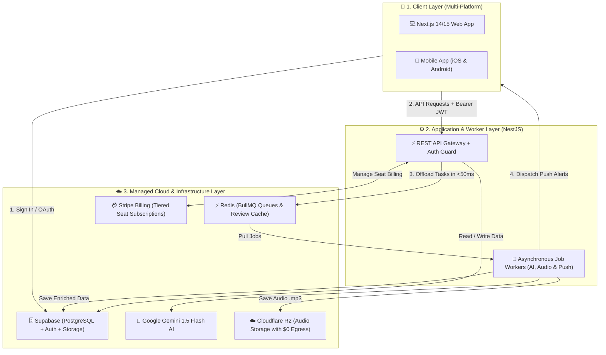
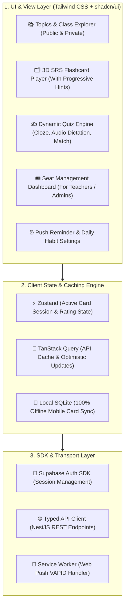
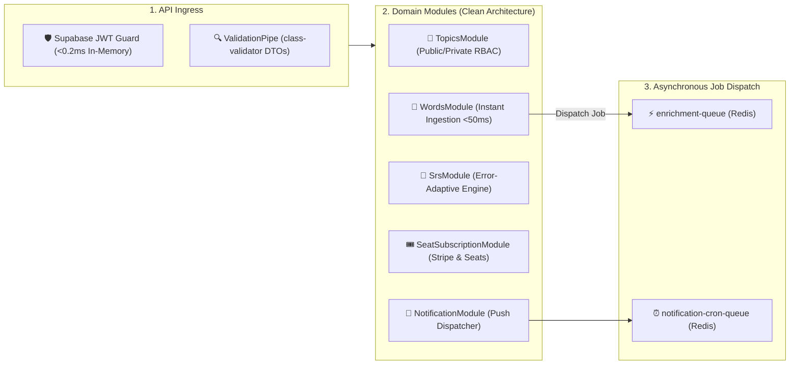
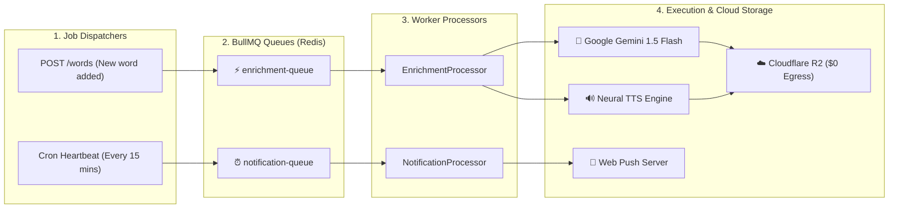
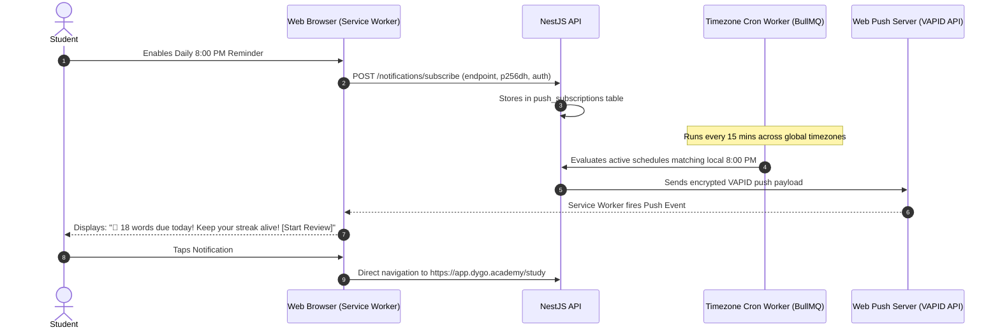
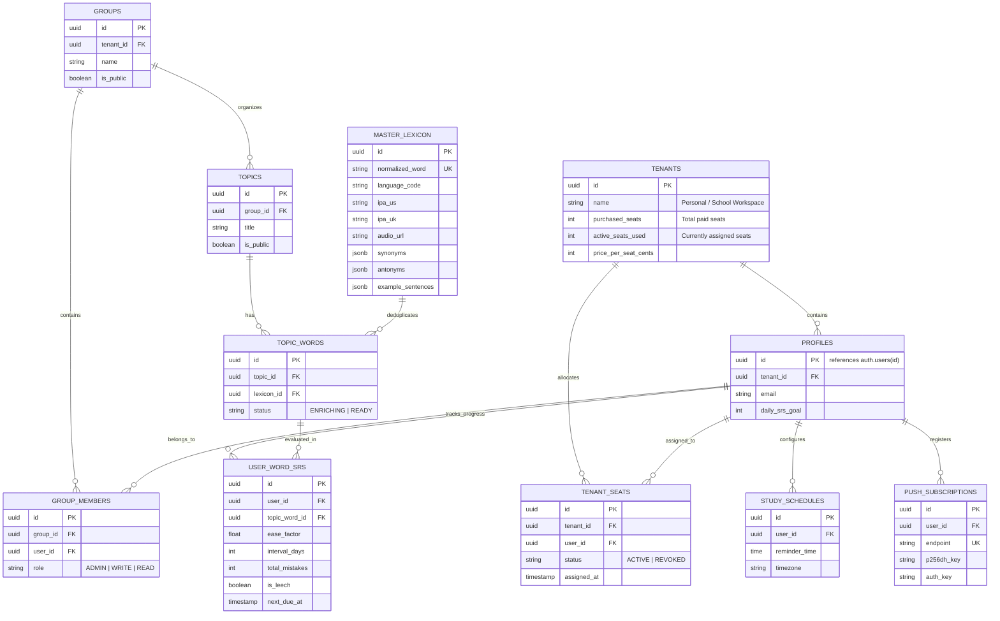
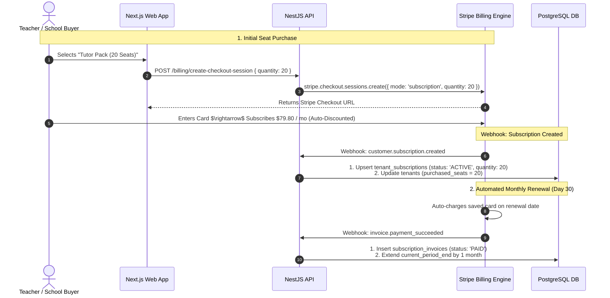

# 🏛️ Dygo Academy: Master System Architecture Specification
**Document Version**: 5.0 (Definitive Master Blueprint)  
**Author**: Principal Cloud & SaaS Solutions Advisory  
**Status**: Ready for Direct Engineering Execution  

---

# PART 1: MASTER HIGH-LEVEL ARCHITECTURE (MAJOR BLOCKS ONLY)

A clean, executive-level view of the major building blocks in the Dygo Academy ecosystem:



---

# PART 2: DETAILED SUBSYSTEM ARCHITECTURES

---

## 1. 💻 Frontend Subsystem Architecture (Web & Mobile)



### Engineering Details:
1. **Next.js 14/15 App Router**: Server Components deliver sub-second initial load and perfect SEO for public vocabulary sets.
2. **Offline-First Mobile Sync**: Mobile clients pre-fetch the daily 20 due cards into local SQLite; review logs sync automatically when internet connectivity returns.
3. **Progressive Clue Engine**: Flashcard player reveals hints step-by-step (First-Letter $\rightarrow$ IPA $\rightarrow$ Audio $\rightarrow$ Context Sentence).

---

## 2. ⚙️ Backend Subsystem Architecture (NestJS Modular Monolith)



### Engineering Details:
1. **Sub-50ms Response Time**: Word ingestion immediately responds `201 Created` with status `ENRICHING`; heavy AI/audio processing runs in BullMQ.
2. **Automatic Swagger API Docs**: Interactive API console at `/api/docs` enables rapid frontend & mobile development with zero manual documentation effort.

---

## 3. 🤖 Jobs & Asynchronous Worker Architecture (BullMQ + Redis)



### Engineering Details:
* **Global Master Lexicon Cache**: Before calling AI, the worker checks if the word already exists in `master_lexicon`. If it exists, existing IPA, audio, and examples are reused, **saving 90% in AI & TTS API costs**.

---

## 4. 🔔 Push Notification & Scheduling Subsystem Architecture



### Core Notification Types:
1. **Daily Study Habit**: Sent at user's local configured hour (e.g., 8:00 PM).
2. **Teacher Class Sprint**: Class-wide alerts for homework deadlines.
3. **Streak Protection**: Evening alerts if a student has an active streak $\ge 3$ days.
4. **Leech Word Remedial**: Alerts suggesting a quick 3-minute drill for repeatedly missed words.

---

## 5. 🗄️ Supabase Subsystem Architecture (PostgreSQL, Auth & RLS)



### Key Database Components:
1. **Sub-5ms Partial Index for Daily Due Cards**:
   ```sql
   CREATE INDEX idx_srs_due_fast ON public.user_word_srs (user_id, next_due_at)
   WHERE next_due_at <= NOW();
   ```
2. **Partitioned Historical Tables**: `review_logs` partitioned by month to ensure sub-10ms query execution across billions of review logs.
3. **Row-Level Security (RLS)**: Enforces access control at the database layer; students can only view topics they own or have an active sponsored seat in.

---

## 6. 💳 Subscription & Stripe Billing Subsystem Architecture



### Unified Seat Pricing Structure:
* **Solo Learner (1 Seat)**: **\$7.99 / mo**
* **Online Tutor (5 – 30 Seats)**: **\$3.99 / seat / mo** (50% Volume Discount)
* **Language Academy (31 – 150 Seats)**: **\$2.49 / seat / mo** (68% Volume Discount)
* **School District (151+ Seats)**: **\$1.49 / seat / mo** (80% Bulk Discount)
* **Frictionless Student Onboarding**: Students invited by a teacher/school join **100% FREE** with zero payment screens.
