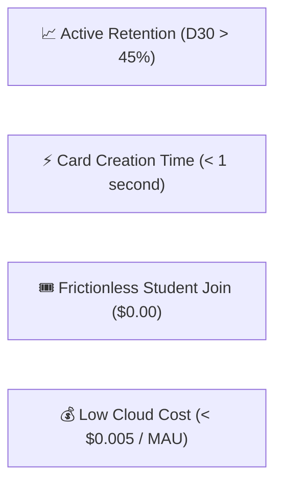
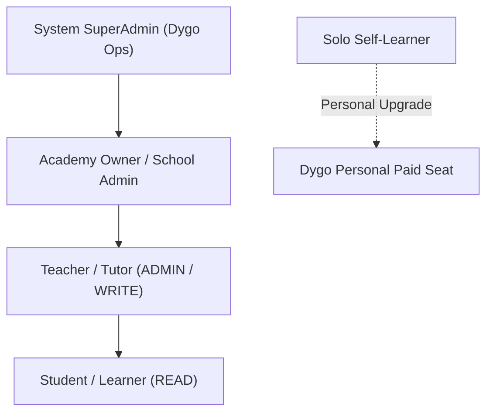
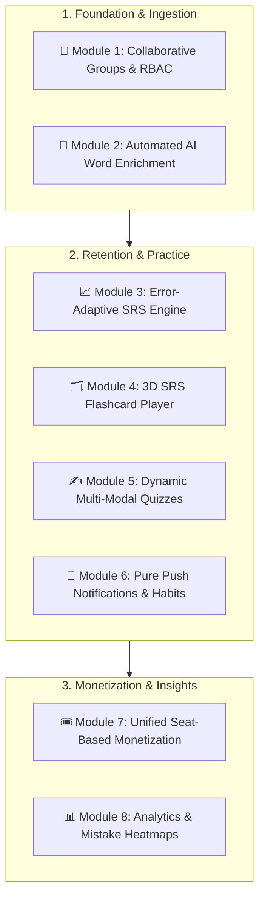

# 📋 Dygo Academy: Master Business Requirements Document (BRD)
**Document Version**: 5.0 (Final Enterprise BRD)  
**Author**: Principal Cloud & SaaS Solutions Advisory  
**Status**: Approved for Engineering & Product Execution  

---

## 1. Executive Summary & Product Vision

### 1.1 Product Vision
**Dygo Academy** is an AI-powered, collaborative vocabulary acquisition platform designed for students, tutors, language academies, and schools. It eliminates the friction of traditional rote flashcards by integrating:
1. **Collaborative Classroom Groups** with granular Role-Based Access Control (Admin, Editor/Write, Viewer/Read).
2. **Automated AI Word Enrichment** providing instant dual-accent IPA phonetics, native neural audio, semantic web (synonyms/antonyms), and level-adapted contextual example sentences with global lexical deduplication.
3. **Error-Adaptive Spaced Repetition (SRS)** that penalizes recent error frequencies and flags problematic "Leech Words" for targeted diagnostic practice.
4. **Interactive 3D Flashcards & Dynamic Quizzes** (Cloze, Audio Dictation, Matching, and AI error nuance explanations).
5. **Pure Push Notifications & Habit Scheduling** (Web Push VAPID + Mobile FCM) with 1-tap deep links.
6. **Unified Seat-Based Monetization** with tiered volume discounts for tutors and schools, allowing invited students to study **100% FREE**.

---

## 2. Business Goals & Success Metrics (KPIs)

| Metric | Target | Measurement Strategy |
| :--- | :--- | :--- |
| **Day-30 User Retention** | **$> 45\%$** | Tracked via daily SRS review completions and push reminder click-throughs. |
| **Time-to-Ingest Vocabulary** | **$< 1\text{ second}$** | Total time from student word entry to full AI enrichment availability. |
| **Student Onboarding Friction** | **0 Payment Steps** | 100% of students joining sponsored teacher classes enter with zero credit cards. |
| **AI Infrastructure Efficiency**| **$> 85\%$ Cache Hit** | Percentage of word requests served via the deduplicated `master_lexicon` cache. |

---

## 3. User Personas & Permissions Matrix

| Persona | Primary Goal | Access & Permissions |
| :--- | :--- | :--- |
| **Student / Learner** | Master custom vocabulary with maximum retention and zero busywork. | Study assigned class topics, create personal lists, flip 3D flashcards, take quizzes. |
| **Teacher / Tutor** | Organize vocabulary for classes, assign homework sprints, and track mistake patterns. | Create private topics, invite students with `READ` access, co-author with `WRITE` access, view class heatmaps. |
| **Academy / School Admin** | Purchase bulk seat licenses, manage teacher licenses, standardize master curriculum. | Manage tenant billing, assign/revoke student seats, access institution-wide retention reports. |
| **System SuperAdmin** | Monitor global infrastructure, AI token consumption, and master dictionary health. | Unrestricted platform management. |

---

## 4. Comprehensive Functional Requirements (8 Core Modules)

---

### 👥 Module 1: Multi-Tenant Workspaces & Group RBAC
* **FR-1.1 (Visibility Scopes)**:
  * *Public Topics*: Searchable, cloneable, and studyable by all users globally.
  * *Private Groups/Classes*: Gated by teacher invite link or school roster.
* **FR-1.2 (Role Hierarchy)**:
  * **`ADMIN` (Owner/Tutor)**: Full management of group settings, seat allocation, member roles, and topic deletions.
  * **`WRITE` (Editor/Co-Teacher)**: Add new vocabulary words, edit phonetic enrichments, and add custom notes.
  * **`READ` (Student/Viewer)**: Browse vocabulary, study flashcards, and take quizzes with **strictly isolated personal SRS progress**.
* **FR-1.3 (Magic Invitation Links)**: One-click join links with cryptographic tokens that automatically grant access and assign a sponsored seat.

---

### 🧠 Module 2: Smart Automated AI Word Enrichment Engine
* **FR-2.1 (Instant Word Ingestion)**: Word creation returns `201 Created` in $< 50\text{ms}$; BullMQ background workers handle AI enrichment asynchronously.
* **FR-2.2 (Global Lexical Deduplication)**: When a word is added, the system checks `master_lexicon`. If it exists, existing IPA, audio, and examples are reused, **cutting AI costs by 90%**.
* **FR-2.3 (Dual-Accent Phonetics)**: Automatically generates US (`/rɪˈzɪl.jənt/`) and UK (`/rɪˈzɪl.i.ənt/`) IPA transcriptions and Part of Speech tags.
* **FR-2.4 (Neural Audio Pronunciation)**: Produces crisp native speech `.mp3` files stored in Cloudflare R2 (\$0 egress fees) with speed toggles ($0.75\times / 1.0\times$).
* **FR-2.5 (Semantic Web)**: Extracts top 5 synonyms and 5 antonyms with CEFR-level relevance rankings.
* **FR-2.6 (Level-Adapted Example Sentences)**: Generates 2–3 contextual sentences illustrating natural discourse matched to learner levels (A2 to C1).

---

### 📈 Module 3: Error-Adaptive Spaced Repetition System (SRS)
* **FR-3.1 (Mistake-Weighted Retention Formula)**: Dynamically reduces intervals for error-prone words:
  $$EF' = EF + \Big(0.1 - (5 - q) \cdot (0.08 + (5 - q) \cdot 0.02)\Big) - (\lambda \cdot M_{\text{recent}})$$
* **FR-3.2 (4 Standardized Rating Actions)**:
  * `[Again]` (< 10 min, resets interval, increments mistake count $M$).
  * `[Hard]` (Short interval multiplier $\times 1.2$).
  * `[Good]` (Standard interval progression: 1d $\rightarrow$ 3d $\rightarrow$ 7d $\rightarrow$ 16d...).
  * `[Easy]` (Bonus interval progression $\times 1.3$).
* **FR-3.3 (Leech Word Diagnostic Queue)**: Words failed $\ge 4$ times in 7 days are automatically tagged as *Leeches* and routed to intensive remedial drills.
* **FR-3.4 (Sub-15ms Review Queue)**: Daily due cards (`next_due_at <= NOW()`) retrieved instantly via Redis session cache and partial PostgreSQL indexes.

---

### 🗂️ Module 4: Interactive 3D SRS Flashcard Player
* **FR-4.1 (3D Flip Card Layout)**: Front (Word + Audio + POS) $\leftrightarrow$ Back (Definition + IPA + Synonyms/Antonyms + Example Sentences).
* **FR-4.2 (Progressive Clue System)**: Tap to reveal First-Letter Clue $\rightarrow$ IPA Hint $\rightarrow$ Context Sentence Clue before flipping.
* **FR-4.3 (Multi-Mode Study Sessions)**:
  * *Standard Mode*: Word $\rightarrow$ Meaning & Examples.
  * *Reverse Mode*: Sentence Context / Definition $\rightarrow$ Target Word.
  * *Listening Mode*: Audio Only $\rightarrow$ Identify Word & Spelling.

---

### ✍️ Module 5: Dynamic Multi-Modal Exercise & Quiz Engine
* **FR-5.1 (Cloze / Fill-in-the-Blank)**: Completing AI-generated sentences missing the target vocabulary word.
* **FR-5.2 (Audio Dictation & Spelling)**: Native audio plays $\rightarrow$ student types correct spelling.
* **FR-5.3 (Synonym & Antonym Matching)**: Interactive drag-and-drop semantic pairing.
* **FR-5.4 (Contextual Multiple Choice)**: Selecting the correct word that best satisfies a complex scenario.
* **FR-5.5 (AI Nuance Explainability)**: When a student selects an incorrect option, AI explains *why* the choice was wrong and clarifies the nuance difference.

---

### 🔔 Module 6: Pure Push Notifications & Study Scheduling
* **FR-6.1 (Daily Study Habits)**: Students configure recurring daily reminder times (e.g., Daily at 8:00 PM in their local timezone).
* **FR-6.2 (Teacher Class Sprints)**: Teachers trigger or schedule class-wide reminders for upcoming homework deadlines or quizzes.
* **FR-6.3 (Streak Protection Alerts)**: Inactive students with active streaks receive an evening push reminder to protect their streak.
* **FR-6.4 (Leech Word Alerts)**: Alerts suggesting a quick 3-minute remedial drill when a word is repeatedly missed.
* **FR-6.5 (Actionable 1-Tap Links)**: Web Push (VAPID) and Mobile FCM notifications link directly to the active flashcard review session.

---

### 🎟️ Module 7: Unified Seat-Based Monetization & Volume Discounts
* **FR-7.1 (Seat-Based Pricing Model)**:
  * **Solo Self-Learner (1 Seat)**: **\$7.99 / mo** (or \$5.99/mo annual)
  * **Online Tutor (5 – 30 Seats)**: **\$3.99 / seat / mo** (50% Volume Discount)
  * **Language Academy (31 – 150 Seats)**: **\$2.49 / seat / mo** (68% Volume Discount)
  * **School District (151+ Seats)**: **\$1.49 / seat / mo** (80% Bulk Discount)
* **FR-7.2 (100% Free Student Onboarding)**: When a teacher or school buys seat licenses, **students join 100% FREE** with zero payment screens.
* **FR-7.3 (Automated Recurring Stripe Billing)**: Stripe native tiered volume billing charges cards automatically on renewal dates, handles card retry dunning, and records invoices in PostgreSQL.
* **FR-7.4 (Mid-Cycle Prorations)**: Adding seats mid-month computes the exact prorated difference automatically.

---

### 📊 Module 8: Analytics & Mistake Heatmaps
* **FR-8.1 (Student Analytics)**: Visual study streaks, retention curve projections, and personal leech word lists.
* **FR-8.2 (Teacher / Academy Heatmap)**: Class-wide error heatmaps pinpointing the exact words that students struggle with most across cohorts.

---

## 5. End-to-End Customer Journey Maps

```mermaid
graph TD
    subgraph J1 ["Customer Journey 1: Student (Alex)"]
        S1["1. One-Tap Login (Apple / Google Auth)"]
        S2["2. Add Word ('ephemeral') -> Instant AI IPA & Audio"]
        S3["3. Push Notification at 8 PM -> 10-Min Flashcard Session"]
        S4["4. Misses Word 3x -> Routed to Audio Dictation Drill"]
        S5["5. Hits Free Quota -> Upgrades to Personal Seat ($7.99/mo)"]
    end

    subgraph J2 ["Customer Journey 2: Teacher / Creator (Sarah)"]
        T1["1. Buys Tutor Pack (20 Seats @ $3.99/seat/mo)"]
        T2["2. Creates Private Class: 'IELTS Band 8.0 Masterclass'"]
        T3["3. Shares Magic Invite Link -> Students Join 100% FREE"]
        T4["4. Sends Push Reminder & Inspects Class Mistake Heatmap"]
        T5["5. Upgrades to 30 Seats Mid-Cycle with Instant Proration"]
    end

    subgraph J3 ["Customer Journey 3: Language Center (Oxford Academy)"]
        A1["1. Provisions 'Oxford English Center' Tenant Workspace"]
        A2["2. Buys Academy Tier (100 Seats @ $2.49/seat/mo)"]
        A3["3. Teachers Co-Curate Standardized B2/C1 Master Library"]
        A4["4. 100 Students Study with Isolated Personal SRS Tracking"]
        A5["5. Director Exports Cohort Retention & Mastery ROI Report"]
    end

    S1 --> S2 --> S3 --> S4 --> S5
    T1 --> T2 --> T3 --> T4 --> T5
    A1 --> A2 --> A3 --> A4 --> A5
```

---

## 6. Non-Functional Requirements (NFRs) & Operational SLOs

| Category | Requirement Specification | Architectural Implementation |
| :--- | :--- | :--- |
| **API Latency** | $\text{p95} < 50\text{ms}$ Word Ingestion | Asynchronous BullMQ background worker offloading. |
| **SRS Queue Latency** | $\text{p95} < 15\text{ms}$ Due Card Fetch | Partial PostgreSQL index (`next_due_at <= NOW()`) + Redis cache. |
| **Auth Performance** | $\text{p95} < 0.2\text{ms}$ JWT Verification | In-memory cryptographic signature check (0 database hits). |
| **Audio Latency** | $\text{p95} < 80\text{ms}$ Worldwide Playback | Cloudflare R2 storage + Global Edge CDN caching ($0 egress). |
| **Availability** | **$99.95\%$ Uptime** | Managed Multi-AZ Supabase PostgreSQL + Auto-healing Containers. |
| **Data Isolation** | Strict Multi-Tenant Isolation | PostgreSQL Row-Level Security (RLS) policies. |
