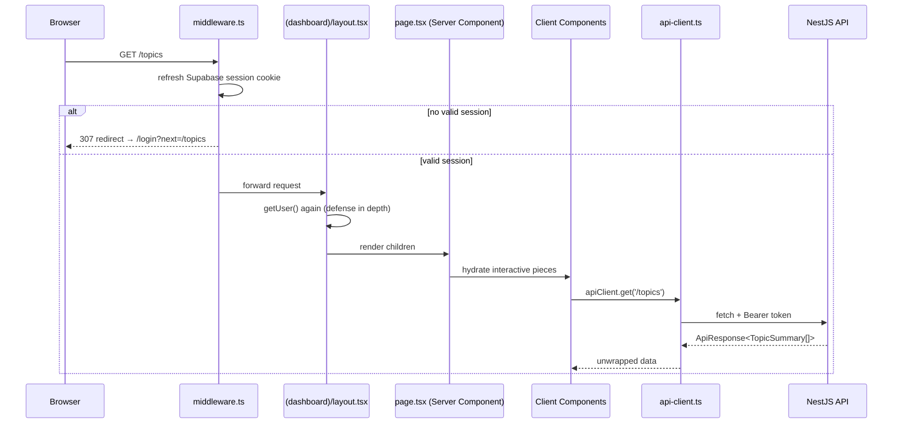

# 🏗️ Dygo Academy: Frontend Architecture & Structure
**Document Version**: 1.2
**Author**: Principal Cloud & SaaS Solutions Advisory
**Status**: Approved Standard — describes `com.dygoacademy.frontend` as of the Topics grid screen (2026-08-31)
**Companion documents**: [`dygo_academy_tech_spec_and_conventions.md`](dygo_academy_tech_spec_and_conventions.md) (naming rules, full stack matrix), [`dygo_academy_api_surface.md`](dygo_academy_api_surface.md) (backend contract)

**Changelog**
* **1.2** (2026-08-31) — Wireframe 1f (Topics grid) built at the new route `/topics/browse`, resolving a gap from 1.1: the Navbar's "Topics" link previously pointed at the same route as "Home." Navbar relinked to match the wireframe's actual 4-tab set (Home/Topics/Progress/You) and the standalone "Study" link removed — the source design has no persistent Study tab.
* **1.1** (2026-08-31) — §15 added: the guest-trial → home → study-session journey implemented from the "Dygo Wireframes" Claude Design canvas. New routes (`/topics/[topicId]`), new feature folders (`components/onboarding/`, `components/topics/`, `components/flashcard/`), the first real data hook (`hooks/useTopics.ts`), and the brand accent token (§9 updated). §3 tree and §6 updated to match.
* **1.0** — Initial architecture, Phase 0 scaffold.

---

## 1. Goals, in priority order

1. **Maintainability** — one place to look for any given concern (routes, types, env, auth), so a change doesn't require hunting across the tree or trusting that two files agree by convention alone.
2. **Performance** — Server Components by default, the smallest client bundle that still ships the interactivity a screen needs, and caching discipline on anything that crosses the network.
3. **Safety** — a session check that can't be bypassed by adding a route and forgetting a decorator; environment configuration that fails at boot, not three components deep at 2am.

Everything below is either already built (Phase 0) or is the pattern the next features should follow (Phase 1+). Where something is a decision rather than a fact, the reasoning is included — so a disagreement has something concrete to argue with.

---

## 2. Request flow



Two things worth naming explicitly because they're easy to lose track of later: the session is checked **twice** (middleware, then the layout) on purpose — see §5 — and the client never talks to the NestJS API without going through `api-client.ts`, which is the one place the response envelope gets unwrapped and the bearer token gets attached.

---

## 3. Directory structure

```
com.dygoacademy.frontend/
├── src/
│   ├── middleware.ts                # Session refresh + edge-side auth guard — runs before every matched request
│   ├── config/
│   │   └── env.ts                   # zod-validated NEXT_PUBLIC_* config, fails fast at boot
│   ├── constants/
│   │   └── routes.ts                # Single source of truth for path strings (PROTECTED_PATH_PREFIXES, ROUTES)
│   ├── types/                       # Domain types — mirror the API wire format & DB schema exactly
│   │   ├── api.ts                   #   ApiResponse<T> / ApiErrorResponse envelope
│   │   ├── user.ts                  #   Profile, GroupRole
│   │   ├── group.ts                 #   Group, GroupMember
│   │   ├── topic.ts                 #   Topic, TopicSummary
│   │   ├── word.ts                  #   TopicWord, WordStatus, CefrLevel
│   │   ├── srs.ts                   #   SrsRating
│   │   └── index.ts                 #   barrel export
│   ├── lib/
│   │   ├── api-client.ts            # Typed fetch wrapper — unwraps ApiResponse<T>, attaches bearer token
│   │   ├── utils.ts                 # cn() class merger
│   │   └── supabase/
│   │       ├── client.ts            #   Browser client — Client Components only
│   │       ├── server.ts            #   Server client — Server Components / Route Handlers / Server Actions
│   │       └── middleware.ts        #   updateSession() — the shared logic middleware.ts calls
│   ├── stores/
│   │   └── useStudySessionStore.ts  # Zustand — client-only session state (see §6)
│   ├── hooks/
│   │   └── useTopics.ts             # TanStack Query — the first real data hook (§15), wraps live GET /topics
│   ├── components/
│   │   ├── ui/                      # shadcn/ui primitives — button.tsx, card.tsx, ... (the design system layer)
│   │   ├── layout/                  # App chrome — Navbar, SignOutButton, QueryProvider, ThemeProvider
│   │   ├── onboarding/               # GuestWordTrial.tsx — the pre-signup trial (§15)
│   │   ├── topics/                  # DueNowCard, TopicCard, TopicGridCard, LeechNudge, WordStatusRow, EmptyTopicState
│   │   ├── flashcard/                # Flashcard.tsx (flip), RatingButtons.tsx — shared by guest trial & study session
│   │   └── quiz/                    # Feature components — Phase 3, still empty
│   └── app/
│       ├── layout.tsx               # Root layout — ThemeProvider + QueryProvider
│       ├── page.tsx                 # Landing page — guest word trial (§15)
│       ├── globals.css              # Tailwind + design tokens (incl. brand accent, §15) + 3D transform utilities
│       ├── error.tsx                # Root error boundary
│       ├── global-error.tsx         # Catches errors in the root layout itself
│       ├── not-found.tsx            # 404
│       ├── loading.tsx              # Default navigation-loading UI
│       ├── api/health/route.ts      # Route Handler placeholder
│       ├── (auth)/
│       │   ├── login/page.tsx
│       │   └── register/page.tsx
│       └── (dashboard)/
│           ├── layout.tsx           # Server-side session re-check + Navbar
│           ├── error.tsx            # Segment-scoped error boundary
│           ├── loading.tsx          # Segment-scoped loading UI
│           ├── topics/page.tsx      # Home screen — due-now, your topics (real data), leech nudge
│           ├── topics/browse/page.tsx     # Topics grid (1f) — search filter, all topics, real data
│           ├── topics/[topicId]/page.tsx  # Topic detail — empty/enriching/failed word states
│           ├── study/page.tsx       # Study session — flashcard flip + two-button rating
│           ├── analytics/page.tsx
│           └── settings/page.tsx
├── package.json                     # name: com.dygoacademy.frontend
├── tailwind.config.ts
├── components.json                  # shadcn/ui config
├── tsconfig.json                    # @/* → ./src/*
└── Dockerfile
```

Every folder here maps to exactly one concern. If a new file doesn't obviously belong in one of these, that's a signal to ask "does this need a new folder" before dropping it into `lib/` as a catch-all — `lib/` catching everything is how a codebase becomes unmaintainable eighteen months in.

---

## 4. Routing architecture

Next.js **route groups** — `(auth)` and `(dashboard)` — organize the App Router without adding URL segments: `(dashboard)/topics/page.tsx` serves `/topics`, not `/dashboard/topics`. They exist so each group can have its own `layout.tsx`: `(dashboard)/layout.tsx` carries the Navbar and the session check; `(auth)` deliberately has none, because a login page wrapped in the authenticated chrome is a bug waiting to happen.

**Static vs. dynamic rendering** is a direct consequence of the auth guard. The landing page, `/login`, and `/register` have no server-side data dependency and prerender as static HTML (`○` in the build output). Every `(dashboard)` route is forced dynamic (`ƒ`) because the layout calls `cookies()` to check the session on every request — confirmed in the actual build output, not assumed:

```
├ ○ /                                      (static)
├ ○ /login                                 (static)
├ ○ /register                              (static)
├ ƒ /topics                                (dynamic — session check)
├ ƒ /study                                 (dynamic — session check)
├ ƒ /analytics                             (dynamic — session check)
└ ƒ /settings                              (dynamic — session check)
```

This is the right trade: a logged-in area can never be cached and served to the wrong person. The performance cost is paid back in §10 — streaming with `loading.tsx` means the dynamic cost is a fast auth check, not a slow page.

---

## 5. Auth architecture — why two checks, not one

| Layer | File | Runs | Catches |
| :--- | :--- | :--- | :--- |
| Edge | `middleware.ts` → `lib/supabase/middleware.ts` | Before any Server Component, on every matched request | The common case — redirects a signed-out visitor before any dashboard code executes |
| Server | `(dashboard)/layout.tsx` | Inside the Server Component tree | The rare case — a future route added under `(dashboard)` without updating the middleware matcher, or the matcher regex narrowed by mistake |

Both use `supabase.auth.getUser()`, never `getSession()`. `getSession()` only decodes the local cookie — a value the client controls and could tamper with. `getUser()` revalidates against the Supabase Auth server on every call. It's the one deliberately "slow" call in the auth path, traded for actually being safe rather than merely looking safe.

Session **refresh** (not just the guard) happens in `lib/supabase/middleware.ts`: Supabase access tokens expire, and without a middleware that writes the refreshed cookie back on every request, a long-lived tab would silently start reading a signed-out session in every Server Component — a failure mode that looks like a random bug report weeks later, not an auth error. This is a correctness requirement of `@supabase/ssr` in the App Router, not an optional hardening step.

---

## 6. Data & state — what goes where

Two different kinds of "state" live in this app, and mixing them up is the most common way a React codebase rots:

| | **Server state** | **Client-only state** |
| :--- | :--- | :--- |
| Owned by | TanStack Query | Zustand |
| Example | Topic list, word enrichment status, SRS due cards | Active flashcard index, current study-session mode |
| Source of truth | The NestJS API | The browser tab |
| Lives in | `QueryProvider` cache, keyed by query key | `stores/use[Domain]Store.ts` |
| Survives a refresh? | Refetched, not preserved | No — and shouldn't be |

The rule: if a value came from the API or needs to eventually get back to the API, it's a Query — cached, deduped, revalidated by TanStack Query's `staleTime: 60_000` default (see `components/layout/QueryProvider.tsx`). If a value only exists to drive the current screen — "which card am I on" — it's Zustand, and it must never be a copy of server data. `useStudySessionStore.ts` currently holds `activeTopicId` and `cardIndex` for exactly this reason: neither belongs in a Query cache, and neither should be re-fetched from the server on every card flip.

---

## 7. Type system & API contract

`src/types/` is hand-mirrored from two sources of truth: the backend's DTOs/entities (e.g. `TopicSummary` copied field-for-field from `topics.service.ts`) and the raw database schema for anything without a live endpoint yet (`Group`, `TopicWord`). One detail that matters and is easy to get wrong: **the API does not camelCase its output** — `TransformResponseInterceptor` on the backend only wraps the payload in `{ success, data, meta }`, it doesn't touch field casing. So `TopicSummary.group_id`, not `.groupId`. Every type file says this explicitly in a comment so nobody "fixes" the casing later and breaks runtime parsing silently.

This is a manual sync today, not codegen — a known limitation, not an oversight. If the backend's DTOs start drifting from these types often enough to cause bugs, the next step is generating `types/` from the OpenAPI document NestJS already produces at `/api/docs` rather than hand-copying further. Not worth doing before there's a second person to disagree with a hand-copied type.

`lib/api-client.ts` is the only file allowed to call `fetch()` against the NestJS API. It unwraps `ApiResponse<T>` once, attaches the bearer token from the current Supabase session, and throws a typed `ApiError` (with `.status` and `.body`) on failure — so a component calling `apiClient.get<TopicSummary[]>('/topics')` gets back `TopicSummary[]`, not an envelope it has to unwrap itself, and a `catch` block gets a typed error instead of a generic one.

---

## 8. Configuration strategy

`src/config/env.ts` validates every `NEXT_PUBLIC_*` variable with `zod` at module load and throws with a specific, actionable message if anything is missing or malformed — deliberately mirroring `com.dygoacademy.backend/src/config/env.validation.ts`, which does the same thing for the backend's env vars. This was proven during the build, not just written and hoped to work: an incomplete `.env.local` fails the build immediately with

```
Invalid frontend environment configuration:
  - NEXT_PUBLIC_API_URL: Required
  - NEXT_PUBLIC_SUPABASE_URL: Required
  - NEXT_PUBLIC_SUPABASE_ANON_KEY: Required
```

rather than a component three renders deep throwing `Cannot read property 'auth' of undefined`. Every module reads config through `env`, imported from `@/config/env` — never `process.env.X` directly — so this is the only place that can be wrong.

---

## 9. Component architecture

- **`components/ui/`** is the design-system layer — shadcn/ui primitives (`Button`, `Card`, ...) built on Tailwind + the CSS-variable tokens in `globals.css`. Nothing here knows about Dygo's domain; a `Button` doesn't know what a Topic is. This is what makes dark mode, re-theming, or a future design refresh a one-file change instead of a find-and-replace across every screen.
- **`components/layout/`** is app chrome — things that appear on every authenticated page regardless of feature (`Navbar`, `SignOutButton`, the `QueryProvider`/`ThemeProvider` wrappers). Not domain components either.
- **`components/flashcard/`, `components/topics/`, `components/onboarding/`, `components/quiz/`** are feature folders — one per domain area, populated as each phase builds it. This is the pattern the customer-journey build in §15 followed exactly: `components/topics/` didn't exist until the Topic Explorer needed it, and it holds only topic-related pieces. `components/quiz/` is still an empty scaffold — Phase 3. A flat `components/` directory is the single most common way a React app becomes hard to navigate past a few dozen files.
- **Cross-context reuse belongs in the feature folder whose concept it is, not a new one.** `Flashcard.tsx` lives in `components/flashcard/` and is used by both the guest trial (`components/onboarding/GuestWordTrial.tsx`) and the real study session (`app/(dashboard)/study/page.tsx`) — it's a flashcard in both places, so it didn't get copied or moved to a generic `components/shared/`.
- **Composition rule**: `page.tsx` files orchestrate (fetch, lay out, pass props); reusable pieces live in `components/`. A `page.tsx` that's mostly JSX markup instead of composition is a sign a component should be extracted.

---

## 10. Performance strategy

**Server Components by default.** Every file in `app/` is a Server Component unless it starts with `'use client'`. Today that's exactly four files: `QueryProvider.tsx`, `ThemeProvider.tsx`, `SignOutButton.tsx`, and the two `error.tsx` boundaries (React requires error boundaries to be Client Components). Everything else — including the entire `(dashboard)/layout.tsx` auth check — runs on the server and ships zero JS for that logic. Measured, not assumed: the production build's shared client bundle is **103 kB First Load JS**, and every individual route adds under 1 kB on top of that — because there's almost nothing client-side to add yet. That number is the baseline to watch as features land; a route jumping to 30+ kB First Load JS is worth asking why before merging.

**Streaming absorbs the dynamic-rendering cost.** Because every `(dashboard)` route is forced dynamic (§4), the mitigation is `(dashboard)/loading.tsx` — Next.js streams the Navbar and layout shell immediately and shows the loading skeleton only for the part still resolving, instead of blocking the whole response on the session check.

**TanStack Query owns caching discipline**, not ad-hoc `useEffect` fetches: `staleTime: 60_000` means a Topic list navigated to twice within a minute doesn't refetch, and `retry: 1` avoids hammering a backend that's actually down. As Phase 1 adds real queries, the convention is one hook per resource (`useTopics()`, `useTopic(id)`) in `hooks/`, not `apiClient.get()` calls scattered through components — that's both a maintainability rule and a performance one, since it's the only way to get query-key-based cache sharing between screens that both need the same data.

**Not yet needed, flagged for when it is**: `next/image` (no images in the app yet) and `next/font` (system font stack currently, per `globals.css`) — both are one-line wins the moment a real design lands, and both are Next.js defaults, not extra tooling to evaluate.

---

## 11. Error handling & resilience hierarchy

```
app/global-error.tsx      ← catches failures in the root layout itself (no Tailwind/providers — they may be what broke)
  └─ app/error.tsx        ← catches anything else under the root layout
       └─ (dashboard)/error.tsx  ← scoped to the dashboard; a failure here doesn't take out the Navbar or sign-out
```

Same nesting for `loading.tsx`. The scoping is deliberate: a bug in, say, the SRS queue (Phase 2) should show a "this page couldn't load" card with a retry button — the user stays signed in, oriented, and one click from safety — not a blank white screen or a full app crash.

---

## 12. Naming conventions (summary — full rules in the tech spec)

| What | Convention | Example |
| :--- | :--- | :--- |
| Component files | `PascalCase.tsx` | `FlashcardPlayer.tsx` |
| Hooks | `camelCase.ts`, `use` prefix | `useSrsSession.ts` |
| Zustand stores | `use[Domain]Store.ts` | `useStudySessionStore.ts` |
| Domain types | `kebab-case.ts` under `types/`, one per noun | `topic.ts` |
| Custom CSS classes | `kebab-case` in `globals.css` only | `.perspective-1000` |
| Route paths | Defined once in `constants/routes.ts`, never inline | `ROUTES.topics` |

Full rationale and the backend-side conventions live in [`dygo_academy_tech_spec_and_conventions.md`](dygo_academy_tech_spec_and_conventions.md) §3.3 — this table is a quick reference, not the source of truth.

---

## 13. Known gaps (stated plainly, not glossed over)

- **No test harness.** No Vitest/RTL, no component or hook tests exist yet. The backend has a `test` script wired to Jest; the frontend has nothing to run.
- **No CI.** `.github/workflows` is empty for the whole repo — nothing enforces lint/type-check/build on a push today.
- **No codegen for `types/`.** Manually mirrored from the backend, as noted in §7 — fine at the current size, worth revisiting if it starts drifting.

None of these block Phase 1 feature work, but they're debt that compounds with contributor count — worth scheduling deliberately rather than discovering under pressure.

---

## 14. Adding a new feature — the checklist

Follow this order for every new module (matches the vertical-slice approach in `dygo_academy_master_project_schedule.md`):

1. **Types** — add/extend the relevant file in `types/`, matching the backend DTO or DB schema exactly (casing included).
2. **Routes** — if it's a new page, add the path to `constants/routes.ts` first; add it to `PROTECTED_PATH_PREFIXES` there if it needs auth, and middleware picks it up automatically.
3. **Data hook** — one `use[Resource]()` hook in `hooks/`, built on `apiClient` and TanStack Query. Don't call `apiClient` directly from a component.
4. **Client-only state** — only if the feature has genuine UI-only state (§6); add a store, don't extend an unrelated one.
5. **Components** — a new folder under `components/` named after the feature if it doesn't already exist, built from `components/ui/` primitives.
6. **Page** — compose the above in `app/(dashboard)/<feature>/page.tsx`. Inherits the segment's `error.tsx`/`loading.tsx` unless the feature needs its own.
7. **Docs** — update this file's §3 tree and `dygo_academy_api_surface.md` if new endpoints are involved, with a version bump if the change is structural.

---

## 15. The first customer journey — source, decisions, and honesty about mocks

Implemented from the "Dygo Wireframes" Claude Design canvas (project `f856506e-6112-4476-a6d9-ba2f00730ae8`), which laid out 2–5 alternative screens per step rather than one decided flow. The choices below were made by the product owner, not assumed:

| Step | Chosen | Explicitly not built (this pass) |
| :--- | :--- | :--- |
| Onboarding entry | 1a — try a word before signup (landing page) | 1b (starter-quiz), 1c (teacher invite-link) — different acquisition channels, own routes when needed |
| Home screen | 1d — due-now focus | 1e (checklist framing) |
| Topics tab | 1f — topics grid, at `/topics/browse` | — |
| Card rating | 1g (light) + 1i (dark) | 1h (four ratings shown at once) |
| Edge states | 1j/1k/1l — empty / enriching / failed | 2b (session summary), 1m (quiz explain — Phase 3), 1n (paywall — Phase 4) |

**What's real versus mocked, and why that split:**

- `GET /api/v1/topics` is the one live backend endpoint (Phase 0), so `hooks/useTopics.ts` calls it for real — the "Your Topics" list on the home screen and the topic title/word count on the detail page are genuine data. Whether the empty state (1j) shows is a real decision, driven by real data: `word_count === '0'`.
- Everything that depends on an endpoint that doesn't exist yet — due-count and streak (`GET /srs/due`, `/srs/stats`), the leech nudge (`GET /srs/leeches`), the word list on a topic's detail page (`GET /topics/:topicId/words`), the study queue (`GET /topics/:topicId/cards/due`), and rating persistence (`POST /srs/rate`) — is a clearly labeled mock with a comment naming the endpoint and phase that will replace it. A topic detail page mixes both: real title, mocked word list, with a visible banner saying so. Faking a word list under a real topic id with no disclosure would be more misleading than showing nothing.
- The 1g/1i split ("same layout, light and dark") is implemented as one set of components styled by the app's existing light/dark tokens (next-themes, already wired since Phase 0), not two hand-duplicated skins — the more scalable reading of "same layout, two modes."

**Brand accent**: `#c2603f` (the wireframe's `--acc`, used for every primary CTA across all ~20 screens) is now the app's `--primary` token in `globals.css`, light and dark. This was a design decision made in the course of implementation, not asked about screen-by-screen — flag it if it's wrong; it's one line to change back.

**New in this pass**: `hooks/useTopics.ts` (first real data hook), `components/onboarding/`, `components/topics/`, `components/flashcard/{Flashcard,RatingButtons}.tsx`, the `app/(dashboard)/topics/[topicId]` dynamic route, `types/srs.ts`, and nav links in `Navbar.tsx`. Measured cost: `/topics` and `/topics/[topicId]` grew to 205 kB First Load JS (from the 103 kB baseline in §10) — the first time a route actually uses TanStack Query, so the jump is inherent to that library shipping to the client, not a regression to chase.

**1.2 addendum — Topics grid (1f)**: built at the new route `/topics/browse` (`components/topics/TopicGridCard.tsx`), using the same `useTopics()` hook as the home screen — real title, word count, and public/private badge per topic, plus a client-side search filter (explicitly commented as distinct from the future `GET /lexicon/search`, FR-2.2). Deliberately omits a per-topic due-count chip: one labeled aggregate mock (the home screen's DUE NOW count) reads as honest; several specific-looking per-topic numbers on a grid would not. This pass also fixed a navigation gap from 1.1 — the Navbar's "Topics" link had pointed at the same route as "Home" — by relinking `Navbar.tsx` to the wireframe's actual persistent tab set (Home/Topics/Progress/You) and removing the standalone "Study" link, which the source design never included as persistent navigation. `/topics/browse` measured at 195 kB First Load JS.
