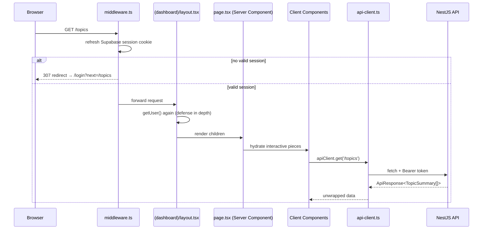

# 🏗️ Dygo Academy: Frontend Architecture & Structure
**Document Version**: 1.5
**Author**: Principal Cloud & SaaS Solutions Advisory
**Status**: Approved Standard — describes `com.dygoacademy.frontend` as of the Topics grid screen (2026-08-31), plus the §16 responsive-breakpoint standard and §17 shared content-width config (updated same day to a single wide width across all tiers), both added 2026-09-17. Note: §3's tree and §4's route table below still reflect the pre-2026-09-17 URL layout (`/` as the guest landing, `/topics` as the dashboard home, `/topics/browse` as the grid) — the 2026-09-17 URL reshuffle (`/` → dashboard home, `/topics` → grid, guest landing → `/search`) and everything built since 1.2 (groups, invites/`/join`, quiz, settings) aren't reconciled into those sections yet. Flagged here rather than silently left wrong; §16 and §17 are current.
**Companion documents**: [`dygo_academy_tech_spec_and_conventions.md`](dygo_academy_tech_spec_and_conventions.md) (naming rules, full stack matrix), [`dygo_academy_api_surface.md`](dygo_academy_api_surface.md) (backend contract)

**Changelog**
* **1.5** (2026-09-17) — §17 updated: all three `CONTENT_WIDTH` tiers now resolve to `max-w-2xl` (672px) — live-requested "wide layout" for every page and popup, after the tradeoff (forms/popups stretching at 672px) was flagged and confirmed anyway. Tier names kept as-is so the values can diverge again later without touching call sites.
* **1.4** (2026-09-17) — §17 added: `src/constants/layout.ts`'s `CONTENT_WIDTH` — one shared, tiered width config now used by every page container and every modal (`ui/dialog.tsx`'s `DialogContent`), replacing the ad-hoc mix of `max-w-sm`/`max-w-md`/`max-w-lg`/`max-w-2xl` that had drifted across ~13 files with no single source of truth.
* **1.3** (2026-09-17) — §16 added: standardized responsive breakpoints for the whole app, target-device widths, and `tailwind.config.ts`'s `theme.screens` pinned explicitly to match. §3/§4/§15 not reconciled with the same day's URL reshuffle — see the Status line above.
* **1.2** (2026-08-31) — Wireframe 1f (Topics grid) built at the new route `/topics/browse`, resolving a gap from 1.1: the Navbar's "Topics" link previously pointed at the same route as "Home." Navbar relinked to match the wireframe's actual 4-tab set (Home/Topics/Progress/You) and the standalone "Study" link removed — the source design has no persistent Study tab.
* **1.1** (2026-08-31) — §15 added: the guest-trial → home → study-session journey implemented from the "Dygo Wireframes" Claude Design canvas. New routes (`/topics/[topicId]`), new feature folders (`components/onboarding/`, `components/topics/`, `components/flashcard/`), the first real data hook (`hooks/useTopics.ts`), and the brand accent token (§9 updated). §3 tree and §6 updated to match.
* **1.0** — Initial architecture, Phase 0 scaffold.

---

## 1. Goals, in priority order

1. **Maintainability** — one place to look for any given concern (routes, types, env, auth), so a change doesn't require hunting across the tree or trusting that two files agree by convention alone.
2. **Performance** — Server Components by default, the smallest client bundle that still ships the interactivity a screen needs, and caching discipline on anything that crosses the network.
3. **Safety** — a session check that can't be bypassed by adding a route and forgetting a decorator; environment configuration that fails at boot, not three components deep at 2am.

Everything below is either already built (Phase 0) or is the pattern the next features should follow (Phase 1+). Where something is a decision rather than a fact, the reasoning is included — so a disagreement has something concrete to argue with.

---

## 2. Request flow



Two things worth naming explicitly because they're easy to lose track of later: the session is checked **twice** (middleware, then the layout) on purpose — see §5 — and the client never talks to the NestJS API without going through `api-client.ts`, which is the one place the response envelope gets unwrapped and the bearer token gets attached.

---

## 3. Directory structure

Updated 2026-10-02 (Phase 12 UI-8): the classic adult UI is deleted (U8-3), the garden is the only signed-in UI, and its screens live at their final short URLs (U8-5). Older layouts are in git history.

```
com.dygoacademy.frontend/
├── src/
│   ├── middleware.ts                # Session refresh, auth guard, legacy-URL 308 redirects (§4)
│   ├── config/env.ts                # zod-validated NEXT_PUBLIC_* config, fails fast at boot
│   ├── constants/
│   │   ├── routes.ts                # PROTECTED_PATH_PREFIXES, ROUTES, legacyRedirect() — single source of truth for paths
│   │   ├── garden.ts                # GARDEN_ROUTES (the short URLs), reference/dev page paths
│   │   └── layout.ts                # CONTENT_WIDTH tiers (§17)
│   ├── i18n/                        # next-intl config + messages (en-US, vi-VN, zh-CN live in ../messages)
│   ├── types/                       # Domain types — mirror the API wire format & DB schema
│   ├── lib/                         # api-client.ts, supabase/{client,server,middleware}.ts, offline review queue, push, timezone
│   ├── stores/useStudySessionStore.ts
│   ├── hooks/                       # TanStack Query hooks (topics, srs, quiz, groups, invites, missions, profile, push…)
│   ├── components/
│   │   ├── ui/                      # shadcn/ui primitives still used by dialogs and the guest trial
│   │   ├── layout/                  # QueryProvider, ThemeProvider
│   │   ├── onboarding/              # GuestWordTrial (the /search guest trial)
│   │   ├── flashcard/               # Flashcard, AudioButton (guest trial)
│   │   └── garden/                  # The design system's components (BottomTabBar, GardenRail, GardenSidebar, sheets, rows…)
│   │       ├── screens/             #   Pure screens + canvas fixtures (also rendered by /garden/_reference/<screen>)
│   │       ├── live/                #   *Live wrappers: hooks → screen props
│   │       └── auth/                #   Sign-in / register / forgot / reset screens
│   └── app/
│       ├── layout.tsx, error.tsx, global-error.tsx, not-found.tsx, loading.tsx, globals.css
│       ├── api/health/route.ts
│       ├── search/page.tsx          # Signed-out guest trial ("/" sends signed-out visitors here)
│       ├── (auth)/login, register   # Garden-styled auth screens
│       ├── (auth-garden)/forgot-password, reset-password
│       ├── (garden)/                # Signed-in app: layout (session re-check + nav chrome), error/loading/not-found
│       │   ├── garden/page.tsx      #   /garden — home (Today's garden)
│       │   ├── garden/_gallery, _tokens   # dev pages (public)
│       │   ├── review/, review/done/      # /review, /review/done
│       │   ├── topics/, topics/[id]/      # /topics, /topics/:id
│       │   ├── missions/, me/, quiz/      # /missions, /me, /quiz
│       │   ├── groups/, groups/[id]/, groups/[id]/manage/  # /groups/**
│       │   └── join/[token]/        #   /join/:token — redeem an invite
│       └── (garden-reference)/garden/_reference/[name]/  # canvas fixture pages for `npm run garden:diff`
├── messages/                        # en-US.json, vi-VN.json, zh-CN.json
├── tailwind.config.ts               # Breakpoints (§16), garden tokens (no prefix since U8-4)
├── tsconfig.json / tsconfig.test.json
└── Dockerfile
```

Every folder here maps to exactly one concern. If a new file doesn't obviously belong in one of these, that's a signal to ask "does this need a new folder" before dropping it into `lib/` as a catch-all.

---

## 4. Routing architecture

Next.js **route groups** — `(auth)`, `(auth-garden)`, `(garden)`, `(garden-reference)` — organize the App Router without adding URL segments: `(garden)/review/page.tsx` serves `/review`. `(garden)/layout.tsx` carries the session re-check and the navigation chrome (bottom tab bar / rail / sidebar, §16); the auth groups deliberately have none.

**Final URLs (Phase 12 decision 1, built in UI-8 U8-5, 2026-10-02):**

| URL | Screen | Access |
| :--- | :--- | :--- |
| `/` | — | signed in → `/garden` (307), signed out → `/search` |
| `/search` | Guest word trial | public |
| `/login`, `/register`, `/forgot-password`, `/reset-password` | Auth | public (signed-in users are sent away from login/register) |
| `/garden` | Home — Today's garden | signed in |
| `/review`, `/review/done` | Review session, done screen | signed in |
| `/topics`, `/topics/:id` | Topics, topic bed | signed in |
| `/missions`, `/me`, `/quiz` | Missions, Me (settings + stats), quiz | signed in |
| `/groups`, `/groups/:id`, `/groups/:id/manage` | Shared gardens | signed in |
| `/join/:token` | Redeem an invite | signed in (bounces through `/login?next=…`) |
| `/garden/_reference/<screen>`, `/garden/_gallery`, `/garden/_tokens` | Dev/fixture pages | public, canvas sample data only |

**Legacy redirects** (`legacyRedirect()` in `constants/routes.ts`, applied in `middleware.ts` **before** the session check, query string kept, all **308 permanent**): `/garden/<x>/**` → `/<x>/**` for review, topics, missions, me, groups, quiz, join; `/study` → `/review`; `/analytics` and `/settings` → `/me`. Old bookmarks, push-notification deep links (the backend still sends `/study`) and invite links keep working.

**Static vs. dynamic rendering:** `/search` and the auth pages have no server data dependency; every `(garden)` route is dynamic because the layout reads `cookies()` to re-check the session. A logged-in area can never be cached and served to the wrong person.

---

## 5. Auth architecture — why two checks, not one

| Layer | File | Runs | Catches |
| :--- | :--- | :--- | :--- |
| Edge | `middleware.ts` → `lib/supabase/middleware.ts` | Before any Server Component, on every matched request | The common case — redirects a signed-out visitor before any dashboard code executes |
| Server | `(dashboard)/layout.tsx` | Inside the Server Component tree | The rare case — a future route added under `(dashboard)` without updating the middleware matcher, or the matcher regex narrowed by mistake |

Both use `supabase.auth.getUser()`, never `getSession()`. `getSession()` only decodes the local cookie — a value the client controls and could tamper with. `getUser()` revalidates against the Supabase Auth server on every call. It's the one deliberately "slow" call in the auth path, traded for actually being safe rather than merely looking safe.

Session **refresh** (not just the guard) happens in `lib/supabase/middleware.ts`: Supabase access tokens expire, and without a middleware that writes the refreshed cookie back on every request, a long-lived tab would silently start reading a signed-out session in every Server Component — a failure mode that looks like a random bug report weeks later, not an auth error. This is a correctness requirement of `@supabase/ssr` in the App Router, not an optional hardening step.

---

## 6. Data & state — what goes where

Two different kinds of "state" live in this app, and mixing them up is the most common way a React codebase rots:

| | **Server state** | **Client-only state** |
| :--- | :--- | :--- |
| Owned by | TanStack Query | Zustand |
| Example | Topic list, word enrichment status, SRS due cards | Active flashcard index, current study-session mode |
| Source of truth | The NestJS API | The browser tab |
| Lives in | `QueryProvider` cache, keyed by query key | `stores/use[Domain]Store.ts` |
| Survives a refresh? | Refetched, not preserved | No — and shouldn't be |

The rule: if a value came from the API or needs to eventually get back to the API, it's a Query — cached, deduped, revalidated by TanStack Query's `staleTime: 60_000` default (see `components/layout/QueryProvider.tsx`). If a value only exists to drive the current screen — "which card am I on" — it's Zustand, and it must never be a copy of server data. `useStudySessionStore.ts` currently holds `activeTopicId` and `cardIndex` for exactly this reason: neither belongs in a Query cache, and neither should be re-fetched from the server on every card flip.

---

## 7. Type system & API contract

`src/types/` is hand-mirrored from two sources of truth: the backend's DTOs/entities (e.g. `TopicSummary` copied field-for-field from `topics.service.ts`) and the raw database schema for anything without a live endpoint yet (`Group`, `TopicWord`). One detail that matters and is easy to get wrong: **the API does not camelCase its output** — `TransformResponseInterceptor` on the backend only wraps the payload in `{ success, data, meta }`, it doesn't touch field casing. So `TopicSummary.group_id`, not `.groupId`. Every type file says this explicitly in a comment so nobody "fixes" the casing later and breaks runtime parsing silently.

This is a manual sync today, not codegen — a known limitation, not an oversight. If the backend's DTOs start drifting from these types often enough to cause bugs, the next step is generating `types/` from the OpenAPI document NestJS already produces at `/api/docs` rather than hand-copying further. Not worth doing before there's a second person to disagree with a hand-copied type.

`lib/api-client.ts` is the only file allowed to call `fetch()` against the NestJS API. It unwraps `ApiResponse<T>` once, attaches the bearer token from the current Supabase session, and throws a typed `ApiError` (with `.status` and `.body`) on failure — so a component calling `apiClient.get<TopicSummary[]>('/topics')` gets back `TopicSummary[]`, not an envelope it has to unwrap itself, and a `catch` block gets a typed error instead of a generic one.

---

## 8. Configuration strategy

`src/config/env.ts` validates every `NEXT_PUBLIC_*` variable with `zod` at module load and throws with a specific, actionable message if anything is missing or malformed — deliberately mirroring `com.dygoacademy.backend/src/config/env.validation.ts`, which does the same thing for the backend's env vars. This was proven during the build, not just written and hoped to work: an incomplete `.env.local` fails the build immediately with

```
Invalid frontend environment configuration:
  - NEXT_PUBLIC_API_URL: Required
  - NEXT_PUBLIC_SUPABASE_URL: Required
  - NEXT_PUBLIC_SUPABASE_ANON_KEY: Required
```

rather than a component three renders deep throwing `Cannot read property 'auth' of undefined`. Every module reads config through `env`, imported from `@/config/env` — never `process.env.X` directly — so this is the only place that can be wrong.

---

## 9. Component architecture

- **`components/ui/`** is the design-system layer — shadcn/ui primitives (`Button`, `Card`, ...) built on Tailwind + the CSS-variable tokens in `globals.css`. Nothing here knows about Dygo's domain; a `Button` doesn't know what a Topic is. This is what makes dark mode, re-theming, or a future design refresh a one-file change instead of a find-and-replace across every screen.
- **`components/layout/`** is app chrome — things that appear on every authenticated page regardless of feature (`Navbar`, `SignOutButton`, the `QueryProvider`/`ThemeProvider` wrappers). Not domain components either.
- **`components/flashcard/`, `components/topics/`, `components/onboarding/`, `components/quiz/`** are feature folders — one per domain area, populated as each phase builds it. This is the pattern the customer-journey build in §15 followed exactly: `components/topics/` didn't exist until the Topic Explorer needed it, and it holds only topic-related pieces. `components/quiz/` is still an empty scaffold — Phase 3. A flat `components/` directory is the single most common way a React app becomes hard to navigate past a few dozen files.
- **Cross-context reuse belongs in the feature folder whose concept it is, not a new one.** `Flashcard.tsx` lives in `components/flashcard/` and is used by both the guest trial (`components/onboarding/GuestWordTrial.tsx`) and the real study session (`app/(dashboard)/study/page.tsx`) — it's a flashcard in both places, so it didn't get copied or moved to a generic `components/shared/`.
- **Composition rule**: `page.tsx` files orchestrate (fetch, lay out, pass props); reusable pieces live in `components/`. A `page.tsx` that's mostly JSX markup instead of composition is a sign a component should be extracted.

---

## 10. Performance strategy

**Server Components by default.** Every file in `app/` is a Server Component unless it starts with `'use client'`. Today that's exactly four files: `QueryProvider.tsx`, `ThemeProvider.tsx`, `SignOutButton.tsx`, and the two `error.tsx` boundaries (React requires error boundaries to be Client Components). Everything else — including the entire `(dashboard)/layout.tsx` auth check — runs on the server and ships zero JS for that logic. Measured, not assumed: the production build's shared client bundle is **103 kB First Load JS**, and every individual route adds under 1 kB on top of that — because there's almost nothing client-side to add yet. That number is the baseline to watch as features land; a route jumping to 30+ kB First Load JS is worth asking why before merging.

**Streaming absorbs the dynamic-rendering cost.** Because every `(dashboard)` route is forced dynamic (§4), the mitigation is `(dashboard)/loading.tsx` — Next.js streams the Navbar and layout shell immediately and shows the loading skeleton only for the part still resolving, instead of blocking the whole response on the session check.

**TanStack Query owns caching discipline**, not ad-hoc `useEffect` fetches: `staleTime: 60_000` means a Topic list navigated to twice within a minute doesn't refetch, and `retry: 1` avoids hammering a backend that's actually down. As Phase 1 adds real queries, the convention is one hook per resource (`useTopics()`, `useTopic(id)`) in `hooks/`, not `apiClient.get()` calls scattered through components — that's both a maintainability rule and a performance one, since it's the only way to get query-key-based cache sharing between screens that both need the same data.

**Not yet needed, flagged for when it is**: `next/image` (no images in the app yet) and `next/font` (system font stack currently, per `globals.css`) — both are one-line wins the moment a real design lands, and both are Next.js defaults, not extra tooling to evaluate.

---

## 11. Error handling & resilience hierarchy

```
app/global-error.tsx      ← catches failures in the root layout itself (no Tailwind/providers — they may be what broke)
  └─ app/error.tsx        ← catches anything else under the root layout
       └─ (dashboard)/error.tsx  ← scoped to the dashboard; a failure here doesn't take out the Navbar or sign-out
```

Same nesting for `loading.tsx`. The scoping is deliberate: a bug in, say, the SRS queue (Phase 2) should show a "this page couldn't load" card with a retry button — the user stays signed in, oriented, and one click from safety — not a blank white screen or a full app crash.

---

## 12. Naming conventions (summary — full rules in the tech spec)

| What | Convention | Example |
| :--- | :--- | :--- |
| Component files | `PascalCase.tsx` | `FlashcardPlayer.tsx` |
| Hooks | `camelCase.ts`, `use` prefix | `useSrsSession.ts` |
| Zustand stores | `use[Domain]Store.ts` | `useStudySessionStore.ts` |
| Domain types | `kebab-case.ts` under `types/`, one per noun | `topic.ts` |
| Custom CSS classes | `kebab-case` in `globals.css` only | `.perspective-1000` |
| Route paths | Defined once in `constants/routes.ts`, never inline | `ROUTES.topics` |

Full rationale and the backend-side conventions live in [`dygo_academy_tech_spec_and_conventions.md`](dygo_academy_tech_spec_and_conventions.md) §3.3 — this table is a quick reference, not the source of truth.

---

## 13. Known gaps (stated plainly, not glossed over)

- **No test harness.** No Vitest/RTL, no component or hook tests exist yet. The backend has a `test` script wired to Jest; the frontend has nothing to run.
- **No CI.** `.github/workflows` is empty for the whole repo — nothing enforces lint/type-check/build on a push today.
- **No codegen for `types/`.** Manually mirrored from the backend, as noted in §7 — fine at the current size, worth revisiting if it starts drifting.

None of these block Phase 1 feature work, but they're debt that compounds with contributor count — worth scheduling deliberately rather than discovering under pressure.

---

## 14. Adding a new feature — the checklist

Follow this order for every new module (matches the vertical-slice approach in `dygo_academy_master_project_schedule.md`):

1. **Types** — add/extend the relevant file in `types/`, matching the backend DTO or DB schema exactly (casing included).
2. **Routes** — if it's a new page, add the path to `constants/routes.ts` first; add it to `PROTECTED_PATH_PREFIXES` there if it needs auth, and middleware picks it up automatically.
3. **Data hook** — one `use[Resource]()` hook in `hooks/`, built on `apiClient` and TanStack Query. Don't call `apiClient` directly from a component.
4. **Client-only state** — only if the feature has genuine UI-only state (§6); add a store, don't extend an unrelated one.
5. **Components** — a new folder under `components/` named after the feature if it doesn't already exist, built from `components/ui/` primitives.
6. **Page** — compose the above in `app/(dashboard)/<feature>/page.tsx`. Inherits the segment's `error.tsx`/`loading.tsx` unless the feature needs its own.
7. **Docs** — update this file's §3 tree and `dygo_academy_api_surface.md` if new endpoints are involved, with a version bump if the change is structural.

---

## 15. The first customer journey — source, decisions, and honesty about mocks

Implemented from the "Dygo Wireframes" Claude Design canvas (project `f856506e-6112-4476-a6d9-ba2f00730ae8`), which laid out 2–5 alternative screens per step rather than one decided flow. The choices below were made by the product owner, not assumed:

| Step | Chosen | Explicitly not built (this pass) |
| :--- | :--- | :--- |
| Onboarding entry | 1a — try a word before signup (landing page) | 1b (starter-quiz), 1c (teacher invite-link) — different acquisition channels, own routes when needed |
| Home screen | 1d — due-now focus | 1e (checklist framing) |
| Topics tab | 1f — topics grid, at `/topics/browse` | — |
| Card rating | 1g (light) + 1i (dark) | 1h (four ratings shown at once) |
| Edge states | 1j/1k/1l — empty / enriching / failed | 2b (session summary), 1m (quiz explain — Phase 3), 1n (paywall — Phase 4) |

**What's real versus mocked, and why that split:**

- `GET /api/v1/topics` is the one live backend endpoint (Phase 0), so `hooks/useTopics.ts` calls it for real — the "Your Topics" list on the home screen and the topic title/word count on the detail page are genuine data. Whether the empty state (1j) shows is a real decision, driven by real data: `word_count === '0'`.
- Everything that depends on an endpoint that doesn't exist yet — due-count and streak (`GET /srs/due`, `/srs/stats`), the leech nudge (`GET /srs/leeches`), the word list on a topic's detail page (`GET /topics/:topicId/words`), the study queue (`GET /topics/:topicId/cards/due`), and rating persistence (`POST /srs/rate`) — is a clearly labeled mock with a comment naming the endpoint and phase that will replace it. A topic detail page mixes both: real title, mocked word list, with a visible banner saying so. Faking a word list under a real topic id with no disclosure would be more misleading than showing nothing.
- The 1g/1i split ("same layout, light and dark") is implemented as one set of components styled by the app's existing light/dark tokens (next-themes, already wired since Phase 0), not two hand-duplicated skins — the more scalable reading of "same layout, two modes."

**Brand accent**: `#c2603f` (the wireframe's `--acc`, used for every primary CTA across all ~20 screens) is now the app's `--primary` token in `globals.css`, light and dark. This was a design decision made in the course of implementation, not asked about screen-by-screen — flag it if it's wrong; it's one line to change back.

**New in this pass**: `hooks/useTopics.ts` (first real data hook), `components/onboarding/`, `components/topics/`, `components/flashcard/{Flashcard,RatingButtons}.tsx`, the `app/(dashboard)/topics/[topicId]` dynamic route, `types/srs.ts`, and nav links in `Navbar.tsx`. Measured cost: `/topics` and `/topics/[topicId]` grew to 205 kB First Load JS (from the 103 kB baseline in §10) — the first time a route actually uses TanStack Query, so the jump is inherent to that library shipping to the client, not a regression to chase.

**1.2 addendum — Topics grid (1f)**: built at the new route `/topics/browse` (`components/topics/TopicGridCard.tsx`), using the same `useTopics()` hook as the home screen — real title, word count, and public/private badge per topic, plus a client-side search filter (explicitly commented as distinct from the future `GET /lexicon/search`, FR-2.2). Deliberately omits a per-topic due-count chip: one labeled aggregate mock (the home screen's DUE NOW count) reads as honest; several specific-looking per-topic numbers on a grid would not. This pass also fixed a navigation gap from 1.1 — the Navbar's "Topics" link had pointed at the same route as "Home" — by relinking `Navbar.tsx` to the wireframe's actual persistent tab set (Home/Topics/Progress/You) and removing the standalone "Study" link, which the source design never included as persistent navigation. `/topics/browse` measured at 195 kB First Load JS.


---

## 16. Responsive breakpoints — target devices and why

Standardized 2026-09-17; **updated 2026-10-02 for Phase 12 UI-8** (U8-4 renamed the garden's `medium`/`expanded` to `md`/`lg`; the old 768px `md:` became `tablet:`).

**Target viewport widths** (CSS pixels, portrait):

| Device class | Width range | Representative models |
| :--- | :--- | :--- |
| iPhone | 375–440px | SE (375) → standard 390–402 → Plus/Pro Max 428–440 |
| iPad mini | 744px | — |
| iPad / iPad Air / iPad Pro 11" | 820–834px | The two most common iPad sizes |
| iPad Air 13" / iPad Pro 13" | 1024–1032px | — |

**`tailwind.config.ts` `theme.screens`:**

| Prefix | Width | Covers / garden layout |
| :--- | :--- | :--- |
| *(base)* | < 600px | Every iPhone portrait — compact: bottom tab bar |
| `md:` | ≥ 600px | iPhone landscape, every iPad portrait — medium: `GardenRail` (icon rail) |
| `sm:` | ≥ 640px | Kept for the few shadcn/guest-trial spacing tweaks |
| `tablet:` | ≥ 768px | The old classic `md:` (768px), kept so no layout moved in the rename |
| `lg:` | ≥ 1024px | iPad 13" portrait, every iPad landscape — expanded: `GardenSidebar` |
| `xl:` / `2xl:` | 1280 / 1536px | Reserved |
| `short:` | height ≤ 499px | Phone landscape (shorter chrome) |

**Design/test standard:** build at **375px** first, then check **820px** (rail) and **1024px** (sidebar). Playwright runs all 8 viewports in `com.dygoacademy.automationtesting/ui`.

Sources for the device widths: [screensizechecker.com — iPhone viewport sizes](https://screensizechecker.com/devices/iphone-viewport-sizes), [screensizechecker.com — iPad viewport sizes](https://screensizechecker.com/devices/ipad-viewport-sizes).


## 17. Shared content-width config — one source of truth for container widths

Added 2026-09-17; **updated 2026-10-02 for Phase 12 UI-8**: the classic `CONTENT_WIDTH` (all tiers `max-w-2xl`) was deleted with the classic UI (U8-3), and the garden's `GARDEN_CONTENT_WIDTH` was renamed to `CONTENT_WIDTH` (U8-4). Values follow the design system per breakpoint:

```ts
// src/constants/layout.ts
export const CONTENT_WIDTH = {
  narrow: 'w-full md:max-w-[540px]',                  // forms and dialogs
  default: 'w-full md:max-w-[560px] lg:max-w-[640px]', // single-item content
  wide: 'w-full md:max-w-[720px] lg:max-w-[1080px]',   // grids and dashboards
} as const;
```

**Usage:** import it and interpolate into `className` — never hardcode a `max-w-*` container width inline:

```tsx
import { CONTENT_WIDTH } from '@/constants/layout';
<div className={`mx-auto flex ${CONTENT_WIDTH.default} flex-col gap-4`}>
```

Pick the tier that matches the content density rather than inventing a fourth value. Current direct consumers outside the garden screens: `ui/dialog.tsx`, `ui/alert-dialog.tsx`, `onboarding/GuestWordTrial.tsx`, and the `/garden/_gallery` and `/garden/_tokens` dev pages.
