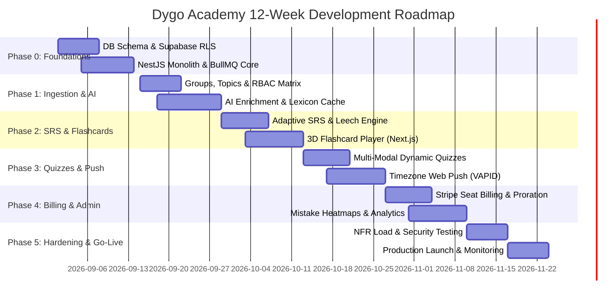

# 📅 Dygo Academy: Master Project Schedule & Phasing Strategy
**Document Version**: 5.1 (Phase 0 marked complete)  
**Author**: Principal Cloud & SaaS Solutions Advisory  
**Status**: Approved for Engineering & Product Execution  

**Changelog**
* **5.1** (2026-08-31) — Phase 0 core engineering tasks marked complete; see status notes under §2.
* **5.0** — Definitive Master Execution Plan (baseline).

---

## 1. Executive Summary & Phasing Overview

To successfully deliver **Dygo Academy** within a predictable timeline while maintaining high architectural integrity and strict SLOs (as detailed in `dygo_academy_final_master_brd.md` and `dygo_academy_complete_system_architecture_master.md`), development is organized into a **12-week, 6-sprint phased execution plan**.

The core engineering principle is **"Foundations & Asynchronous Pipelines First $\rightarrow$ Retention & Practice Loop Second $\rightarrow$ Monetization & Enterprise Tooling Third."**

```
Total MVP Timeline: 12 Weeks (6 Two-Week Sprints)
Methodology: Agile-Scrum with Milestone-Gated Releases
Target: Production-Ready Commercial MVP Launch
```



---

## 2. Detailed Phase & Sprint Breakdown

### 🧱 Phase 0: Architecture Setup, Infrastructure & DB Foundations
* **Timeline**: Sprint 1 (Weeks 1 – 2)  
* **Primary Objective**: Establish the data schema, Row-Level Security (RLS) policies, API gateway, asynchronous queue cluster, and CI/CD pipelines.
* **Status**: ✅ **Complete** (2026-08-31) — core engineering tasks 1–4 below are done. Two items from the objective line are carried forward rather than closed: CI/CD pipelines were never broken into a task here and still don't exist (`.github/workflows` is empty); Cloudflare R2 is provisioned at deploy time; local dev runs against MinIO instead (see task 3).

#### Core Engineering Tasks:
1. ✅ **Database & Auth Layer (Supabase / PostgreSQL 15+)**:
   * Initialize full multi-tenant schema: `tenants`, `tenant_seats`, `profiles`, `master_lexicon`, `groups`, `group_members`, `topics`, `topic_words`, `user_word_srs`, `study_schedules`, `push_subscriptions`.
   * Implement Row-Level Security (RLS) policies ensuring students only access permitted topics and maintain isolated personal review progress.
   * Add high-performance partial index:
     ```sql
     CREATE INDEX idx_srs_due_fast ON public.user_word_srs (user_id, next_due_at)
     WHERE next_due_at <= NOW();
     ```
   * Set up monthly table partitioning for `review_logs`.
   * *Done — `database/migrations/001_initial_schema.sql`, `002_rls_policies.sql`, `003_indexes.sql`; verified by the 26-assertion RLS suite in `database/tests/rls_test.sql`.*

2. ✅ **Backend Monolith Framework (NestJS)**:
   * Scaffold Clean Architecture modules: `TopicsModule`, `WordsModule`, `SrsModule`, `SeatSubscriptionModule`, `NotificationModule`.
   * Configure Supabase JWT Guard with in-memory cryptographic verification (`<0.2ms` overhead).
   * Integrate Global `ValidationPipe` with `class-validator` DTOs.
   * Auto-generate interactive OpenAPI / Swagger docs at `/api/docs`.
   * *Done — `com.dygoacademy.backend/src/modules/*`, `common/guards/supabase-jwt.guard.ts`, `main.ts`. Route implementations inside these modules are Phase 1+ work — see `dygo_academy_api_surface.md` for what's actually live today.*

3. ✅ **Asynchronous Queues & Cloud Storage**:
   * Configure Redis cluster with BullMQ (`enrichment-queue`, `notification-cron-queue`).
   * Provision Cloudflare R2 bucket with custom domain and edge CDN ($0 egress).
   * *Done for local dev — `src/queues/queues.module.ts`, `docker-compose.yml` (`redis`, `minio` services). MinIO stands in for R2 locally; the R2 bucket itself is a production provisioning step, not something this repo does.*

4. ✅ **Frontend Scaffolding (Next.js 14/15 App Router)**:
   * Set up Tailwind CSS with shadcn/ui design tokens.
   * Implement TanStack Query and Zustand client state stores.
   * Set up Supabase Auth client session management.
   * *Done — `com.dygoacademy.frontend/` (App Router, `tailwind.config.ts` + `components/ui/`, `components/layout/QueryProvider.tsx`, `stores/useStudySessionStore.ts`, `lib/supabase.ts`). Builds and type-checks clean; domain screens are Phase 1+.*

---

### 🧠 Phase 1: Collaborative Groups & AI Lexicon Ingestion
* **Timeline**: Sprint 2 (Weeks 3 – 4)  
* **Primary Objective**: Implement **Module 1** (Multi-Tenant Groups & RBAC) and **Module 2** (Automated AI Word Enrichment Engine).
* **Status** (2026-09-01): Module 1 backend is code-complete — 19 live endpoints
  covering groups, roster/RBAC management, magic invites, and topic CRUD +
  clone (`dygo_academy_api_surface.md` §2). Module 2 has only its ingestion
  endpoint (`POST /words`) and the `master_lexicon` dedup lookup; the
  Gemini/TTS calls inside `EnrichmentProcessor` are still a stub. **None of
  this has been run against a live Postgres/Redis stack** — no Docker in the
  sandbox this work was done in. Static checks only: `tsc --noEmit`, `eslint`,
  and 45 Jest unit tests, all clean. Verify against `/api/docs` and the RLS
  suite (`database/apply-migrations.sh --test`) before treating Module 1 as
  done.

#### Core Engineering Tasks:
1. **Module 1: Groups, Topics & Granular RBAC**:
   * Public vs. Private Topic scoping and discovery endpoints.
   * Granular permission validation: `ADMIN` (Full Control), `WRITE` (Add/Edit Words), `READ` (Study & Quiz Only).
   * One-click Magic Invitation link generation with secure cryptographic join tokens.

2. **Module 2: Automated AI Enrichment Pipeline**:
   * Build `POST /words` ingestion endpoint returning `201 Created` with status `ENRICHING` in $<50\text{ms}$.
   * BullMQ `EnrichmentProcessor` integrating Google Gemini 1.5 Flash:
     * Dual-accent IPA phonetics (US `/rɪˈzɪl.jənt/` & UK `/rɪˈzɪl.i.ənt/`).
     * Part of Speech (POS), CEFR-graded synonyms (5) and antonyms (5).
     * Level-adapted contextual example sentences (A2–C1).
   * Integrate Neural TTS engine $\rightarrow$ Stream `.mp3` directly to Cloudflare R2.
   * **Global Lexical Deduplication**: Query `master_lexicon` before invoking Gemini/TTS to reuse cached linguistic assets and reduce API costs by $>85\%$.

3. **Frontend Integration**:
   * Build Topic/Group Explorer, Word creation modal, and real-time enrichment status polling via TanStack Query.

---

### 📈 Phase 2: Error-Adaptive SRS Engine & 3D Flashcards
* **Timeline**: Sprint 3 (Weeks 5 – 6)  
* **Primary Objective**: Implement **Module 3** (Mistake-Penalized SRS) and **Module 4** (3D Flashcard Player).

#### Core Engineering Tasks:
1. **Module 3: Error-Adaptive Spaced Repetition System**:
   * Implement mistake-weighted retention formula:
     $$EF' = EF + \Big(0.1 - (5 - q) \cdot (0.08 + (5 - q) \cdot 0.02)\Big) - (\lambda \cdot M_{\text{recent}})$$
   * Build 4 standard rating handlers: `[Again]` (reset, +1 mistake), `[Hard]` ($\times 1.2$), `[Good]` (standard intervals), `[Easy]` ($\times 1.3$).
   * Implement **Leech Word Diagnostic Detection**: Auto-flag words with $\ge 4$ failures in 7 days.
   * Build sub-15ms daily due card retrieval using Redis session caching + PostgreSQL partial indexes.

2. **Module 4: Interactive 3D SRS Flashcard Player**:
   * Responsive 3D flip card component with smooth CSS perspective transforms.
   * **Progressive Clue Engine**: Step-by-step hint reveals (First-Letter $\rightarrow$ IPA Hint $\rightarrow$ Audio $\rightarrow$ Context Sentence).
   * Multiple study session modes: Standard Mode, Reverse Context Mode, and Audio-Only Listening Mode.
   * Offline-first sync capability using local SQLite / IndexedDB cache.

---

### ✍️ Phase 3: Dynamic Quiz Engine & Habit Push Scheduling
* **Timeline**: Sprint 4 (Weeks 7 – 8)  
* **Primary Objective**: Implement **Module 5** (Multi-Modal Quizzes) and **Module 6** (Web Push & Habit Reminders).

#### Core Engineering Tasks:
1. **Module 5: Dynamic Multi-Modal Exercise Engine**:
   * Dynamic Cloze (fill-in-the-blank) generation from AI contextual sentences.
   * Audio Dictation & Spelling verification engine with audio playback speed controls ($0.75\times / 1.0\times$).
   * Synonym & Antonym drag-and-drop semantic pairing.
   * AI Nuance Explanations: Real-time contextual feedback on incorrect quiz answers.
   * Dedicated Leech Word Remedial Practice Queue.

2. **Module 6: Pure Push Notifications & Scheduling**:
   * VAPID Web Push client registration (`POST /notifications/subscribe`).
   * BullMQ 15-minute cron heartbeat evaluating user-configured local times (e.g., 8:00 PM in user's timezone).
   * Automated alert triggers: Daily Habit reminder, Teacher Class Sprints, Streak Protection, and Leech word drills.
   * Actionable 1-tap notification deep links routing directly into `/study`.

---

### 🎟️ Phase 4: Tiered Seat Billing & Analytics Heatmaps
* **Timeline**: Sprint 5 (Weeks 9 – 10)  
* **Primary Objective**: Implement **Module 7** (Stripe Seat Monetization) and **Module 8** (Teacher Heatmaps).

#### Core Engineering Tasks:
1. **Module 7: Unified Seat-Based Monetization**:
   * Stripe Checkout integration supporting tiered volume discounts:
     * Solo Learner (1 Seat): **\$7.99 / mo**
     * Online Tutor (5 – 30 Seats): **\$3.99 / seat / mo** (50% discount)
     * Language Academy (31 – 150 Seats): **\$2.49 / seat / mo** (68% discount)
     * School District (151+ Seats): **\$1.49 / seat / mo** (80% bulk discount)
   * Stripe Webhook processing (`customer.subscription.created`, `invoice.payment_succeeded`, `customer.subscription.updated`).
   * Automated mid-cycle seat additions and prorations.
   * **Frictionless Student Onboarding**: Students joining via teacher invite links access the platform **100% FREE** with zero payment screens.

2. **Module 8: Analytics & Cohort Heatmaps**:
   * Student analytics: Active study streaks, mastery projections, and leech lists.
   * Teacher / Academy Heatmap: Cohort-level error analysis identifying words with the highest failure rates.

---

### 🚀 Phase 5: Hardening, NFR Verification & Production Launch
* **Timeline**: Sprint 6 (Weeks 11 – 12)  
* **Primary Objective**: Rigorous NFR load testing, security audits, SEO optimization, and production deployment.

#### Core Engineering Tasks:
1. **Performance & SLO Verification**:
   * Verify word ingestion API $\text{p95} < 50\text{ms}$.
   * Verify daily SRS review queue fetch $\text{p95} < 15\text{ms}$.
   * Verify audio streaming latency $\text{p95} < 80\text{ms}$ across global edge nodes.
   * Validate $>85\%$ hit rate on `master_lexicon` cache.

2. **Security & Multi-Tenant Audit**:
   * Complete penetration testing of PostgreSQL RLS policies across tenants.
   * Validate Stripe webhook signature verification and idempotency.

3. **SEO, Deployment & Go-Live**:
   * Enable Server-Side Rendering (SSR) for public topic libraries to maximize search indexing.
   * Set up health check endpoints, automated container auto-healing, and alerting.
   * Production release and official onboarding of pilot tutors and language academies.

---

## 3. Milestone Deliverables Summary Table

| Milestone | Target Window | Key Engineering Deliverables | Acceptance & Success Criteria |
| :--- | :---: | :--- | :--- |
| **M0: Core Foundation** | End of Week 2 | PostgreSQL schema, RLS policies, NestJS API Gateway, Redis & BullMQ | Verified JWT auth, DB migrations executed, BullMQ passing test jobs. |
| **M1: Ingestion & AI** | End of Week 4 | Collaborative Topics, RBAC & Gemini 1.5 Flash Worker | Word ingestion $<50\text{ms}$, AI & audio enriched asynchronously, Lexicon deduplication working. |
| **M2: Learning Engine** | End of Week 6 | Error-Adaptive SRS & 3D Flashcard Player | Review queue $<15\text{ms}$, 3D flip card functioning with progressive hint engine. |
| **M3: Retention Loop** | End of Week 8 | Multi-Modal Quizzes & Timezone Push Alerts | Cloze/audio drills active, VAPID push fired on local user schedule with 1-tap links. |
| **M4: Monetization** | End of Week 10 | Stripe Tiered Billing & Teacher Heatmaps | Seat license checkout, webhook sync, and student \$0-cost join flow verified. |
| **M5: Launch Ready** | End of Week 12 | Security Audit, Load Testing & Production Deployment | Meets all NFR SLOs (p95 $<50\text{ms}$ ingestion, 99.95% uptime ready). |

---

## 4. Responsibility Assignment Matrix (RACI)

| Functional Area | Tech Lead / Backend | Frontend Lead | QA & DevOps | Product Owner |
| :--- | :---: | :---: | :---: | :---: |
| **Database Schema & RLS** | **A / R** | C | C | I |
| **NestJS API & BullMQ** | **A / R** | C | C | I |
| **Gemini AI & Audio Ingestion** | **A / R** | C | C | C |
| **Next.js 3D Flashcards & UI** | C | **A / R** | C | C |
| **SRS Algorithm & Redis Cache** | **A / R** | C | C | I |
| **Push Notification Subsystem** | **R** | **R** | C | I |
| **Stripe Tiered Seat Billing** | **A / R** | C | C | C |
| **NFR Load & Security Audit** | C | C | **A / R** | I |

*Legend: **A** = Accountable, **R** = Responsible, **C** = Consulted, **I** = Informed.*

---

## 5. Key Project Risks & Mitigation Strategy

| Risk Domain | Potential Impact | Pre-Emptive Mitigation Strategy |
| :--- | :--- | :--- |
| **AI Ingestion Cost / Latency Spikes** | High token usage and external API delays impacting user UX. | `master_lexicon` deduplication cache intercepts $85\%+$ redundant lookups; BullMQ ensures the user receives a response in $<50\text{ms}$ while enrichment runs in the background. |
| **Multi-Tenant Data Leakage** | Students viewing private classroom sets without authorization. | PostgreSQL Row-Level Security (RLS) enforces access control directly at the database engine level, independent of application code. |
| **Timezone Notification Drift** | Push reminders arriving at incorrect hours across global timezones. | Timezones stored explicitly as standard IANA strings; BullMQ cron runs every 15 minutes calculating matching local user times. |
| **Mid-Cycle Seat Proration Errors** | Inaccurate billing when academy owners scale seats mid-month. | Use Stripe's native tiered volume subscription items with automated proration webhooks. |

---

## 6. Pre-Development Checklist (Definition of Ready)

Before initiating Day 1 of Sprint 1, ensure the following infrastructure and configuration prerequisites are satisfied:

- [ ] **Supabase Organization**: Project provisioned with PostgreSQL 15+ and Auth enabled.
- [ ] **Google Gemini API**: API credentials active with Gemini 1.5 Flash rate limits allocated.
- [ ] **Cloudflare R2**: Bucket created with public read CDN and CORS access for audio streaming.
- [ ] **Stripe Developer Account**: Sandbox configured with Tiered Seat Subscription Products.
- [ ] **VAPID Keys**: Web Push public and private keys generated for browser notifications.
- [ ] **Repository Setup**: Monorepo/Multi-repo initialized with NestJS backend, Next.js frontend, and GitHub Actions CI/CD workflows.
