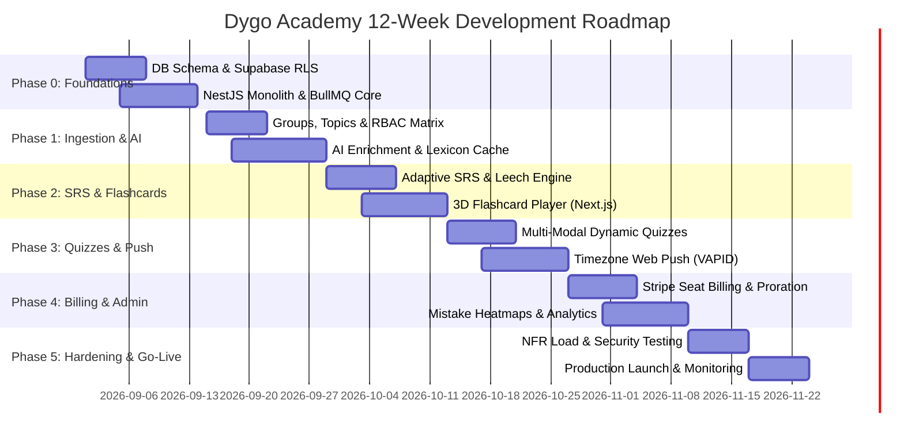

# 📅 Dygo Academy: Master Project Schedule & Phasing Strategy
**Document Version**: 5.11 (regression-clean, UAT script consolidated)  
**Author**: Principal Cloud & SaaS Solutions Advisory  
**Status**: Approved for Engineering & Product Execution  

**Changelog**
* **5.11** (2026-09-01) — Thirteenth pass, the day of tomorrow morning's
  UAT. Full regression run first (153/153 backend jest, clean `tsc`/lint
  both sides) confirmed no drift from 5.10. Searched for a new small
  well-scoped gap in the style of the 10th–12th passes' picks and found
  none — a backend-wide `TODO`/`FIXME` grep came back empty and
  `BillingController` is confirmed still a zero-route scaffold; what
  remains open (Module 7, "Write it myself") is real feature scope, not a
  quick fix, so none was invented. Instead: corrected a stale wireframe
  caption (turn 1, screen 1l — "Try again"/"Write it myself" hadn't been
  updated to reflect the 12th pass shipping the former and disabling the
  latter in the real frontend), and replaced the ten scattered, serially
  "superseding" per-pass UAT checklist sections in
  `dygo_academy_session_report_2026-09-01.md` with one linear,
  deduplicated script, `dygo_academy_uat_checklist_2026-09-02.md`, that
  also states plainly up front which three things (live-Postgres
  migrations/RLS, `next build`, real-browser behavior) have never
  actually run anywhere outside this Docker-less sandbox. Module 7
  reasoning unchanged from the 7th–12th passes — still deliberately
  deferred, still the standing top item for the first pass after UAT
  feedback lands. `next build` not re-attempted — 12-for-12 hang standing,
  unchanged. See the thirteenth pass entry in
  `dygo_academy_session_report_2026-09-01.md`.
* **5.10** (2026-09-01) — Twelfth pass, same day as the eleventh, still
  ahead of tomorrow morning's UAT. Module 7 (Stripe seat billing) reasoning
  is unchanged from the 7th–11th passes — still deliberately deferred to
  after UAT feedback lands. Closed one small, well-scoped, low-risk gap
  instead: the FAILED word state's "Try again" button (wireframe 1l) had
  no backend route and no `onClick` since Module 2 shipped. New
  `POST /words/:id/re-enrich` (`WordsService.reEnrich`) flips a `FAILED`
  `topic_words` row back to `ENRICHING` and re-enqueues the existing
  `enrich-word` BullMQ job, gated by the already-existing
  `topic_words_update_write` RLS policy — no new migration needed. Frontend:
  `useReEnrichWord` + `WordStatusRow.tsx` wiring, invalidating the same
  topic-detail query `useTopic`'s existing 2.5s poll already watches. Also
  disabled (rather than left silently inert) the adjacent "Write it myself"
  button, a separate unbuilt feature. 2 new backend unit tests (153 total,
  up from 151). `dygo_academy_api_surface.md` updated: the endpoint moved
  from "implied" to "live" (37 live, 13 implied), and the `GET /words/:id`
  implied row was annotated as possibly unneeded — the frontend actually
  polls `GET /topics/:id`, not a per-word route. `next build` was not
  re-attempted this pass (11-for-11 hang standing, unchanged, not
  re-verified a 12th time — token budget judgment call). See the twelfth
  pass entry in `dygo_academy_session_report_2026-09-01.md`.
* **5.9** (2026-09-01) — Eleventh pass, same day as the tenth, still ahead
  of tomorrow morning's UAT. Module 7 (Stripe seat billing) reasoning is
  unchanged from the 7th–10th passes — still deliberately deferred to
  after UAT feedback lands, not started this pass either. Instead closed
  two standing, lower-risk known gaps that had been carried forward
  unfixed for several passes: **Module 4's offline-first sync** (open
  since Phase 2) and **FR-6.2's unrated sprint route** (flagged since the
  5th pass). Offline sync: new `lib/offline-review-queue.ts` (native
  IndexedDB, no new dependency) queues a rating when `POST /srs/rate`
  fails at the network level (not a real `ApiError` from a reachable
  server — that still surfaces as before); `useOfflineReviewSync`, mounted
  once at the app root in `QueryProvider.tsx`, drains that queue through
  the already-existing, already-unit-tested `POST /srs/sync` on the
  browser's `online` event. No backend change was needed — `SrsService.sync`
  has done the actual work since Phase 2, only nothing on the frontend ever
  called it outside a manual replay. Sprint rate limiting: new
  `SprintRateLimitGuard` (in-process, per-group 60s cooldown, no new
  dependency — `@nestjs/throttler` was considered and deliberately not
  added this close to UAT), registered as a provider in
  `NotificationsModule` and applied via `@UseGuards` on
  `POST /groups/:groupId/sprint`; documented as a single-instance-only
  limiter, not what a horizontally-scaled deployment would want. 6 new
  backend unit tests (151 total, up from 145); frontend has no test
  runner, `tsc --noEmit` and `next lint` clean on both changes. No
  wireframe change — offline sync and the rate limit are both invisible
  mechanisms, not new screens. Also cleaned up `.tmp_work/`, a stray
  scratch directory left over from a prior pass's wireframe-editing
  process that this sandbox's `rm`/`mv`-across-filesystem permission quirk
  wouldn't let this pass actually delete — same-filesystem `mv` into the
  already-gitignored `.SANDBOX_UNDELETABLE_JUNK_ignore/` worked instead
  (see the master reference memory / eleventh pass's session report entry
  for the exact commands). `next build` still hangs in this sandbox — 11th
  occurrence across 11 sessions. Nothing this pass touched has run against
  a live Postgres/Redis stack or a real browser's IndexedDB/`online`
  event — same standing sandbox limitation as every earlier pass. See the
  eleventh pass entry in `dygo_academy_session_report_2026-09-01.md`.
* **5.8** (2026-09-01) — Tenth pass, evening before UAT. Closed the standing
  "roster shows no name for an invite-redeemed member" gap, open since the
  6th pass and precisely diagnosed (but not fixed) by the 9th:
  `profiles_select_self_or_tenant` was tenant-equality-only, and a
  redeemed member's personal tenant (006) deliberately never equals the
  inviting teacher's. New `database/migrations/008_profiles_group_visibility.sql`
  adds a `shares_group_with()` SECURITY DEFINER helper and a matching OR
  clause to that policy — a teacher (or classmate) can now see any
  groupmate's name/email regardless of tenant; `review_logs`/SRS visibility
  is untouched. One new `rls_test.sql` section (I, 4 new assertions, 47
  total) proves both the fix and that isolation still holds for a
  non-groupmate. Backend 145/145 tests still pass unmodified (this pass's
  only backend change is the migration + two doc/comment updates, no
  service logic touched). Wireframe turn 3c's caption updated to describe
  the fix. Module 7 (Stripe seat billing) remains deliberately untouched —
  same standing reasoning as the 7th/8th/9th pass, this close to UAT is not
  the time to start integrating a live payment provider. `next build`
  still hangs in this sandbox — 10th occurrence across 10 sessions, treated
  as a sandbox property per the 9th pass's own note, not re-investigated
  further. Not run against a live Postgres — same standing limitation as
  every earlier pass; the new migration and RLS section are unverified
  against a real database. See the 10th pass entry in
  `dygo_academy_session_report_2026-09-01.md`.
* **5.7** (2026-09-01) — Ninth pass. Fixed a real, UAT-blocking bug: a
  freshly-registered user (anyone not one of the 5 seeded fixtures)
  couldn't create their first group at all, because `handle_new_auth_user()`
  left `profiles.tenant_id` NULL and `groups.tenant_id` is `NOT NULL` —
  `006_solo_tenant_provisioning.sql` now auto-provisions a personal,
  unpaid (0-seat) tenant for every signup inside the same trigger. Traced
  through `profiles_select_self_or_tenant` precisely enough to correct the
  8th pass's assumption that this was "the same root cause" as invite-
  redeemed members showing no name in the roster — it isn't quite; that
  gap is still open, see the migration's own header comment. Verified (not
  re-fixed) that the topic-delete button is still correctly ADMIN-gated in
  `GroupTopicsPanel.tsx`. Built Module 8 (Phase 4) end to end: wired the
  frontend to FR-8.1's already-existing `/srs/stats`/`/srs/leeches` routes,
  and built FR-8.2's class-wide mistake heatmap new from scratch
  (`AnalyticsModule`, `GET /groups/:id/heatmap`, backed by a `SECURITY
  DEFINER` function since `review_logs` RLS is owner-only with no ADMIN
  exception). Module 7 (Stripe billing) deliberately untouched — flagged
  for the next pass. Added wireframe turn 9 (student analytics + teacher
  heatmap screens). 15 new backend unit tests (145 total). See the 9th
  pass entry in `dygo_academy_session_report_2026-09-01.md`.
* **5.6** (2026-09-01) — UAT-prep pass, no new module work: closed the
  known "`GET /groups/:id/members` has no email/display-name join" gap
  flagged since the 7th pass (`RosterPanel` showed a shortened user id).
  Also corrected two stale wireframe captions (turns 3c/3d) that still said
  their endpoints were "Implied, not built" long after both shipped. See
  status notes under §2 (Phase 1) and the 8th pass entry in
  `dygo_academy_session_report_2026-09-01.md`.
* **5.5** (2026-09-01) — No new backend phase work; this pass closed the standing "no group-management frontend" gap (Phase 1's own status note below) and, more importantly, discovered and fixed that `(auth)/login`/`(auth)/register` had never been built — see status notes under §2 (Phase 1) for both.
* **5.4** (2026-09-01) — Phase 3, Module 6 (Web Push & Habit Scheduling) marked code-complete — Phase 3 as a whole is now done. See status notes under §2.
* **5.3** (2026-09-01) — Phase 3, Module 5 (Dynamic Multi-Modal Quiz Engine) marked code-complete; Module 6 (Push & Habit Scheduling) is still open. See status notes under §2. Also fixed a standing Phase 1 gap: the last-ADMIN-removal guard.
* **5.2** (2026-09-01) — Phase 2 (Modules 3 & 4) marked code-complete; see status notes under §2.
* **5.1** (2026-08-31) — Phase 0 core engineering tasks marked complete; see status notes under §2.
* **5.0** — Definitive Master Execution Plan (baseline).

---

## 1. Executive Summary & Phasing Overview

To successfully deliver **Dygo Academy** within a predictable timeline while maintaining high architectural integrity and strict SLOs (as detailed in `dygo_academy_final_master_brd.md` and `dygo_academy_complete_system_architecture_master.md`), development is organized into a **12-week, 6-sprint phased execution plan**.

The core engineering principle is **"Foundations & Asynchronous Pipelines First $\rightarrow$ Retention & Practice Loop Second $\rightarrow$ Monetization & Enterprise Tooling Third."**

```
Total MVP Timeline: 12 Weeks (6 Two-Week Sprints)
Methodology: Agile-Scrum with Milestone-Gated Releases
Target: Production-Ready Commercial MVP Launch
```



---

## 2. Detailed Phase & Sprint Breakdown

### 🧱 Phase 0: Architecture Setup, Infrastructure & DB Foundations
* **Timeline**: Sprint 1 (Weeks 1 – 2)  
* **Primary Objective**: Establish the data schema, Row-Level Security (RLS) policies, API gateway, asynchronous queue cluster, and CI/CD pipelines.
* **Status**: ✅ **Complete** (2026-08-31) — core engineering tasks 1–4 below are done. Two items from the objective line are carried forward rather than closed: CI/CD pipelines were never broken into a task here and still don't exist (`.github/workflows` is empty); Cloudflare R2 is provisioned at deploy time; local dev runs against MinIO instead (see task 3).

#### Core Engineering Tasks:
1. ✅ **Database & Auth Layer (Supabase / PostgreSQL 15+)**:
   * Initialize full multi-tenant schema: `tenants`, `tenant_seats`, `profiles`, `master_lexicon`, `groups`, `group_members`, `topics`, `topic_words`, `user_word_srs`, `study_schedules`, `push_subscriptions`.
   * Implement Row-Level Security (RLS) policies ensuring students only access permitted topics and maintain isolated personal review progress.
   * Add high-performance partial index:
     ```sql
     CREATE INDEX idx_srs_due_fast ON public.user_word_srs (user_id, next_due_at)
     WHERE next_due_at <= NOW();
     ```
   * Set up monthly table partitioning for `review_logs`.
   * *Done — `database/migrations/001_initial_schema.sql`, `002_rls_policies.sql`, `003_indexes.sql`; verified by the RLS suite in `database/tests/rls_test.sql` (45 assertions as of the 9th pass — see 5.7 changelog entry).*

2. ✅ **Backend Monolith Framework (NestJS)**:
   * Scaffold Clean Architecture modules: `TopicsModule`, `WordsModule`, `SrsModule`, `SeatSubscriptionModule`, `NotificationModule`.
   * Configure Supabase JWT Guard with in-memory cryptographic verification (`<0.2ms` overhead).
   * Integrate Global `ValidationPipe` with `class-validator` DTOs.
   * Auto-generate interactive OpenAPI / Swagger docs at `/api/docs`.
   * *Done — `com.dygoacademy.backend/src/modules/*`, `common/guards/supabase-jwt.guard.ts`, `main.ts`. Route implementations inside these modules are Phase 1+ work — see `dygo_academy_api_surface.md` for what's actually live today.*

3. ✅ **Asynchronous Queues & Cloud Storage**:
   * Configure Redis cluster with BullMQ (`enrichment-queue`, `notification-cron-queue`).
   * Provision Cloudflare R2 bucket with custom domain and edge CDN ($0 egress).
   * *Done for local dev — `src/queues/queues.module.ts`, `docker-compose.yml` (`redis`, `minio` services). MinIO stands in for R2 locally; the R2 bucket itself is a production provisioning step, not something this repo does.*

4. ✅ **Frontend Scaffolding (Next.js 14/15 App Router)**:
   * Set up Tailwind CSS with shadcn/ui design tokens.
   * Implement TanStack Query and Zustand client state stores.
   * Set up Supabase Auth client session management.
   * *Done — `com.dygoacademy.frontend/` (App Router, `tailwind.config.ts` + `components/ui/`, `components/layout/QueryProvider.tsx`, `stores/useStudySessionStore.ts`, `lib/supabase.ts`). Builds and type-checks clean; domain screens are Phase 1+.*

---

### 🧠 Phase 1: Collaborative Groups & AI Lexicon Ingestion
* **Timeline**: Sprint 2 (Weeks 3 – 4)  
* **Primary Objective**: Implement **Module 1** (Multi-Tenant Groups & RBAC) and **Module 2** (Automated AI Word Enrichment Engine).
* **Status** (2026-09-01, updated): Module 1 backend is code-complete — 19
  live endpoints covering groups, roster/RBAC management, magic invites, and
  topic CRUD + clone (`dygo_academy_api_surface.md` §2). Module 2's ingestion
  endpoint (`POST /words`) and `EnrichmentProcessor` are both code-complete
  now too: dedup lookup, real Gemini 1.5 Flash calls for IPA/POS/synonyms/
  antonyms/examples, Gemini TTS for audio, R2/MinIO upload, `master_lexicon`
  upsert (see `dygo_academy_api_surface.md` note (4) for the `.wav`-not-`.mp3`
  deviation and why). Frontend task 3 below (word creation modal + polling)
  is also done. **None of this has been run against a live
  Postgres/Redis/MinIO stack** — no Docker in the sandbox this work was done
  in. Static checks only: `tsc --noEmit`, `eslint`, and 51 Jest unit tests
  (backend), `tsc`/`next lint` clean (frontend) — `next build` still hangs
  in this sandbox, reproduced a third time across three sessions, so treat
  it as a sandbox limitation rather than a code issue pending a real run.
  Verify against `/api/docs`, the RLS suite
  (`database/apply-migrations.sh --test`), and a real `POST /words` →
  enrichment → `GET /topics/:id` round-trip before treating Phase 1 as done.
  **Update (2026-09-01, 7th pass):** frontend task 3's own scope — "Build
  Topic/Group Explorer" — is now actually complete; the "Group" half was
  missing until this pass (`app/(dashboard)/groups/`,
  `app/(dashboard)/join/[token]/`: list/create groups, roster + role
  management + member removal, invite mint/list/revoke, ADMIN settings/
  delete, the Module 6 teacher-sprint trigger, and topic create/delete —
  all previously API- and wireframe-only). Separately, and more
  foundationally: `(auth)/login` and `(auth)/register` were discovered to
  still be Phase-0 stubs with no form at all, meaning no route in this
  application was reachable through an actual browser regardless of
  backend completeness — six prior passes never caught this because none
  booted a browser. Both are real now (`signInWithPassword`/`signUp`), and
  `database/migrations/004_seed_data.sql` was fixed to give the seeded
  fixtures a real GoTrue password (`dygo-dev-2026`) so UAT can sign in
  through the browser, not only via `scripts/dev-token.js` + curl/Swagger.
  **Neither the roster/invite screens nor the login form have run against
  a live Postgres/GoTrue stack** — same standing sandbox limitation as
  everything else in this document; verify a real sign-in and a real
  invite-link round-trip before treating this as done.
  **Update (2026-09-01, 8th pass):** the roster's own known gap — no email
  or display name, only a shortened user id — is fixed. `GroupsService.findMembers`
  now `left join`s `profiles` for `email`/`display_name`; `RosterPanel` shows
  `display_name`, falling back to `email`, falling back to the shortened id
  only when both are null. A `left` (not `inner`) join is the deliberate
  choice: an inner join would have silently dropped from the roster any
  member whose profile `profiles_select_self_or_tenant` hides from the
  caller — real today for anyone seated via a redeemed invite link, since
  `redeem_group_invite()` seats them in `group_members` but never sets
  `profiles.tenant_id` (same root cause as the standing "no solo-user
  tenant provisioning" gap, not a new one). 1 new backend unit test (130
  total, up from 129); `tsc`/lint clean both sides. Two wireframe captions
  (3c, 3d) that still read "Implied, not built" — stale since as early as
  the 2nd/3rd pass — were also corrected to reflect current reality.

#### Core Engineering Tasks:
1. **Module 1: Groups, Topics & Granular RBAC**:
   * Public vs. Private Topic scoping and discovery endpoints.
   * Granular permission validation: `ADMIN` (Full Control), `WRITE` (Add/Edit Words), `READ` (Study & Quiz Only).
   * One-click Magic Invitation link generation with secure cryptographic join tokens.

2. **Module 2: Automated AI Enrichment Pipeline**:
   * Build `POST /words` ingestion endpoint returning `201 Created` with status `ENRICHING` in $<50\text{ms}$.
   * BullMQ `EnrichmentProcessor` integrating Google Gemini 1.5 Flash:
     * Dual-accent IPA phonetics (US `/rɪˈzɪl.jənt/` & UK `/rɪˈzɪl.i.ənt/`).
     * Part of Speech (POS), CEFR-graded synonyms (5) and antonyms (5).
     * Level-adapted contextual example sentences (A2–C1).
   * Integrate Neural TTS engine $\rightarrow$ Stream `.mp3` directly to Cloudflare R2.
   * **Global Lexical Deduplication**: Query `master_lexicon` before invoking Gemini/TTS to reuse cached linguistic assets and reduce API costs by $>85\%$.

3. **Frontend Integration**:
   * Build Topic/Group Explorer, Word creation modal, and real-time enrichment status polling via TanStack Query.

---

### 📈 Phase 2: Error-Adaptive SRS Engine & 3D Flashcards
* **Timeline**: Sprint 3 (Weeks 5 – 6)  
* **Primary Objective**: Implement **Module 3** (Mistake-Penalized SRS) and **Module 4** (3D Flashcard Player).
* **Status** (2026-09-01): Both modules are code-complete. Module 3 —
  `SrsService`/`SrsController` (`GET /srs/due`, `/leeches`, `/stats`, `POST
  /rate`, `/sessions`, `/sync`) plus `GET /topics/:id/cards/due` — implements
  the full FR-3.1 mistake-weighted formula, all four FR-3.2 rating actions,
  and FR-3.3's leech flag; the scoring math is isolated in
  `src/modules/srs/srs-algorithm.ts` as pure, unit-tested functions (24 new
  tests, 75 total). This also **settles the `recent_mistakes` decay question**
  flagged in `dygo_academy_api_surface.md` §5.4 — recomputed from
  `review_logs` on every rating, not decayed on a schedule. Module 4 wires
  the Phase 0 flashcard scaffold (`components/flashcard/Flashcard.tsx`,
  `RatingButtons.tsx`) to real data via two new hooks
  (`useStudySession`/`useRateWord`), adds the FR-4.2 progressive clue ladder
  (`ProgressiveClues.tsx`) and FR-2.4's audio speed toggle (`AudioButton.tsx`),
  and implements all three FR-4.3 modes (Standard/Reverse/Listening) in
  `/study`. Offline-first sync (Module 4's "local SQLite/IndexedDB cache")
  was **not** implemented as of this pass — `POST /srs/sync` existed on the
  backend and was unit-tested, but nothing on the frontend queued reviews
  offline. **Update (2026-09-01, 11th pass): closed.** `lib/offline-review-queue.ts`
  (native IndexedDB) queues a rating when `POST /srs/rate` fails at the
  network level; `useOfflineReviewSync`, mounted at the app root, drains
  the queue through the existing `POST /srs/sync` on the browser's
  `online` event. See the 11th pass's session report entry for the full
  design and its deliberate scope limits (no client-side ease-factor
  computation, no retry of server-rejected items). **None of this has been
  run against a live Postgres/Redis stack, or a real browser's
  IndexedDB/`online` event** — same standing sandbox limitation as Phase 1;
  verify a real `POST /srs/rate` round-trip and the `p95 < 15ms` due-card
  query before treating Phase 2 as done. `tsc`/lint clean on both sides;
  frontend `next build` still hangs in this sandbox (4th occurrence across
  4 sessions as of this pass, 11th as of the 11th pass overall).

#### Core Engineering Tasks:
1. **Module 3: Error-Adaptive Spaced Repetition System**:
   * Implement mistake-weighted retention formula:
     $$EF' = EF + \Big(0.1 - (5 - q) \cdot (0.08 + (5 - q) \cdot 0.02)\Big) - (\lambda \cdot M_{\text{recent}})$$
   * Build 4 standard rating handlers: `[Again]` (reset, +1 mistake), `[Hard]` ($\times 1.2$), `[Good]` (standard intervals), `[Easy]` ($\times 1.3$).
   * Implement **Leech Word Diagnostic Detection**: Auto-flag words with $\ge 4$ failures in 7 days.
   * Build sub-15ms daily due card retrieval using Redis session caching + PostgreSQL partial indexes.

2. **Module 4: Interactive 3D SRS Flashcard Player**:
   * Responsive 3D flip card component with smooth CSS perspective transforms.
   * **Progressive Clue Engine**: Step-by-step hint reveals (First-Letter $\rightarrow$ IPA Hint $\rightarrow$ Audio $\rightarrow$ Context Sentence).
   * Multiple study session modes: Standard Mode, Reverse Context Mode, and Audio-Only Listening Mode.
   * Offline-first sync capability using local SQLite / IndexedDB cache.

---

### ✍️ Phase 3: Dynamic Quiz Engine & Habit Push Scheduling
* **Timeline**: Sprint 4 (Weeks 7 – 8)  
* **Primary Objective**: Implement **Module 5** (Multi-Modal Quizzes) and **Module 6** (Web Push & Habit Reminders).
* **Status** (2026-09-01): Module 5 is code-complete —
  `QuizService`/`QuizController` (`POST /quizzes/generate`, `POST
  /quizzes/:id/answer`, `GET /quizzes/leech-drill`) implement FR-5.1–5.5;
  the generation/grading logic is isolated in `src/modules/quiz/quiz-
  generator.ts` as pure, unit-tested functions (32 new tests, 107 total).
  Biggest design call: **no persisted quiz/session/attempt row** — a quiz
  item's id is deterministic and its correct answer always derived the same
  way, so grading needs no database memory of what was generated (see
  `dygo_academy_api_surface.md` note (6) for the full reasoning). FR-5.3
  ("drag-and-drop semantic pairing") is implemented as one-word-at-a-time
  multiple choice rather than a literal drag-and-drop board — flagged as a
  deliberate simplification, not a silent scope cut. The frontend's `/quiz`
  page (mirroring `/study`'s Suspense-split structure) covers all four quiz
  types plus FR-5.5's AI nuance feedback on a wrong answer, and the topic
  detail page's new "Quiz" button and the home screen's leech nudge both
  route into it. This pass also fixed a standing Phase 1 gap unrelated to
  Module 5: `DELETE /groups/:id/members/:userId` now blocks removing a
  group's last ADMIN (`409 Conflict`) instead of silently permitting it.
  **Module 6 (Web Push & Habit Scheduling) is code-complete as of a later
  pass the same day** — `NotificationsService`/`NotificationsController`
  (`GET /notifications/vapid-public-key`, `POST`/`DELETE
  /notifications/subscribe`, `GET`/`POST /notifications/schedules`, `DELETE
  /notifications/schedules/:id`, `POST
  /notifications/groups/:groupId/sprint`) implement FR-6.1–6.5; a shared
  `PushDispatchService` owns the actual VAPID `web-push` send and
  dead-subscription cleanup, used by both `NotificationProcessor`'s
  15-minute tick and the sprint route's immediate dispatch. FR-6.1/6.3/6.4
  are merged into one priority-ordered decision per matched schedule
  (`notification-message.ts`'s `buildReminderPayload`: leech drill outranks
  streak protection outranks a plain habit nudge) rather than three
  independent triggers, since no `notification_log` table exists to track
  "already notified today" — same "don't persist what's derivable" instinct
  Module 5 used for its stateless quiz items. The tick matches each user's
  own local reminder time via `width_bucket` bucketing rather than a UTC
  offset comparison, so half- and quarter-hour zones (`Asia/Kathmandu`,
  UTC+5:45) still land in the right 15-minute window despite the tick
  itself running on UTC quarter-hours. FR-6.2's teacher sprint is
  ADMIN-gated by an explicit `has_group_role` check rather than RLS (there
  is no table row being written for RLS to gate) and is API- and
  wireframe-only for now — there is no group-management frontend at all yet
  for a teacher to trigger it from, flagged in wireframe turn 8g's caption
  rather than silently built unreachable. Settings ("You" tab), a
  "Coming in a later phase" stub since turn 1, is real now: push
  on/off, add/remove a daily reminder time. 22 new backend unit tests (129
  total). **Phase 3 is now fully code-complete — both Module 5 and Module 6.**
  **Neither module has run against a live Postgres/Redis stack, and Module
  6's VAPID sends have never hit a real browser push service** — same
  standing sandbox limitation as Phases 1 and 2; verify a real
  `POST /quizzes/generate` → `POST /quizzes/:id/answer` round-trip
  (including a real Gemini nuance-explanation call) and a real
  `POST /notifications/subscribe` → wait for a matching tick → browser
  receives the push round-trip before treating Phase 3 as done. `tsc`/lint
  clean on both sides; frontend `next build` still hangs in this sandbox
  (6th occurrence across 6 sessions).

#### Core Engineering Tasks:
1. **Module 5: Dynamic Multi-Modal Exercise Engine**:
   * Dynamic Cloze (fill-in-the-blank) generation from AI contextual sentences.
   * Audio Dictation & Spelling verification engine with audio playback speed controls ($0.75\times / 1.0\times$).
   * Synonym & Antonym drag-and-drop semantic pairing.
   * AI Nuance Explanations: Real-time contextual feedback on incorrect quiz answers.
   * Dedicated Leech Word Remedial Practice Queue.

2. **Module 6: Pure Push Notifications & Scheduling**:
   * VAPID Web Push client registration (`POST /notifications/subscribe`).
   * BullMQ 15-minute cron heartbeat evaluating user-configured local times (e.g., 8:00 PM in user's timezone).
   * Automated alert triggers: Daily Habit reminder, Teacher Class Sprints, Streak Protection, and Leech word drills.
   * Actionable 1-tap notification deep links routing directly into `/study`.

---

### 🎟️ Phase 4: Tiered Seat Billing & Analytics Heatmaps
* **Timeline**: Sprint 5 (Weeks 9 – 10)  
* **Primary Objective**: Implement **Module 7** (Stripe Seat Monetization) and **Module 8** (Teacher Heatmaps).
* **Status** (2026-09-01, 9th pass): Module 8 is code-complete. FR-8.1
  (student streak/mastery/leech list) was already served by `GET
  /srs/stats`/`/srs/leeches` since Phase 2 — this pass wired the frontend
  (`useSrsStats`, `useLeeches`, `(dashboard)/analytics/page.tsx`, previously
  the literal "Coming in a later phase" stub since turn 1). FR-8.2 (the
  class-wide mistake heatmap) is new end-to-end: `GET /groups/:id/heatmap`
  (new `AnalyticsModule`), ADMIN-gated the same `has_group_role` way the
  Module 6 teacher-sprint route is, backed by `public.group_word_heatmap()`
  (`007_group_word_heatmap.sql`) — a narrowly-scoped `SECURITY DEFINER`
  function, required because `review_logs_select_own` is owner-only RLS
  with no ADMIN exception (confirmed by `rls_test.sql`'s own "even the
  group ADMIN cannot read a student's review history" assertion); the
  function returns only per-word aggregate counts, never a raw row or a
  `user_id`. Ranking (failure-rate computation, worst-first sort, top-20
  cap) is isolated in `heatmap-aggregator.ts` as a pure, unit-tested
  function, matching the `srs-algorithm.ts`/`quiz-generator.ts` precedent.
  15 new backend unit tests. **Module 7 (Stripe seat billing) is
  untouched and still fully open** — `billing/*` is still the literal
  empty scaffold stub; deliberately not started this pass (the day before
  UAT is not the time to start integrating a live payment provider) —
  flagged as the top item for the next pass. **Not run against a live
  Postgres/Redis stack** — same standing sandbox limitation as every
  earlier phase.

#### Core Engineering Tasks:
1. **Module 7: Unified Seat-Based Monetization**:
   * Stripe Checkout integration supporting tiered volume discounts:
     * Solo Learner (1 Seat): **\$7.99 / mo**
     * Online Tutor (5 – 30 Seats): **\$3.99 / seat / mo** (50% discount)
     * Language Academy (31 – 150 Seats): **\$2.49 / seat / mo** (68% discount)
     * School District (151+ Seats): **\$1.49 / seat / mo** (80% bulk discount)
   * Stripe Webhook processing (`customer.subscription.created`, `invoice.payment_succeeded`, `customer.subscription.updated`).
   * Automated mid-cycle seat additions and prorations.
   * **Frictionless Student Onboarding**: Students joining via teacher invite links access the platform **100% FREE** with zero payment screens.

2. **Module 8: Analytics & Cohort Heatmaps**:
   * Student analytics: Active study streaks, mastery projections, and leech lists.
   * Teacher / Academy Heatmap: Cohort-level error analysis identifying words with the highest failure rates.

---

### 🚀 Phase 5: Hardening, NFR Verification & Production Launch
* **Timeline**: Sprint 6 (Weeks 11 – 12)  
* **Primary Objective**: Rigorous NFR load testing, security audits, SEO optimization, and production deployment.

#### Core Engineering Tasks:
1. **Performance & SLO Verification**:
   * Verify word ingestion API $\text{p95} < 50\text{ms}$.
   * Verify daily SRS review queue fetch $\text{p95} < 15\text{ms}$.
   * Verify audio streaming latency $\text{p95} < 80\text{ms}$ across global edge nodes.
   * Validate $>85\%$ hit rate on `master_lexicon` cache.

2. **Security & Multi-Tenant Audit**:
   * Complete penetration testing of PostgreSQL RLS policies across tenants.
   * Validate Stripe webhook signature verification and idempotency.

3. **SEO, Deployment & Go-Live**:
   * Enable Server-Side Rendering (SSR) for public topic libraries to maximize search indexing.
   * Set up health check endpoints, automated container auto-healing, and alerting.
   * Production release and official onboarding of pilot tutors and language academies.

---

## 3. Milestone Deliverables Summary Table

| Milestone | Target Window | Key Engineering Deliverables | Acceptance & Success Criteria |
| :--- | :---: | :--- | :--- |
| **M0: Core Foundation** | End of Week 2 | PostgreSQL schema, RLS policies, NestJS API Gateway, Redis & BullMQ | Verified JWT auth, DB migrations executed, BullMQ passing test jobs. |
| **M1: Ingestion & AI** | End of Week 4 | Collaborative Topics, RBAC & Gemini 1.5 Flash Worker | Word ingestion $<50\text{ms}$, AI & audio enriched asynchronously, Lexicon deduplication working. |
| **M2: Learning Engine** | End of Week 6 | Error-Adaptive SRS & 3D Flashcard Player | Review queue $<15\text{ms}$, 3D flip card functioning with progressive hint engine. |
| **M3: Retention Loop** | End of Week 8 | Multi-Modal Quizzes & Timezone Push Alerts | Cloze/audio drills active, VAPID push fired on local user schedule with 1-tap links. |
| **M4: Monetization** | End of Week 10 | Stripe Tiered Billing & Teacher Heatmaps | Seat license checkout, webhook sync, and student \$0-cost join flow verified. |
| **M5: Launch Ready** | End of Week 12 | Security Audit, Load Testing & Production Deployment | Meets all NFR SLOs (p95 $<50\text{ms}$ ingestion, 99.95% uptime ready). |

---

## 4. Responsibility Assignment Matrix (RACI)

| Functional Area | Tech Lead / Backend | Frontend Lead | QA & DevOps | Product Owner |
| :--- | :---: | :---: | :---: | :---: |
| **Database Schema & RLS** | **A / R** | C | C | I |
| **NestJS API & BullMQ** | **A / R** | C | C | I |
| **Gemini AI & Audio Ingestion** | **A / R** | C | C | C |
| **Next.js 3D Flashcards & UI** | C | **A / R** | C | C |
| **SRS Algorithm & Redis Cache** | **A / R** | C | C | I |
| **Push Notification Subsystem** | **R** | **R** | C | I |
| **Stripe Tiered Seat Billing** | **A / R** | C | C | C |
| **NFR Load & Security Audit** | C | C | **A / R** | I |

*Legend: **A** = Accountable, **R** = Responsible, **C** = Consulted, **I** = Informed.*

---

## 5. Key Project Risks & Mitigation Strategy

| Risk Domain | Potential Impact | Pre-Emptive Mitigation Strategy |
| :--- | :--- | :--- |
| **AI Ingestion Cost / Latency Spikes** | High token usage and external API delays impacting user UX. | `master_lexicon` deduplication cache intercepts $85\%+$ redundant lookups; BullMQ ensures the user receives a response in $<50\text{ms}$ while enrichment runs in the background. |
| **Multi-Tenant Data Leakage** | Students viewing private classroom sets without authorization. | PostgreSQL Row-Level Security (RLS) enforces access control directly at the database engine level, independent of application code. |
| **Timezone Notification Drift** | Push reminders arriving at incorrect hours across global timezones. | Timezones stored explicitly as standard IANA strings; BullMQ cron runs every 15 minutes calculating matching local user times. |
| **Mid-Cycle Seat Proration Errors** | Inaccurate billing when academy owners scale seats mid-month. | Use Stripe's native tiered volume subscription items with automated proration webhooks. |

---

## 6. Pre-Development Checklist (Definition of Ready)

Before initiating Day 1 of Sprint 1, ensure the following infrastructure and configuration prerequisites are satisfied:

- [ ] **Supabase Organization**: Project provisioned with PostgreSQL 15+ and Auth enabled.
- [ ] **Google Gemini API**: API credentials active with Gemini 1.5 Flash rate limits allocated.
- [ ] **Cloudflare R2**: Bucket created with public read CDN and CORS access for audio streaming.
- [ ] **Stripe Developer Account**: Sandbox configured with Tiered Seat Subscription Products.
- [ ] **VAPID Keys**: Web Push public and private keys generated for browser notifications.
- [ ] **Repository Setup**: Monorepo/Multi-repo initialized with NestJS backend, Next.js frontend, and GitHub Actions CI/CD workflows.
