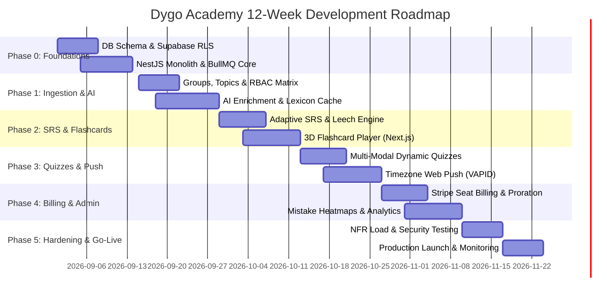

# 📅 Dygo Academy: Master Project Schedule & Phasing Strategy
**Document Version**: 5.49 (Phase 12 added: adult UI rebuild, "Word Garden")  
**Author**: Principal Cloud & SaaS Solutions Advisory  
**Status**: Approved for Engineering & Product Execution  

**Changelog**
* **5.70** (2026-10-03, not committed) — Phase 12 **Home page v2 code complete**: HP-6 … HP-9 built, HP-10 dropped (the landing page is marketing only, no backend calls), HP-11 fixtures, diff jobs and `ui/tests/home.spec.ts` (`9b4ee0d`). Next, Dylan: deploy, `garden:diff` on the 5 v2 boards (≤ 0.5%), Playwright, Lighthouse, phones.
* **5.69** (2026-10-02, automated pass, not committed) — Phase 12 **UI-8 U8-6 wrap-up done (`bac901a`)**: tsc (app + test + backend), `next lint`, Vitest 363/363 green; frontend architecture §3/§4/§16/§17, API surface, UAT checklist and README updated for the garden-only UI and short URLs. **Phase 12 done** apart from Dylan's checks (deploy, `next build`, Playwright, `garden:diff` en+vi, real iPhone/iPad + old-link redirects).
* **5.68** (2026-10-02, automated pass, not committed) — Phase 12 **UI-8 U8-5 short URLs done (`9a95ce7`)**: garden screens at `/review`, `/topics/**`, `/missions`, `/me`, `/groups/**`, `/quiz`, `/join/**` (`/garden` stays home), 308 redirects from `/garden/<x>` and `/study`, `/analytics`, `/settings`; tsc/lint/Vitest 363 green; next: U8-6 wrap-up.
* **5.67** (2026-10-02, automated pass, not committed) — Phase 12 **UI-8 U8-4 renames done (`cb6026a`)**: `garden-` Tailwind prefix dropped, `medium:`/`expanded:` → `md:`/`lg:` (old 768px `md:` → `tablet:`), `GARDEN_CONTENT_WIDTH` → `CONTENT_WIDTH`; compiled CSS unchanged, tsc/lint clean, Vitest 328/328; Dylan to re-run `garden:diff` en+vi after deploy.
* **5.66** (2026-10-02, automated pass, not committed) — Phase 12 **UI-8 U8-3 done early at Dylan's request (`62bb379`, + `69c00c9` `?ui=classic` removed)**: classic adult UI, classic group pages, Navbar/PublicNavbar, `CONTENT_WIDTH`, classic palette and the garden flag deleted; tsc/lint clean, Vitest 328/328; not deployed, no `next build`/Playwright. Rollback: `git revert 62bb379` + deploy.
* **5.65** (2026-10-02, automated pass, not committed) — Phase 12 **UI-8 U8-2 prepared**: `NEXT_PUBLIC_GARDEN_UI=true` set in `env-profiles/prod.env` (gitignored, no commit); `?ui=classic` still beats the flag; tsc + Vitest 26/26 green. Waiting for Dylan to deploy and run the UAT checks. Rollback: set the flag back and redeploy.
* **5.64** (2026-10-02, automated pass, not committed) — Phase 12 **UI-8 U8-1 done (`bc999be`, empty marker commit)**: inventory check passed (every "Remove" row has a garden replacement); tenant director rollup restyle dropped by Dylan — no classic rollup page exists (`GET /analytics/tenant/heatmap` is backend-only). Next: U8-2 flag on, 16:15 UTC.
* **5.63** (2026-10-02, not committed) — Phase 12 **UI-8 moved to the "middle" plan**: everyone switched to the garden today (U8-1 15:00, U8-2 16:15 UTC as scheduled tasks, `?ui=classic` kept); delete/renames/short URLs (U8-3 … U8-6) Fri 10-16 after G3. Decision 1: new short URLs (`/review`, `/topics`, `/missions`, `/me`, `/groups`, `/quiz`, `/join`; `/garden` home).
* **5.62** (2026-10-02, not committed) — Phase 12 **UI-7 and UI-8 scheduled**: UI-7 as U7-1 … U7-7 (2026-10-05 → 10-13, G3 target Thu 10-15), UI-8 as U8-1 … U8-6 (switch everyone Mon 10-19, stable week, delete classic UI Tue 10-27, renames + final URLs, Phase 12 done Fri 10-30). Decision 1 (final URLs) needed by Fri 10-09.
* **5.61** (2026-10-02, automated pass, not committed) — Phase 12 **UI-6 code complete (U6-8 wrap-up, `8f1ca2f`)**: retention backend + A1/A3/A4/A5/A8 live (U6-1 `247d92d` → U6-7b `c96515a`); backend tsc + jest 144/144, frontend tsc (app + test, stale i18n test arg fixed), lint, Vitest 328/328 pass; `rls_retention_test.sql` added to `apply-migrations.sh --test`. Left for Dylan: RLS suite, Playwright, `garden:diff` A1/A3/A4/A5/A8 (en+vi), real-iPhone check.
* **5.60** (2026-10-01, automated pass, not committed) — Phase 12 **UI-5 quiz design QZ-4 wrap-up** (QZ-1 `d924173`, QZ-2 `956dd43`, QZ-4 `a95b5e2` wires the live "Drill tricky words" link): frontend tsc/lint/Vitest 313 pass. Open: QZ-3 Q1–Q8 pixel diff (en + vi) and a live quiz check on the Mac.
* **5.59** (2026-09-30, automated pass, not committed) — Phase 12 **UI-4 code complete (U4-5 wrap-up)**: U4-1 `365a13c` → U4-4 `6e7eb53` plus the classic↔garden parity Playwright spec `7300da9`; srs jest 77/77, frontend tsc/lint/Vitest pass; UI-4 checklist ticked except the beta. Open: **G2** (migrations from `20260926_*`, Playwright on the Mac, 3–5 beta users).
* **5.58** (2026-09-30, automated pass, not committed) — Phase 12 **UI-3 wrap-up (U3-5)**: `/garden` now protected in the middleware (U3-5a `3e602f8`); UI-3 checklist fully ticked; on the Mac tsc/lint/vitest 299, `build:prod:domain` and the Playwright suite (448/448, signed in, 8 viewports) pass. **UI-3 done**: Dylan's real-iPhone check passed the same evening. Next: UI-4 stage counts in `GET /srs/stats` + preview-equals-rate test. See session report 2026-09-26, "UI-3 finish".
* **5.57** (2026-09-29, automated pass, not committed) — Phase 12 **UI-A code complete** (A-1 `8be6590` → A-4 `7a5e342`, wrap-up A-5): garden Sign in, Create account (+ invite), Forgot / set new password behind the garden flag, classic auth pages unchanged; tsc/lint/`next build` pass, AU pixel diffs and real Supabase flows still to be checked on the Mac. See `phase 12 implementation plan.md` → UI-A.
* **5.56** (2026-09-27, automated pass, not committed) — Phase 12 **UI-5 done** (U5-1 `6e86063` → U5-6 `5f016d7`, fix `b467190`, wrap-up U5-7): per-word SRS state on `GET /topics/:id`, A6 beds sorted by due words, A7 live stage tiles/filter/next-due sort, "Water N due", garden Add word sheet, garden quiz with results and leech drill. Frontend tsc/lint/vitest/`next build` and backend tsc/jest pass; `garden:diff` A6/A7 not re-run (no browser on the VM). Collocation quiz → mission 3 moves to UI-6.
* **5.55** (2026-09-26, not committed) — Phase 12 locale codes are now full tags everywhere: `en-SG`, `en-US`, `vi-VN`, `zh-CN` (message files `messages/<code>.json`, new `en-US.json`, profile values + `20260926_profile_locales_codes.sql`, cookie, `?locale=`, `PATCH /profiles/me`); old `en` / `vi` still read. Commit `452a893`.
* **5.54** (2026-09-26, automated pass, not committed) — Phase 12 **UI-G built** (`d9ab4d8` → `92e86bb`): shared gardens GR1–GR7 as components, screens and reference pages (all 7 English and 7 Vietnamese ≤ 0.013%), fifth "Groups" tab for group members, aggregate-only backend (`20260926_group_garden.sql`: garden counts, activity, tricky patches, invite preview; 30 RLS assertions) and the live routes `/garden/groups`, `/garden/groups/[id]`, `/manage`, `/garden/join/[token]` on the existing group endpoints. Rain days aren't stored yet. Details: session report 2026-09-26, "UI-G pass".
* **5.53** (2026-09-26, automated pass, not committed) — Phase 12 **UI-L built** (`33466be` → `4d6f4eb`): garden in English, 简体中文 and Tiếng Việt (profile → cookie → Accept-Language → en; en-SG/en-US/vi-VN/zh-CN formats), all garden copy through next-intl, `vi.json` from the canvas, `zh-CN.json` draft for native review, per-language fixture pages; all 11 Vietnamese references ≤ 0.088%, English unchanged (A7 0.738%, font decision); zh-CN screenshot check at 8 viewports; `profiles.ui_locale` / `meaning_locale` + `PATCH /api/v1/profiles/me`; Language sheet on A8. Details: session report 2026-09-26, "UI-L pass".
* **5.52** (2026-09-26) — Phase 12 gains step **UI-L: Languages** (English, 简体中文, Tiếng Việt), done before UI-G, with English and Vietnamese as the pixel-checked reference languages. Groups design approved (G-design passed). References for GR1–GR7 and all Vietnamese screens committed in `5884ddf`. See `phase 12 implementation plan.md`, UI-L.
* **5.51** (2026-09-26) — Phase 12 gains step **UI-G: Groups ("shared
  gardens")**. The Word Garden canvas never designed groups (only a group
  card on A4 and a "Group" chip on A6), so groups, roles, invites, join,
  sprints and the heatmap get 7 new artboards (GR1–GR7), a design gate,
  then a build to the same 100% fidelity rule. Classic group pages are
  deleted in UI-8 instead of restyled. See `phase 12 implementation plan.md`.
* **5.51** (2026-09-26, automated pass, not committed) — Phase 12 canvas fidelity: all 8 adult garden screens rebuilt to the design canvas and pixel-diffed against it (`061a08d` → `c058552`); 10 of 11 references at the noise floor, A7 0.74% from the decided Vietnamese fallback font only. Live `/garden` routes on existing data, `npm run garden:diff`. Details: `dygo_academy_session_report_2026-09-26.md`.
* **5.50** (2026-09-26, automated pass, not committed) — Phase 12 UI-2 components finished (`f06702b` → `1063de0`): plant glyph + `stageFromSrs`, rating bar, review card, garden audio button, mission row, hero card, stage tile, word row, tab bar, bottom sheet, toast, and a Vitest runner (131 tests). G1 waits on the mockup PNGs and Dylan's check. Details: `dygo_academy_session_report_2026-09-26.md`.
* **5.49** (2026-09-26) — Added **Phase 12: Adult UI Rebuild ("Word
  Garden")** with a companion `phase 12 implementation plan.md`, which
  supersedes `ui rebuild implementation plan.md`. Records what the
  2026-09-25 overnight pass built (UI-0, UI-1, UI-2 part 1), maps every
  garden screen to FSRS data from Phase 10, and takes over Phase 11's
  frontend i18n (next-intl) and its Settings UI (as the A8 Me screen).
  Phase 11's household work (WS2) is unchanged and stays separate.
* **5.48** (2026-09-25, overnight automated pass) — Adult UI rebuild started per
  `ui rebuild implementation plan.md`: UI-0 (garden flag, `?ui=garden` cookie,
  `(garden)` route group) and UI-1 (scoped tokens, fonts, next-intl,
  `/garden/_tokens`) committed, plus a first slice of UI-2 components and
  `/garden/_gallery`. Classic UI unchanged. Details:
  `dygo_academy_session_report_2026-09-25.md`.
* **5.47** (2026-09-25, same day as 5.46) — Owner asked to simplify the
  migrations and rebuild the database from scratch. Migrations 001–021
  are squashed into `database/schema/` (6 ordered files) plus
  `database/seeds/` (5 packs); the originals are archived.
  `database/reset-db.sh` does a verified backup → typed confirmation →
  volume wipe → rebuild → Redis flush. The baseline was proven identical
  to the old chain except for two deliberate changes. Found and fixed a
  **real production bug**: creating a group via the API failed for any
  non-admin, including every new signup, because `groups_select` rejected
  the `INSERT … RETURNING` row before the owner was seated. Repaired the
  RLS suite, which now runs 64/64 to completion for the first time.
  Phase 10's upgrade path (019–021, backfill script) is superseded by the
  rebuild. Details: `database/README.md`, `Change Log.md`.
* **5.46** (2026-09-25, same day as 5.45) — **Built Phase 10** after a
  customer-experience pass that settled all four blockers: flashcard
  "Knew it" counts at face value (not capped at Hard); retention 0.95;
  sticky, grandfathered mastery, so no learner's count drops at the
  switch; no dual-write, and due dates untouched at the switch. Code
  complete for Workstreams 1–4: FSRS-6 via `ts-fsrs`, quiz answers grade
  the schedule, `srs-algorithm.ts` deleted, and migrations 019–021 plus
  a history-replay backfill script. Backend 217/217 tests (was 190);
  `tsc` clean on all three packages. Migrations proven on a throwaway
  Postgres: fresh install, upgrade from SM-2, a straggler row written
  mid-upgrade, and post-021 SQL. The RLS suite is unchanged against
  pre-change files (one pre-existing failure at line 207). **Not yet
  migrated, deployed or committed.** Full detail in `phase 10
  implementation plan.md` → "Build status" and `Change Log.md`.
* **5.45** (2026-09-25) — Added a new **Phase 10: FSRS Scheduler
  (Replaces SM-2)**, with a companion `phase 10 implementation plan.md`.
  Triggered by a review of the SRS code against flashcard/quiz grading
  rules, which found that Dygo runs a modified SM-2 (not FSRS) with two
  real bugs: HARD never grows past a 1-day interval, and four HARD
  ratings count as "mastered". It also found that quiz answers never
  reach the SRS at all. The former Phase 10 (Locale, Timezone,
  Household Profiles & i18n) is renumbered to **Phase 11**, and its
  companion file renamed to `phase 11 implementation plan.md`. FSRS goes
  first because Phase 11's RLS rewrite targets the same `user_word_srs`/
  `review_logs` tables whose columns Phase 10 changes. Documentation
  only; no code changed.
* **5.44** (2026-09-21, same day as 5.43) — Live-requested ("check the
  other three screens for anything else missing"): re-checked Home,
  Session-end, and Analytics against the mockup. Session-end and
  Analytics both already matched fully. Home's static "Welcome back"
  didn't — the mockup shows "GOOD EVENING, SARAH," a time-of-day-aware,
  name-personalized greeting. `GET /srs/stats` gained `display_name`
  (a new third parallel query in `computeSrsSummary`, reading
  `public.profiles.display_name` for the caller — kept separate from
  the existing `user_word_srs` aggregate rather than joined, since a
  fresh account has zero rows there). New `formatGreeting()` helper
  produces "Good morning/afternoon/evening[, name]" — checked first
  whether the data existed: `/register` never collects a name, so this
  only shows one for hand-seeded fixture accounts (confirmed
  name-when-available scope with the user before building, given most
  real accounts have none). 4 existing backend unit tests updated for
  the new query; full suite still 186/186. `tsc`/lint clean. Deployed
  and live-verified signed in as `sarah@dygo.test`: Home now reads
  "Good morning, Sarah Chen." Full detail in `Change Log.md`. This
  closes the Phase 9 mockup-comparison pass — no further gaps found
  across all four mockup screens.
* **5.43** (2026-09-21, same day as 5.42) — Live-requested ("check the
  topic design mockup, that look like haven't implement the indicate
  yet"): re-examined the mockup's "Your collections" screen and
  confirmed each collection card's ring shows a percentage ("35%",
  "12%") in its center — `MasteryRing` (shared by `TopicCard`,
  `TopicCollectionRow`, `TopicGridCard`) only rendered the colored fill,
  no label. `TierProgressCard` picked up this same treatment during
  5.41's visual-redesign pass; this smaller, more-widely-used ring was
  missed at the time. Added a centered "N%" label, font size scaling
  off the existing `size` prop so it stays legible at both 28px and
  36px. No backend change. `tsc`/lint clean. Deployed and
  live-verified signed in as `sarah@dygo.test`: "0%" renders correctly
  inside the ring on Home's flat list and both Topics views (her 7
  topics are all currently at 0% mastered). Full detail in
  `Change Log.md`.
* **5.42** (2026-09-21, same day as 5.41) — Live-requested ("Build the
  topics word-count/focus-word subtext next"): closed the one item
  explicitly deferred from 5.41's visual-redesign pass. `GET
  /api/v1/topics` now returns `focus_word_count` (count of each topic's
  words currently flagged `is_leech`, same `user_word_srs` join
  `mastered_count` already uses). New shared `formatTopicWordCount()`
  helper renders "N words" or "N words · M focus words" (only when
  focus > 0), matching the mockup's own "21 words · 3 focus words"
  copy — wired into all three components that independently render a
  topic's word count (`TopicCard`, `TopicCollectionRow`,
  `TopicGridCard`) instead of each building the string inline. 2 new
  backend unit tests, full suite 186/186 passing; `tsc`/lint clean.
  Deployed (backend + frontend) with the same build-verify-restart
  discipline as every prior deploy, and live-verified signed in as
  `sarah@dygo.test`: all three components correctly show plain "N
  words" (her account currently has 0 leeches, so the focus-word clause
  is correctly absent everywhere the zero-leech path was exercised
  live; the nonzero path is covered by the 2 new unit tests). Full
  detail in `Change Log.md`.
* **5.41** (2026-09-20, same day as 5.40) — Live-requested ("why the
  UI/UX not match with mock design" → "I want to follow the UI/UX design
  with same with mock design with light mode not dark mode"): closed the
  biggest remaining gap between Phase 9's shipped features and the
  original mockup — they matched its *behavior* but not its *look*.
  Rebuilt `TierProgressCard` as a ring instead of a bar (reusing
  `MasteryRing`'s existing conic-gradient technique — no new chart
  library, no new dark palette). Replaced `DueNowCard`/`ActivityTrail`/
  `UpcomingPath` (three separate boxes) with one new `LearningPath`
  component — a connected vertical list of day-rows, which is what the
  mockup's Home screen actually was; an earlier note in this document had
  mis-described it as a horizontal strip. Added a "You just moved N words
  from shaky to solid" narrative line to session-end, reusing the
  already-verified `tally.mastered` count rather than a new claim. All
  three changes deliberately kept this app's existing light color tokens
  — the ask was to match the mockup's *layout*, not its dark navy
  palette. Deployed (frontend only) and live-verified signed in as
  `sarah@dygo.test`: ring renders identically on Home/Analytics,
  `LearningPath` correctly shows a real mix of Missed/Cleared/Today/Up
  next/Locked states in one card, session-end's fallback copy still
  renders correctly. Full detail in `Change Log.md`.
* **5.40** (2026-09-20, same day as 5.39) — Live-requested ("sign in as
  a fresh test account and verify"): closed the one remaining gap from
  Phase 9's close-out check. Registered a genuinely new account through
  the real `/register` flow (the user entered the credentials directly
  in the browser pane, not Claude — the same credential-entry line held
  throughout this entire session, for registration exactly as it was for
  every login). Checked Home, Analytics, and Topics: every Phase 9
  feature degraded cleanly to its zero-state — Vocabulary Mastery Tier
  Ladder still shows "Foundation / Tier 1 of 4" for an account with zero
  group memberships (confirming the tier topics' `is_public` flag works
  exactly as intended for this exact case), Upcoming Path shows `0/0/0`
  rather than erroring, Ranked Focus List and the class heatmap both
  correctly don't render, and "+ New Topic" correctly disables with "join
  a group first." No errors anywhere. Phase 9's close-out check is now
  fully satisfied with no open items. Full detail in `Change Log.md` and
  `phase 9 implementation plan.md`.
* **5.39** (2026-09-20, same day as 5.38) — Closed Phase 9: built,
  deployed, and live-verified the 6th and final feature, "Upcoming
  Path" — Home's forward-looking trail, grouping `user_word_srs.next_due_at`
  by future calendar day (strictly excluding today, so it never
  double-counts against `SrsStats.due_now`). Turned out to need only a
  new query against data the SRS engine already had, not a new "planned
  curriculum" concept, confirming the correction already made in v5.27.
  3 new backend unit tests, full suite 184/184. Live-verified on
  production as `sarah@dygo.test`: Home now shows one continuous
  WED→THU→FRI→SAT→TODAY→UP NEXT→LOCKED→LOCKED sequence with real,
  varying counts. A local `next dev` sanity check was blocked outright by
  the auto-mode classifier before deploying — reinforcing this session's
  own resolution to never run it in this project directory again; went
  straight to build+deploy+live-verify instead, same as the previous 3
  features.
  
  **All 6 Phase 9 features are now shipped, deployed, and live-verified**:
  Topics as Collections, Ranked Focus List, Vocabulary Mastery Tier
  Ladder, Session Mastery Count, Targeted Re-Quiz, Upcoming Path. The
  phase's own close-out check (Home showing Tier Ladder + Upcoming Path
  together, Analytics showing Tier Ladder + Focus List together,
  cross-screen tier consistency, the full session→re-quiz→Home loop) was
  satisfied organically across this session's individual live
  verifications rather than as one separate final pass. **Left open**:
  a live check signed in as a genuinely fresh, non-fixture account —
  every check this session used the one seeded `sarah@dygo.test`
  fixture. Full detail in `Change Log.md` and
  `phase 9 implementation plan.md`, both fully updated.
* **5.38** (2026-09-20, same day as 5.37) — Built Phase 9's "Targeted
  Re-Quiz": `POST /quizzes/generate` gained a `topicWordIds` scope
  (rejecting it alongside `topicId`), and session-end's reward-hero now
  offers a primary "Quiz these N now" button for the specific words just
  missed, handed to `/quiz?mode=requiz` via a one-shot `sessionStorage`
  write. Found and fixed a real edge case while building the reader side:
  the quiz query had to stay disabled (not just loading) while that
  handoff was pending or resolved empty, since React Query's `isLoading`
  never resolves for a disabled query — handled with explicit state
  checks rather than folding into the existing generic ones. 2 new
  backend unit tests, full suite 181/181. **Deployed and live-verified
  end-to-end on production** as `sarah@dygo.test` — the most complete
  live check of any Phase 9 feature: missed a word for real, got exactly
  "Quiz these 1 now," and walked all 4 generated question types
  (correctly testing that one word, with distractors correctly pulled
  from elsewhere) through to a clean 4/4 finish. Full detail in
  `Change Log.md` and `phase 9 implementation plan.md`. Phase 9's build
  sequence is now 5 of 6 features complete — only Upcoming Path remains.
* **5.37** (2026-09-20, same day as 5.36) — Built Phase 9's "Session
  Mastery Count": `POST /srs/rate` now returns `just_mastered: boolean`
  (the mastery threshold crossed by that specific rating), accumulated
  into a per-session count driving a new "+N Mastered" reward-hero chip.
  Centralized `MASTERY_THRESHOLD = 4` into one named constant while doing
  so — a grep found it hardcoded in 4 separate places across 2 files, not
  the 1 the plan anticipated. 3 new backend unit tests, full suite
  179/179 passing. Rebuilt and redeployed both `dygo-backend` and
  `dygo-frontend` to production (verified the new field/correct
  hostnames landed in each compiled output before restarting — no
  incident this time), then live-verified with a real 20-card study
  session as `sarah@dygo.test`: reward-hero renders correctly, "+N
  Mastered" chip correctly absent for a fresh account's first pass,
  ratings confirmed persisted server-side. The exact 3→4 crossing itself
  wasn't observed live (needs multiple real sessions over days per SM-2
  scheduling) — covered by the unit tests instead. Full detail in
  `Change Log.md` and `phase 9 implementation plan.md`. Only Targeted
  Re-Quiz remains before Phase 9's build sequence is complete.
* **5.36** (2026-09-20, same day as 5.35) — Live-requested ("please do
  the testing before continue with develop next feature"): signed in as
  `sarah@dygo.test` on the real production site and live-verified all 3
  shipped Phase 9 features together in one session — Topics as
  Collections (both list/grid views correct), Ranked Focus List
  (correctly absent with 0 leeches), and Vocabulary Mastery Tier Ladder
  (Home and Analytics agree exactly: "Foundation / Tier 1 of 4 / 0 of 6
  words to Core Vocabulary" on both screens). All three features' release
  checkpoints in `phase 9 implementation plan.md` are now marked done.
  **Separately, found and fixed a real production outage this session's
  own verification testing had caused**: earlier `next dev` runs on
  scratch ports, inside the same directory `dygo-frontend`'s pm2 process
  runs `next start` from, had silently overwritten the production build
  — a different port isolates network traffic, not the shared `.next`
  build directory. Rebuilt correctly (verified the right hostnames landed
  in the compiled output, not assumed) and restarted; production
  confirmed back up via the same live-verification session. Full
  incident writeup in `phase 9 implementation plan.md`'s new "Incident"
  section and `Change Log.md` — the verification method itself is fixed
  going forward (no more `next dev` inside a pm2-managed project
  directory). Also surfaced, not fixed: the bare `dygoacademy.com`
  domain intermittently error'd during this session, a more serious
  version of Phase 8's already-logged "no www redirect" finding.
* **5.35** (2026-09-20, same day as 5.34) — Built Phase 9's "Vocabulary
  Mastery Tier Ladder" end-to-end: new `GET /srs/tier-progress`
  (`SrsService.getTierProgress`), a hardcoded `TIER_TOPICS` config
  pointing at 5.34's seeded topic ids, 6 new backend unit tests (fresh /
  mid-tier / boundary / top-tier / zero-word guard / RLS-scoping — all
  passing, full suite re-run at 176/176), and a shared `TierProgressCard`
  wired into both Home and Analytics via one `useTierProgress()` hook so
  the two screens can't disagree (same rule as Phase 6's streak/due-count
  fix). No decimal "band score" anywhere — every display is a checkable
  "N of M words" claim. Frontend verified with mock data across all three
  real-world states via a disposable preview route; full real,
  signed-in end-to-end verification (both screens together through an
  actual login) is flagged as not yet done — out of scope without a full
  local Supabase-auth + local-backend stack. Full detail in
  `Change Log.md` and `phase 9 implementation plan.md`'s updated section.
  Only Session Mastery Count and Targeted Re-Quiz remain in Phase 9's
  build sequence.
* **5.34** (2026-09-20, same day as 5.33) — Resolved Vocabulary Mastery
  Tier Ladder's remaining content-decision blocker (which topic backs
  which tier) with a real test dataset rather than waiting on an
  external curriculum decision, live-directed: "Let's map tiers to
  topics ourselves for now" / "You can build test dataset by yourself."
  New `database/migrations/018_tier_ladder_seed.sql` — 4 topics, 24 real
  dictionary words, CEFR-graded per tier — wired into
  `apply-migrations.sh` as both a standalone flag and part of the default
  seed sequence. Applied to the live local dev DB after finding it had
  already diverged from a clean 004 seed (real team accounts, Sarah's
  group under a different id) — validated in a rolled-back transaction
  first, then applied for real against the actual existing group per
  live confirmation, while keeping the committed file itself targeting
  the canonical fixed id for any fresh re-seed. Full detail in
  `Change Log.md` and `phase 9 implementation plan.md`'s updated section.
  Backend/frontend build for the tier-progress endpoint itself has not
  started yet.
* **5.33** (2026-09-20, same day as 5.32) — Built Phase 9's "Ranked Focus
  List" feature, revised from the plan as written before building it:
  originally scoped as capping the existing Analytics leech list to 3
  with a "+N more" link, changed instead to an additive "Focus words"
  summary above the existing list, which stays completely untouched below
  it — same reasoning as 5.32's Topics as Collections revision, applied
  proactively this time rather than after live feedback. Verified against
  0/2/5-leech mock scenarios via a disposable preview route (same
  production-backend caution as before). Full detail in `Change Log.md`
  and `phase 9 implementation plan.md`'s updated section. Still needs a
  real signed-in production check before the next feature (Vocabulary
  Mastery Tier Ladder) starts.
* **5.32** (2026-09-20, same day as 5.31) — Built Phase 9's "Topics as
  Collections" feature, then revised it the same day per live feedback
  ("I think the list can let use choose vertical list or gridcard by
  them self rather than we give on option to the customer"): shipped
  first as a hard grid→list replacement per the implementation plan as
  written, then converted to a toggle — both `TopicGridCard` (grid) and
  the new `TopicCollectionRow` (list, the default) coexist, picked by the
  viewer, preference persisted via `localStorage`. Verified against mock
  data via a disposable preview route rather than the real signed-in app,
  since the local dev server's backend is confirmed production
  (`start:prod:domain`) — avoided fabricating a login or touching real
  account data. Full detail in `Change Log.md` and
  `phase 9 implementation plan.md`'s updated "Topics as Collections"
  section, not duplicated here. Still needs a real signed-in production
  check before the next feature (Ranked Focus List) starts, per that
  feature's own release checkpoint.
* **5.31** (2026-09-20, same day as 5.30) — Live-requested (screen
  mapping, feature dependencies, which screen to build first, priority
  for each): added a **Dependencies, sequencing, and priority** section
  to `phase 9 implementation plan.md`. Headline finding: none of the 6
  features have a code-level dependency on each other — the one real
  dependency in the whole plan is the content decision gating Vocabulary
  Mastery Tier Ladder (which topic backs which tier), not code. Added a
  numbered 1–6 build sequence and a derived "which screen finishes first"
  table — a screen only counts as complete once every feature it needs is
  live, so Screen 2 (1 feature) finishes first and Screen 1 (needs both
  the slowest-to-unblock feature and the lowest-confidence one) finishes
  last, even though its other half is ready earlier.
* **5.30** (2026-09-20, same day as 5.29) — Live-requested ("why we not
  develop by feature like agile style, easier for testing and release
  feature?"): added a **Test plan** and **Release checkpoint** to each of
  `phase 9 implementation plan.md`'s 6 features — a per-feature ship →
  verify-live → move-to-next cadence, instead of one combined
  acceptance-criteria line per feature and no explicit release framing.
  Each checkpoint explicitly calls back to Phase 6/7's own deploy-lag
  incidents (code-complete repeatedly turned out not to mean verified
  live in this project's history) rather than assuming `tsc`/tests
  passing is enough. Also added a **Phase 9 close-out check** at the end
  of that file — a combined walkthrough once all 6 features are
  individually live, since two features sharing one screen (Vocabulary
  Mastery Tier Ladder + Upcoming Path on Home; the same + Ranked Focus
  List on Analytics) are each verified in isolation and never previously
  checked side by side.
* **5.29** (2026-09-20, same day as 5.28) — Live-requested ("how those
  feature match with those screen as a design"): added a screen-to-feature
  map to `phase 9 implementation plan.md`. Not 1:1 — Screen 1 (Home)
  needs two features (Vocabulary Mastery Tier Ladder + Upcoming Path),
  Screen 3 (session-end) needs two (Session Mastery Count + Targeted
  Re-Quiz), and Vocabulary Mastery Tier Ladder is itself shared across
  Screens 1 and 4 (same `GET /srs/tier-progress` endpoint, deliberately,
  so Home and Analytics can't show conflicting numbers).
* **5.28** (2026-09-20, same day as 5.27) — Live-reported the same day
  ("I don't understand you. Why we don't use feature name by feature?"):
  `phase 9 implementation plan.md`'s "Feature 1"–"Feature 6" headings,
  stacked on top of the master schedule's own "Screen 1"–"4" and
  "Blocker 1"–"3" numbering, made it hard to tell which number referred
  to what. Renamed every section in that file to a descriptive name
  (Topics as Collections, Ranked Focus List, Vocabulary Mastery Tier
  Ladder, Session Mastery Count, Targeted Re-Quiz, Upcoming Path) and
  updated this document's own two `phase 9 implementation plan.md`
  cross-references (§2 Phase 9, Blockers 2/3) to match by name instead of
  by number.
* **5.27** (2026-09-20, same day as 5.26) — Wrote `phase 9 implementation
  plan.md`, a developer-facing, file-by-file handoff for all 6 Phase 9
  features (the 4-screen mockup broken into: Topics-as-collections,
  Focus List capping, the tier ladder, before/after mastery tracking,
  word-subset quiz generation, and the forward-looking path), following
  the same companion-implementation-plan convention Phases 6/7 used.
  Real backend files/routes named throughout (`srs.controller.ts`,
  `srs.service.ts`, `quiz.service.ts`, `generate-quiz.dto.ts`,
  `topics.service.ts`) after checking each one directly rather than
  assuming shapes from the frontend alone. That research corrected two
  things this document previously got wrong: (1) Screen 1's forward path
  doesn't need a new "planned curriculum" data model — `next_due_at`
  already supports it via a new query, downgraded from "closer to Module
  23" to a lower-confidence-but-buildable Tier C item (§2 Phase 9, item 1
  updated); (2) Blockers 2 and 3 are fully scoped now, not just named —
  Blocker 2 turned out not to need a new endpoint or migration at all
  (the existing `POST /srs/rate` round trip already carries what's
  needed). §2 Phase 9's Status line now points to the new file instead of
  restating its contents.
* **5.26** (2026-09-20, same day as 5.25) — Resolved Phase 9's Blocker 1
  (IELTS band-score methodology, gating Screens 1 and 4's hero metric).
  Instead of inventing a decimal band estimate — the exact move Phase 7's
  Module 20 was shelved over for lacking a credible methodology —
  replaced it with a 4-tier vocabulary-mastery ladder (Foundation → Core
  Vocabulary → Band 6.5 Ready → Band 7.5 Ready), each tier earned by
  completing a specific curated word collection rather than estimated by
  an algorithm. Sketched as two mockup panels (Home hero card, Analytics
  Band Tracker section); both read data that already exists
  (`mastered_words`, per-topic `mastered_count`/`word_count`). What's
  actually new is a curriculum-content decision (which collections back
  which tier) plus real threshold calibration, not a backend build —
  §2 Phase 9's Recommended Sequencing updated to move the tier-ladder
  metric into the same "ship now" bucket as Screens 2/4's restyle work.
  Blockers 2 (before/after mastery tracking) and 3 (word-subset quiz
  generation) remain open, still gating Screen 3.
* **5.25** (2026-09-20, same day as 5.24) — Added §2 Phase 9: Signed-In
  App UI/UX Renovation ("Dygo Learning Path" v2), scoped from a 4-panel
  design concept (`phase 9 -UIUX design.png`) covering Home, Topics,
  session-end, and personal analytics. Analysis only, nothing built.
  Checked each panel against the live codebase rather than taking it at
  face value: Screen 2 (Topics-as-collections) and half of Screen 4
  (capped/ranked Focus List) are largely restyles of data already live
  (`MasteryRing`, `useLeeches()`). Screens 1 and 4's headline "estimated
  band" metric is not a styling gap — it's Phase 7's already-shelved
  Module 20 (methodology unscoped), so two of the four screens depend on
  a product decision this project deferred once already. Screen 3's
  "+4 mastered" claim directly contradicts an on-the-record decision in
  `study/page.tsx`'s own comment not to make that exact claim without
  real before/after repetition data; its "Quiz these 5 now" CTA also
  needs a word-subset mode `/quizzes/generate` doesn't have today.
  Recommended sequencing: ship the two restyle-only pieces first, resolve
  the band-methodology and before/after-tracking questions as their own
  decisions, build the rest after.
* **5.24** (2026-09-20, same day as 5.23) — Closed Phase 8: shipped and
  verified priority #2 (hero headline/subcopy now scale at `sm`/`md`
  breakpoints instead of rendering identically to the phone layout with
  extra margin — `src/app/search/page.tsx`), the last of the phase's 3
  priority recommendations. Deliberately did not widen `GuestWordTrial`'s
  card or add a second-column feature callout, the other two options the
  critique raised — the first would reopen the settled `CONTENT_WIDTH`
  consolidation (every page/popup sharing one width after past drift),
  the second would need marketing copy/assets that don't exist yet.
  Verified at 768×1024 and 1024×768 (scaled sizes, page fits viewport
  with no scroll) and confirmed unchanged at 375×812 phone width. Full
  detail in `Change Log.md`. All 3 lower-priority findings from the same
  critique (apex-domain redirect, flashcard tap affordance, PWA
  manifest/icons) remain open and unscheduled.
* **5.23** (2026-09-20, same day as 5.22) — Shipped and verified 2 of
  Phase 8's 3 priority recommendations: the vertical-centering dead-space
  fix (`src/app/search/page.tsx`) and the 44×44pt touch targets +
  restored back-face audio button (`src/components/onboarding/GuestWordTrial.tsx`).
  Both verified live in-browser at iPhone/iPad viewport sizes via an
  isolated `next dev` instance on a scratch port, kept deliberately
  separate from the pm2-managed production `dygo-frontend`/`dygo-backend`
  processes given this project's own history (Phase 7) of a stray dev
  server serving production traffic. Full per-change detail now lives in
  a new companion file, `Change Log.md`, rather than duplicated here —
  this document's own §2 Phase 8 entry was updated with a one-line status
  per item instead. Priority #2 (an iPad-specific layout) remains not
  started.
* **5.22** (2026-09-20, same day as 5.21) — Added §2 Phase 8: Public
  Landing Page UI/UX Remediation, not started. Scoped from a design
  critique of `dygoacademy.com` on iPhone/iPad (mobile-webapp focus):
  three priority fixes (full-height vertical centering pushes the
  headline/input below the fold on real device viewports; the tablet
  breakpoint reuses the phone layout instead of using the extra width;
  40×40px touch targets are under Apple's 44×44pt HIG minimum and the
  audio-play control disappears once the flashcard is flipped) plus
  three lower-priority findings (apex domain 404s instead of redirecting
  to `www`; no visual affordance that the flashcard is tappable; no PWA
  manifest/icons despite the "mobile webapp" positioning).
* **5.21** (2026-09-20, same day as 5.20) — Consolidated all Phase 6/7
  planning into this single file at the user's request ("I want to build
  only master project schedule"). Deleted six documents that §2's Phase
  6/Phase 7 sections and the 5.18–5.20 entries below point to by name:
  `phase 2.md`, `phase 2 implementation plan.md`, `phase 3.md`,
  `phase 3 implementation plan.md` (all four were git-tracked — full
  history stays recoverable with `git log -- "<filename>"` /
  `git show <commit>:"<filename>"`), plus two untracked files that were
  never part of git history and are gone for good:
  `Claude outputs/phase 2 session schedule.md` (a session-by-session
  execution tracker) and `phase 8 redesign.html` (not a planning
  document at all — a browser-saved copy of the "Dygo Learning Path"
  artifact page, kept locally under a filename of the user's own
  choosing). `Claude outputs/phase 3 session schedule.md` was **not** in
  the deletion request and still lives alongside this file. The §2 Phase
  6/Phase 7 sections already carried a full summary of each deleted
  document's substance from their own close-outs, so nothing substantive
  was lost — their dead `see phase 2.md §X` / `see phase 3.md §X`
  pointers were updated in place to say so directly. The **5.17–5.20
  entries below are left untouched** — this project's standing
  convention is dated addenda, not silent rewrites of past changelog
  entries — so where they cite `phase 2.md`/`phase 3.md` by section
  number, that section now only exists in git history (for the two
  implementation-plan files and the two phase docs) or is gone entirely
  (for the two untracked files).
* **5.20** (2026-09-20, same day as 5.19) — Found and fixed the
  production incident 5.19 flagged. The real root cause was not a bad
  build: `pm2 list` showed both `dygo-backend` and `dygo-frontend`
  stopped, and two orphaned, pm2-untracked processes were squatting on
  their ports — including a `next dev` dev server that had apparently
  been serving all of `dygoacademy.com`'s traffic (via an existing
  `cloudflared` tunnel connection) for this entire project, which is why
  a dev-only Supabase URL was live rather than a mis-run production
  build. Killed both orphans, rebuilt the frontend via the documented
  `npm run build:prod:domain` path (confirmed the correct URL landed in
  the compiled output by grepping it directly, not assuming), and
  restarted both pm2 processes clean — both stayed online with no further
  crashes. Live-verified by signing in and walking Home, Topics, a full
  study session, Progress, and Groups: Phase 7's activity trail, mastery
  rings, and reward-hero session summary all render correctly with real
  data, and Phase 6's FR-10.1/FR-10.3/FR-15.4/FR-15.5 all confirmed live
  too — the first time either phase's authenticated screens have been
  checked against what a real user actually sees. Full trace in
  `phase 3.md` §10.

  Continued the same pass to finish what Phase 6 could finally check now
  that sign-in worked: walked all remaining deploy-blocked FRs
  (FR-12.1–12.3, FR-13.1, FR-14.1) live too. 8 of 9 total were correct
  exactly as built. **FR-16.3 was not** — the saved-reminder list showed
  "21:27" while the actual `<input type="time">` on the same page showed
  "08:00 PM," meaning the original fix's assumption (that
  `Intl.DateTimeFormat(undefined, ...)` would match the native input's
  own rendering) was simply wrong; the two are unrelated subsystems that
  don't have to agree, and there's no reliable way to read back what a
  native time input actually chose. Fixed by forcing `hour12: true`
  explicitly instead of guessing, rebuilt, redeployed, re-verified live
  ("9:27 pm", matching). Phase 6 is now closed — every one of its 20 FRs
  is both code-complete and live-confirmed, not just tested. Full trace
  in `phase 2.md` §10.
* **5.19** (2026-09-20) — Added §2's new Phase 7 (Learning Path &
  Engagement), building the parts of the "Dygo Learning Path" concept
  Phase 6 explicitly scoped out of its own remediation work. 5 of 7
  modules code-complete across 4 sessions (a 5th, close-out, found the
  real headline of this entry): a personalized arrival headline,
  per-topic mastery rings, a 5-day Home activity trail, a reward-framed
  study-session summary, and severity-scaled coloring on the personal
  leech-word list — the last one corrected mid-implementation after
  discovering `phase 3.md`'s original scoping was wrong (it claimed no
  personal focus view existed; one has since Module 8). The remaining 2
  modules and one FR stay unbuilt on purpose, gated on open product
  questions named in `phase 3.md` §7, same discipline Phase 6 used for
  its own out-of-scope items.
  
  Session 5's close-out did what Phase 6's close-out did — verify against
  the live app instead of stopping at code review — and this time found
  something worse than a deploy lag: **production sign-in is completely
  broken**. The live bundle's `NEXT_PUBLIC_SUPABASE_URL` points at
  `http://localhost:8000` instead of `env-profiles/prod.env`'s
  `https://supabase.dygoacademy.com` — a dev value baked in at build time
  by whatever produced the currently-live bundle, which didn't go through
  the documented `npm run build:prod:domain` path (or that path's
  env-sourcing silently failed). Every authenticated screen is unreachable
  for every real user right now. This also retires Phase 6's own "9 FRs
  pending deploy" status as checkable — a deploy clearly happened since
  (Phase 7's own new copy is live), it just shipped this regression
  instead of resolving that backlog. See `phase 3.md` §9 for the full
  finding, including the exact failed request and every env file checked.
* **5.18** (2026-09-19) — Added §2's new Phase 6 (UX & Trust Remediation),
  a post-launch pass this document's own Phase 0–5 never scoped, run
  across 9 sessions against 20 findings from a live-app UX audit. Full
  detail lives in `phase 2.md`/`phase 2 implementation plan.md`/
  `Claude outputs/phase 2 session schedule.md` rather than duplicated
  here — this entry is the pointer those documents' own close-out
  (`phase 2.md`'s changelog, v1.3) asked to be filed under "Phase 6" to
  avoid colliding with this file's own pre-existing Phase 2 (SRS/
  Flashcards, §2 above, unrelated). Headline finding, the reason this
  entry exists at all: Session 9's close-out did what this document has
  flagged as a standing gap since the very first pass and never actually
  done for *any* earlier phase — verified every item against the live
  app, not just code review — and caught a real deploy lag as a result.
  11 of 20 FRs are confirmed live; the other 9 are code-complete and
  test-covered (`tsc --noEmit`/`eslint`/`jest` 165/165 clean) but
  reproducibly still show pre-fix behavior in production, because
  nothing has redeployed since partway through this phase's work. Not a
  code defect — this repo has never had a deploy-on-commit pipeline
  (`.github/workflows` empty since Phase 0, noted every phase since) —
  but a real gap between "done" and "shipped" that only a live check
  caught. See `phase 2.md` §9 for the exact commit boundary and which 9
  FRs are waiting on a deploy.
* **5.17** (2026-09-01) — Nineteenth pass, still the same day, still ahead
  of tomorrow morning's UAT (2026-09-02). Full regression confirmed no
  drift from 5.16 before starting (153/153 backend jest, clean `tsc`/lint
  both sides, frontend `tsc`/`next lint` clean, both sides' `TODO`/`FIXME`
  grep empty — the thirteenth straight pass, 7th–19th, reaching that
  conclusion; `BillingController`/`BillingService` still a zero-route
  scaffold). Took the first of the 18th pass's own three "Try next"
  options — build `AnalyticsService.getHeatmap`'s tenant-wide widening,
  named as unblocked at the RLS layer since 009 — rather than either
  Module 7's Stripe integration (still deferred, same "not hours before
  UAT" reasoning as every pass since the 7th) or waiting on UAT feedback
  that doesn't exist yet (UAT is still tomorrow morning, not run yet).
  This is the first *new backend* work since the 17th pass's RLS fix —
  the 12 passes in between (7th–18th) all correctly concluded there was
  no new well-scoped gap to build, and this pass agrees that conclusion
  held right up until 009 unblocked this specific, previously-named item.

  Shipped `public.tenant_word_heatmap(p_tenant_id)`
  (`database/migrations/010_tenant_word_heatmap.sql`) — same shape as
  007's `group_word_heatmap()` (SECURITY DEFINER, re-checks its own gate,
  returns aggregates only, never a `user_id`), scoped by `g.tenant_id`
  instead of a single `group_id`, gated by `is_tenant_admin()` (009's
  already-existing tenant-wide role) instead of `has_group_role`. Two
  columns wider than 007's shape — `group_id`/`group_name` — since a
  rollup spanning multiple classes needs to say which class each mistake
  row happened in; `topic_title` alone isn't a safe attribution key since
  two teachers can legally reuse the same title in different groups.
  `AnalyticsService.tenantHeatmap` derives the tenant from the caller
  (`current_user_tenant_id()`) rather than accepting one as a request
  param — the only tenant a director rollup can mean is the caller's own,
  and there is no capability gained by accepting an id, since a caller
  who isn't `is_tenant_admin()` of it is rejected either way. New route:
  `GET /api/v1/analytics/tenant/heatmap`, on a new `TenantAnalyticsController`
  (kept separate from the group-scoped `AnalyticsController`, which is
  registered under the `groups` path and takes an `:id`). Extended
  `heatmap-aggregator.ts`'s `rankHeatmap` to a generic
  (`<T extends WordAttemptCounts>`) rather than duplicating the
  worst-first/attempts-tiebreak ranking logic for the wider shape.

  While wiring this up, found and fixed a real, unrelated doc gap in
  `dygo_academy_api_surface.md`: `GET /api/v1/groups/:id/heatmap` — live
  since Module 8 shipped in the 8th pass — had never been added to that
  file's §2 "Live today" table at all, eleven passes' worth of drift. The
  file's own header count (37, then incorrectly "36" in the section body)
  was stale evidence of the same miss. Both heatmap routes are now listed;
  live count corrected to 39.

  6 new backend unit tests (159 total, up from 153), `tsc --noEmit` and
  lint clean on both sides (frontend untouched — no UI calls the new
  route yet; wireframe turns 12–14 already sketch what one would look
  like). 9 new RLS assertions in `database/tests/rls_test.sql` §K (63
  total, up from 54) — proves the aggregate genuinely spans multiple
  groups in one tenant (inserts a second Oxford class mid-transaction,
  checks the totals actually move) rather than just re-serving one
  group's numbers under a new name, and proves a genuine tenant admin of
  a *different* tenant (Dana, Rival Academy) cannot use this function to
  read Oxford's rollup even by calling it directly with Oxford's tenant
  id — `is_tenant_admin()` checks the specific argument, not "is this
  caller a tenant admin of anything." New `describe` block in
  `com.dygoacademy.automationtesting`'s `analytics.spec.ts` covering the
  live route. None of this has run against a real Postgres in this
  Docker-less sandbox — same standing limitation as every migration since
  the first pass — so §K passing for real is itself a new UAT item
  (`dygo_academy_uat_checklist_2026-09-02.md` item 25).

  Did not touch the wireframes this pass (turns 12–14 already sketch this
  screen; the standing note from the 18th pass was explicit that another
  wireframe-only extension with no new backend behind it would start
  producing screens nobody asked for — this pass is the backend those
  turns were already assuming). Did not start Module 7's Stripe
  integration or the `subscription_status` migration — unchanged
  reasoning, now the thirteenth straight pass making that call. Did not
  wire a frontend "Director rollup" screen to the new route — flagged as
  an open UAT question (item 23) rather than guessed at, since nothing in
  the BRD specifies whether that's in scope for this release or deferred
  like Module 7. See the nineteenth pass entry in
  `dygo_academy_session_report_2026-09-01.md`.
* **5.16** (2026-09-01) — Eighteenth pass, still the same day, still ahead
  of tomorrow morning's UAT (2026-09-02). Full regression confirmed no
  drift from 5.15 (153/153 backend jest, clean `tsc`/lint both sides,
  frontend `tsc`/`next lint` clean, backend/frontend `TODO`/`FIXME` grep
  both empty, `BillingController`/`BillingService` still a zero-route
  scaffold) — the twelfth straight pass (7th–18th) reaching that same
  conclusion. Took the smallest of turn 13's three "Try next" options
  rather than either real-backend-scope one (the tenant-wide heatmap
  query, or Module 7's Stripe integration) — both still correctly
  deferred past UAT feedback, same standing reasoning as every pass
  since the 7th. Added **turn 14** (screens 14a–14b) to
  `Dygo Academy Wireframes.html`: what turn 12's export modal (12c) and
  the resulting emailed report look like when the selected range
  includes a class like 13a/13b's Saturday Beginners — &lt;7 days old,
  no retention number yet, but real mistake-heatmap data already (the
  underlying `group_word_heatmap()` query has no minimum-history gate;
  only the still-unbuilt retention curve waits on 7 days). 14a shows the
  pre-export warning; 14b shows that same "partial" signal surviving
  into the actual report row a director keeps, not just a modal warning
  they might not remember reading. Edited via the same Python
  decode/splice/re-encode procedure as turns 10–13, old length asserted
  (124,775) before writing, validated after (new length 130,466, tags
  balanced, 80 total `id=` anchors with no collisions, up from 77).
  Still unrenderable in this sandbox — five turns (10–14) now unverified
  in a real browser instead of four. Also caught and fixed a stale "47
  RLS assertions" line in `dygo_academy_uat_checklist_2026-09-02.md`'s
  own summary section — the 17th pass's `009` migration raised the real
  count to 54 but that number never propagated past that pass's own
  checklist item 24. See the eighteenth pass entry in
  `dygo_academy_session_report_2026-09-01.md`.
* **5.15** (2026-09-01) — Seventeenth pass, still the same day, still ahead
  of tomorrow morning's UAT (2026-09-02). Full regression confirmed no
  drift from 5.14 (153/153 backend jest, clean `tsc`/lint both sides,
  frontend `tsc`/`next lint` clean, backend `TODO`/`FIXME` grep still
  empty — the eleventh straight pass, 7th–17th, reaching that
  conclusion; `BillingController`/`BillingService` still a zero-route
  scaffold). While scoping turn 12's own "Try next" line (sketch the
  `tenants.director_id`-shaped migration it called out), found that the
  premise was only half right: `is_tenant_admin(tenant_id)`
  (`002_rls_policies.sql`) already exists and already grants a
  tenant-wide read — it's what `groups_select` and
  `tenant_seats_select` already use to let a user who is `ADMIN` of
  even one group in a tenant see every group and every seat in that
  tenant. The real, narrower gap: `can_read_group()` (and therefore
  `topics_select`/`topic_words_select`, which call it via
  `can_read_topic()`) and `group_members_select` never carried the same
  grant, so a tenant admin could see that a sibling class existed but
  not read its topics, words, or roster — exactly what the director
  rollup screens need. Closed with
  `database/migrations/009_tenant_admin_read_expansion.sql` — two
  `CREATE OR REPLACE FUNCTION`s and one policy swap, additive only, no
  new column or migration risk this close to UAT. Deliberately left
  `user_word_srs_all_own` untouched: FR-1.2's "no teacher exception for
  a student's own SRS state" holds for tenant admins too. Added three
  new RLS assertions (section J, `rls_test.sql`, now 54 total, up from
  47) proving the fix and proving it doesn't cross the tenant boundary,
  using a group inserted inside the test's own transaction rather than
  touching `004_seed_data.sql` (avoids perturbing any of that file's
  existing exact-count assertions elsewhere in the suite). Updated
  `database/apply-migrations.sh` to run 009 and
  `dygo_academy_database_dictionary.md`'s RLS policy/function tables to
  match. None of this has run against a real Postgres in this
  Docker-less sandbox — same standing limitation as every migration
  since the first pass — so section J passing for real is itself an
  open UAT item, added as item 24 in
  `dygo_academy_uat_checklist_2026-09-02.md`.

  Also continued the wireframe work: added **turn 13** (screens 13a–13b)
  to `Dygo Academy Wireframes.html`, picking up the other half of turn
  12's "Try next" line — what the rollup looks like for a class under 7
  days old, before there's a full week of data for a retention curve.
  13a shows the single-class view with an explicit "not enough history
  yet" empty state instead of a misleading flat/zeroed chart (the
  mistake heatmap itself has no such gate — `group_word_heatmap()` has
  no minimum-history check, only the retention curve does); 13b shows
  the same class as one row in the academy-wide overview with a "NEW"
  chip in place of a mastery bar with nothing real to fill it. The
  turn's own opening note documents the `is_tenant_admin()` correction
  above rather than silently reusing turn 12's now-outdated framing.
  Edited via the same Python decode/splice/re-encode procedure as turns
  10–13; this pass's splice was correct on the first attempt (located by
  the `"<!DOCTYPE html>` prefix, old-length asserted against the known
  117,335 before writing). Validated: the new blob re-parses as JSON,
  every tag used in the document balances open/close counts across the
  full 124,775-character decoded document, and none of the 77 total
  `id=` anchors collide (up from 74). This sandbox still cannot render
  it in a real browser — now four unrenderable turns (10–13) instead of
  three; `dygo_academy_uat_checklist_2026-09-02.md` item 23 updated
  accordingly. `next build` not re-attempted — 14-for-14 hang standing,
  not re-tried a 15th time, same token-budget judgment call as passes
  12–16. See the seventeenth pass entry in
  `dygo_academy_session_report_2026-09-01.md`.
* **5.14** (2026-09-01) — Sixteenth pass, still the same day, still
  ahead of tomorrow morning's UAT. Full regression confirmed no drift
  from 5.13 (153/153 backend jest, clean `tsc`/lint both sides). Two
  pieces of work, not one: first, found and finished a full **live-stack
  integration test package**, `com.dygoacademy.automationtesting/`
  (Jest + supertest + ts-jest, one spec per built module — groups/RBAC,
  topics, word enrichment, SRS, quizzes, analytics/heatmap,
  notifications), that existed on disk fully written but **uncommitted
  and undocumented** at the start of this pass — almost certainly
  work-in-progress from the 15th pass that ran out of token budget
  before it could commit or write up what it had built. This pass
  verified it rather than assuming it was correct: cross-checked every
  fixture id in `api/support/fixtures.ts` against
  `database/migrations/004_seed_data.sql` (exact match) and every route
  path used in the seven spec files against the real controllers
  (`groups.controller.ts`, `topics.controller.ts`, `words.controller.ts`,
  `srs.controller.ts`, `modules/quiz/quiz.controller.ts`,
  `analytics.controller.ts`, `notifications.controller.ts` — all match,
  nothing hallucinated), then typechecked it (`npx tsc --noEmit`), which
  caught and this pass fixed one real bug: `notifications.spec.ts` read
  `r.reminder_time` off a response typed as `{ id: string }` only. Added
  a new "Run the live-stack integration tests" section to `README.md`
  (with the Layout tree updated to match) since nothing previously
  documented this package existed or how to run it — it cannot run in
  this Docker-less sandbox, so this is its first-ever real execution
  target, whoever runs UAT tomorrow. Second, continued the same
  design-only wireframe work as the 14th/15th passes: added **turn 12**
  to `Dygo Academy Wireframes.html`, picking up turn 11's own "Try next"
  suggestion — the Academy-tier director rollup and cohort ROI export
  (BRD Journey 3 step 5, FR-8.2 widened tenant-wide) — over the other two
  options (the real Module 7 backend, still correctly deferred to
  post-UAT; the `subscription_status` migration, blocked on the same
  thing). Two new findings surfaced honestly in the turn's own opening
  note rather than assumed away: `AnalyticsService.getHeatmap` only
  supports one `groupId` today, so a tenant-wide rollup is new backend
  scope, not existing code with a new screen; and there is no
  tenant-level "director" role anywhere in the schema
  (`group_role` is ADMIN/WRITE/READ, scoped per group, and `tenants` has
  no owner column) — turn 12's 12a screen stands in for that with an
  ADMIN-of-every-group coincidence, which is a real open product
  question, not just an unrendered-screen risk. Edited via the same
  bundled-file Python decode/splice/re-encode procedure as turns 10-11;
  this pass's first splice attempt located the wrong line (matched the
  binary-asset manifest blob instead of the template blob) and
  overwrote it — caught immediately by asserting the decoded length
  before writing, restored the file from `git show HEAD:...` (the
  original `rm`/`mv`-can't-unlink sandbox quirk meant `git checkout --`
  itself failed; writing the git-blob bytes back over the file in place
  with Python worked), then redid the splice correctly with an assertion
  guard. Validated afterward the same three ways as turns 10-11: the new
  blob re-parses as JSON, all HTML tags balance across the full
  117,335-char decoded document, and none of the 74 total `id=` anchors
  collide. Updated `dygo_academy_uat_checklist_2026-09-02.md` with a new
  section K covering the integration-test package and folded turn 12
  into item 23 alongside turns 10-11. `next build` not re-attempted —
  14-for-14 hang standing, unchanged. See the sixteenth pass entry in
  `dygo_academy_session_report_2026-09-01.md`.
* **5.13** (2026-09-01) — Fifteenth pass, still the same day, still
  ahead of tomorrow morning's UAT (2026-09-02). Full regression confirmed
  no drift from 5.12 (153/153 backend jest, clean `tsc`/lint both sides,
  frontend `tsc`/`next lint` clean). Backend-wide `TODO`/`FIXME` grep
  again came back empty and `BillingController`/`BillingService` are
  confirmed still a zero-route scaffold — the ninth straight pass (7th
  through 15th) reaching that same conclusion, so Module 7's backend
  remains correctly untouched rather than started hours before UAT
  feedback that might redirect it. Acted on the same explicit UI/UX
  instruction as the 14th pass and on turn 10's own "Try next" line:
  added **turn 11** to `Dygo Academy Wireframes.html`, wireframing FR-7.3
  (card decline / dunning) — the ADMIN's payment-failed banner and grace
  window, the past-due billing panel, a mockup of the email Stripe itself
  sends (never Dygo), and the suspended state once the grace window
  lapses, including the one-sentence description of what a sponsored
  student sees (nothing billing-related, per FR-7.2). Design only, zero
  payment code, same non-conflicting relationship to the deferred backend
  as turn 10. One genuinely new finding surfaced while writing this
  turn's captions, not just a restatement of turn 10: `tenants` has no
  `subscription_status`-shaped column today per
  `dygo_academy_database_dictionary.md` — only `purchased_seats`/
  `active_seats_used`/`price_per_seat_cents` — so screens 11a/11b/11d
  imply a migration that doesn't exist yet; flagged in the turn's own
  opening note and folded into its "Try next" line rather than silently
  assumed. Edited via the same bundled-file `JSON.parse`d template string
  procedure as the 14th pass (Python decode/splice/re-encode); validated:
  the new blob re-parses as JSON, all HTML tags balance across the full
  108,627-char decoded document, and none of the 70 total `id=` anchors
  collide. This sandbox still cannot render it in a real browser to
  confirm visually — same standing limitation, now covering two unverified
  turns (10 and 11) instead of one; the UAT checklist's item 23 was
  updated accordingly. `next build` not re-attempted — 14-for-14 hang
  standing, unchanged. See the fifteenth pass entry in
  `dygo_academy_session_report_2026-09-01.md`.
* **5.12** (2026-09-01) — Fourteenth pass, still the day of tomorrow
  morning's UAT. Full regression confirmed no drift from 5.11 (153/153
  backend jest, clean `tsc`/lint both sides). Backend-wide `TODO`/`FIXME`
  grep again came back empty and `BillingController`/`BillingService` are
  confirmed still a zero-route scaffold — no new backend gap this pass
  either, same honest conclusion as the 13th. Acted on this pass's
  explicit UI/UX instruction and the wireframe file's own twice-repeated
  "Try next" suggestion: added **turn 10** to `Dygo Academy
  Wireframes.html`, wireframing the Module 7 seat-billing paywall's
  teacher/ADMIN side (FR-7.1's four-tier picker, the Stripe Checkout
  handoff, the ADMIN billing panel, and confirming a sponsored student
  sees no billing UI at all) — design only, zero payment code, so it
  doesn't conflict with the 7th–13th passes' correct decision to keep
  `BillingController` untouched this close to UAT. Edited via the
  bundled file's `JSON.parse`d template string (Python `json` module
  decode/splice/re-encode, not manual text surgery), then validated: the
  new blob re-parses as JSON, all HTML tags balance across the document,
  and no `id=` collides with the existing 61 anchors — this sandbox still
  cannot render it in a real browser to confirm visually. `next build`
  not re-attempted — 13-for-13 hang standing, unchanged. See the
  fourteenth pass entry in `dygo_academy_session_report_2026-09-01.md`.
* **5.11** (2026-09-01) — Thirteenth pass, the day of tomorrow morning's
  UAT. Full regression run first (153/153 backend jest, clean `tsc`/lint
  both sides) confirmed no drift from 5.10. Searched for a new small
  well-scoped gap in the style of the 10th–12th passes' picks and found
  none — a backend-wide `TODO`/`FIXME` grep came back empty and
  `BillingController` is confirmed still a zero-route scaffold; what
  remains open (Module 7, "Write it myself") is real feature scope, not a
  quick fix, so none was invented. Instead: corrected a stale wireframe
  caption (turn 1, screen 1l — "Try again"/"Write it myself" hadn't been
  updated to reflect the 12th pass shipping the former and disabling the
  latter in the real frontend), and replaced the ten scattered, serially
  "superseding" per-pass UAT checklist sections in
  `dygo_academy_session_report_2026-09-01.md` with one linear,
  deduplicated script, `dygo_academy_uat_checklist_2026-09-02.md`, that
  also states plainly up front which three things (live-Postgres
  migrations/RLS, `next build`, real-browser behavior) have never
  actually run anywhere outside this Docker-less sandbox. Module 7
  reasoning unchanged from the 7th–12th passes — still deliberately
  deferred, still the standing top item for the first pass after UAT
  feedback lands. `next build` not re-attempted — 12-for-12 hang standing,
  unchanged. See the thirteenth pass entry in
  `dygo_academy_session_report_2026-09-01.md`.
* **5.10** (2026-09-01) — Twelfth pass, same day as the eleventh, still
  ahead of tomorrow morning's UAT. Module 7 (Stripe seat billing) reasoning
  is unchanged from the 7th–11th passes — still deliberately deferred to
  after UAT feedback lands. Closed one small, well-scoped, low-risk gap
  instead: the FAILED word state's "Try again" button (wireframe 1l) had
  no backend route and no `onClick` since Module 2 shipped. New
  `POST /words/:id/re-enrich` (`WordsService.reEnrich`) flips a `FAILED`
  `topic_words` row back to `ENRICHING` and re-enqueues the existing
  `enrich-word` BullMQ job, gated by the already-existing
  `topic_words_update_write` RLS policy — no new migration needed. Frontend:
  `useReEnrichWord` + `WordStatusRow.tsx` wiring, invalidating the same
  topic-detail query `useTopic`'s existing 2.5s poll already watches. Also
  disabled (rather than left silently inert) the adjacent "Write it myself"
  button, a separate unbuilt feature. 2 new backend unit tests (153 total,
  up from 151). `dygo_academy_api_surface.md` updated: the endpoint moved
  from "implied" to "live" (37 live, 13 implied), and the `GET /words/:id`
  implied row was annotated as possibly unneeded — the frontend actually
  polls `GET /topics/:id`, not a per-word route. `next build` was not
  re-attempted this pass (11-for-11 hang standing, unchanged, not
  re-verified a 12th time — token budget judgment call). See the twelfth
  pass entry in `dygo_academy_session_report_2026-09-01.md`.
* **5.9** (2026-09-01) — Eleventh pass, same day as the tenth, still ahead
  of tomorrow morning's UAT. Module 7 (Stripe seat billing) reasoning is
  unchanged from the 7th–10th passes — still deliberately deferred to
  after UAT feedback lands, not started this pass either. Instead closed
  two standing, lower-risk known gaps that had been carried forward
  unfixed for several passes: **Module 4's offline-first sync** (open
  since Phase 2) and **FR-6.2's unrated sprint route** (flagged since the
  5th pass). Offline sync: new `lib/offline-review-queue.ts` (native
  IndexedDB, no new dependency) queues a rating when `POST /srs/rate`
  fails at the network level (not a real `ApiError` from a reachable
  server — that still surfaces as before); `useOfflineReviewSync`, mounted
  once at the app root in `QueryProvider.tsx`, drains that queue through
  the already-existing, already-unit-tested `POST /srs/sync` on the
  browser's `online` event. No backend change was needed — `SrsService.sync`
  has done the actual work since Phase 2, only nothing on the frontend ever
  called it outside a manual replay. Sprint rate limiting: new
  `SprintRateLimitGuard` (in-process, per-group 60s cooldown, no new
  dependency — `@nestjs/throttler` was considered and deliberately not
  added this close to UAT), registered as a provider in
  `NotificationsModule` and applied via `@UseGuards` on
  `POST /groups/:groupId/sprint`; documented as a single-instance-only
  limiter, not what a horizontally-scaled deployment would want. 6 new
  backend unit tests (151 total, up from 145); frontend has no test
  runner, `tsc --noEmit` and `next lint` clean on both changes. No
  wireframe change — offline sync and the rate limit are both invisible
  mechanisms, not new screens. Also cleaned up `.tmp_work/`, a stray
  scratch directory left over from a prior pass's wireframe-editing
  process that this sandbox's `rm`/`mv`-across-filesystem permission quirk
  wouldn't let this pass actually delete — same-filesystem `mv` into the
  already-gitignored `.SANDBOX_UNDELETABLE_JUNK_ignore/` worked instead
  (see the master reference memory / eleventh pass's session report entry
  for the exact commands). `next build` still hangs in this sandbox — 11th
  occurrence across 11 sessions. Nothing this pass touched has run against
  a live Postgres/Redis stack or a real browser's IndexedDB/`online`
  event — same standing sandbox limitation as every earlier pass. See the
  eleventh pass entry in `dygo_academy_session_report_2026-09-01.md`.
* **5.8** (2026-09-01) — Tenth pass, evening before UAT. Closed the standing
  "roster shows no name for an invite-redeemed member" gap, open since the
  6th pass and precisely diagnosed (but not fixed) by the 9th:
  `profiles_select_self_or_tenant` was tenant-equality-only, and a
  redeemed member's personal tenant (006) deliberately never equals the
  inviting teacher's. New `database/migrations/008_profiles_group_visibility.sql`
  adds a `shares_group_with()` SECURITY DEFINER helper and a matching OR
  clause to that policy — a teacher (or classmate) can now see any
  groupmate's name/email regardless of tenant; `review_logs`/SRS visibility
  is untouched. One new `rls_test.sql` section (I, 4 new assertions, 47
  total) proves both the fix and that isolation still holds for a
  non-groupmate. Backend 145/145 tests still pass unmodified (this pass's
  only backend change is the migration + two doc/comment updates, no
  service logic touched). Wireframe turn 3c's caption updated to describe
  the fix. Module 7 (Stripe seat billing) remains deliberately untouched —
  same standing reasoning as the 7th/8th/9th pass, this close to UAT is not
  the time to start integrating a live payment provider. `next build`
  still hangs in this sandbox — 10th occurrence across 10 sessions, treated
  as a sandbox property per the 9th pass's own note, not re-investigated
  further. Not run against a live Postgres — same standing limitation as
  every earlier pass; the new migration and RLS section are unverified
  against a real database. See the 10th pass entry in
  `dygo_academy_session_report_2026-09-01.md`.
* **5.7** (2026-09-01) — Ninth pass. Fixed a real, UAT-blocking bug: a
  freshly-registered user (anyone not one of the 5 seeded fixtures)
  couldn't create their first group at all, because `handle_new_auth_user()`
  left `profiles.tenant_id` NULL and `groups.tenant_id` is `NOT NULL` —
  `006_solo_tenant_provisioning.sql` now auto-provisions a personal,
  unpaid (0-seat) tenant for every signup inside the same trigger. Traced
  through `profiles_select_self_or_tenant` precisely enough to correct the
  8th pass's assumption that this was "the same root cause" as invite-
  redeemed members showing no name in the roster — it isn't quite; that
  gap is still open, see the migration's own header comment. Verified (not
  re-fixed) that the topic-delete button is still correctly ADMIN-gated in
  `GroupTopicsPanel.tsx`. Built Module 8 (Phase 4) end to end: wired the
  frontend to FR-8.1's already-existing `/srs/stats`/`/srs/leeches` routes,
  and built FR-8.2's class-wide mistake heatmap new from scratch
  (`AnalyticsModule`, `GET /groups/:id/heatmap`, backed by a `SECURITY
  DEFINER` function since `review_logs` RLS is owner-only with no ADMIN
  exception). Module 7 (Stripe billing) deliberately untouched — flagged
  for the next pass. Added wireframe turn 9 (student analytics + teacher
  heatmap screens). 15 new backend unit tests (145 total). See the 9th
  pass entry in `dygo_academy_session_report_2026-09-01.md`.
* **5.6** (2026-09-01) — UAT-prep pass, no new module work: closed the
  known "`GET /groups/:id/members` has no email/display-name join" gap
  flagged since the 7th pass (`RosterPanel` showed a shortened user id).
  Also corrected two stale wireframe captions (turns 3c/3d) that still said
  their endpoints were "Implied, not built" long after both shipped. See
  status notes under §2 (Phase 1) and the 8th pass entry in
  `dygo_academy_session_report_2026-09-01.md`.
* **5.5** (2026-09-01) — No new backend phase work; this pass closed the standing "no group-management frontend" gap (Phase 1's own status note below) and, more importantly, discovered and fixed that `(auth)/login`/`(auth)/register` had never been built — see status notes under §2 (Phase 1) for both.
* **5.4** (2026-09-01) — Phase 3, Module 6 (Web Push & Habit Scheduling) marked code-complete — Phase 3 as a whole is now done. See status notes under §2.
* **5.3** (2026-09-01) — Phase 3, Module 5 (Dynamic Multi-Modal Quiz Engine) marked code-complete; Module 6 (Push & Habit Scheduling) is still open. See status notes under §2. Also fixed a standing Phase 1 gap: the last-ADMIN-removal guard.
* **5.2** (2026-09-01) — Phase 2 (Modules 3 & 4) marked code-complete; see status notes under §2.
* **5.1** (2026-08-31) — Phase 0 core engineering tasks marked complete; see status notes under §2.
* **5.0** — Definitive Master Execution Plan (baseline).

---

## 1. Executive Summary & Phasing Overview

To successfully deliver **Dygo Academy** within a predictable timeline while maintaining high architectural integrity and strict SLOs (as detailed in `dygo_academy_final_master_brd.md` and `dygo_academy_complete_system_architecture_master.md`), development is organized into a **12-week, 6-sprint phased execution plan**.

The core engineering principle is **"Foundations & Asynchronous Pipelines First $\rightarrow$ Retention & Practice Loop Second $\rightarrow$ Monetization & Enterprise Tooling Third."**

```
Total MVP Timeline: 12 Weeks (6 Two-Week Sprints)
Methodology: Agile-Scrum with Milestone-Gated Releases
Target: Production-Ready Commercial MVP Launch
```



---

## 2. Detailed Phase & Sprint Breakdown

### 🧱 Phase 0: Architecture Setup, Infrastructure & DB Foundations
* **Timeline**: Sprint 1 (Weeks 1 – 2)  
* **Primary Objective**: Establish the data schema, Row-Level Security (RLS) policies, API gateway, asynchronous queue cluster, and CI/CD pipelines.
* **Status**: ✅ **Complete** (2026-08-31) — core engineering tasks 1–4 below are done. Two items from the objective line are carried forward rather than closed: CI/CD pipelines were never broken into a task here and still don't exist (`.github/workflows` is empty); Cloudflare R2 is provisioned at deploy time; local dev runs against MinIO instead (see task 3).

#### Core Engineering Tasks:
1. ✅ **Database & Auth Layer (Supabase / PostgreSQL 15+)**:
   * Initialize full multi-tenant schema: `tenants`, `tenant_seats`, `profiles`, `master_lexicon`, `groups`, `group_members`, `topics`, `topic_words`, `user_word_srs`, `study_schedules`, `push_subscriptions`.
   * Implement Row-Level Security (RLS) policies ensuring students only access permitted topics and maintain isolated personal review progress.
   * Add high-performance partial index:
     ```sql
     CREATE INDEX idx_srs_due_fast ON public.user_word_srs (user_id, next_due_at)
     WHERE next_due_at <= NOW();
     ```
   * Set up monthly table partitioning for `review_logs`.
   * *Done — `database/migrations/001_initial_schema.sql`, `002_rls_policies.sql`, `003_indexes.sql`; verified by the RLS suite in `database/tests/rls_test.sql` (45 assertions as of the 9th pass — see 5.7 changelog entry).*

2. ✅ **Backend Monolith Framework (NestJS)**:
   * Scaffold Clean Architecture modules: `TopicsModule`, `WordsModule`, `SrsModule`, `SeatSubscriptionModule`, `NotificationModule`.
   * Configure Supabase JWT Guard with in-memory cryptographic verification (`<0.2ms` overhead).
   * Integrate Global `ValidationPipe` with `class-validator` DTOs.
   * Auto-generate interactive OpenAPI / Swagger docs at `/api/docs`.
   * *Done — `com.dygoacademy.backend/src/modules/*`, `common/guards/supabase-jwt.guard.ts`, `main.ts`. Route implementations inside these modules are Phase 1+ work — see `dygo_academy_api_surface.md` for what's actually live today.*

3. ✅ **Asynchronous Queues & Cloud Storage**:
   * Configure Redis cluster with BullMQ (`enrichment-queue`, `notification-cron-queue`).
   * Provision Cloudflare R2 bucket with custom domain and edge CDN ($0 egress).
   * *Done for local dev — `src/queues/queues.module.ts`, `docker-compose.yml` (`redis`, `minio` services). MinIO stands in for R2 locally; the R2 bucket itself is a production provisioning step, not something this repo does.*

4. ✅ **Frontend Scaffolding (Next.js 14/15 App Router)**:
   * Set up Tailwind CSS with shadcn/ui design tokens.
   * Implement TanStack Query and Zustand client state stores.
   * Set up Supabase Auth client session management.
   * *Done — `com.dygoacademy.frontend/` (App Router, `tailwind.config.ts` + `components/ui/`, `components/layout/QueryProvider.tsx`, `stores/useStudySessionStore.ts`, `lib/supabase.ts`). Builds and type-checks clean; domain screens are Phase 1+.*

---

### 🧠 Phase 1: Collaborative Groups & AI Lexicon Ingestion
* **Timeline**: Sprint 2 (Weeks 3 – 4)  
* **Primary Objective**: Implement **Module 1** (Multi-Tenant Groups & RBAC) and **Module 2** (Automated AI Word Enrichment Engine).
* **Status** (2026-09-01, updated): Module 1 backend is code-complete — 19
  live endpoints covering groups, roster/RBAC management, magic invites, and
  topic CRUD + clone (`dygo_academy_api_surface.md` §2). Module 2's ingestion
  endpoint (`POST /words`) and `EnrichmentProcessor` are both code-complete
  now too: dedup lookup, real Gemini 1.5 Flash calls for IPA/POS/synonyms/
  antonyms/examples, Gemini TTS for audio, R2/MinIO upload, `master_lexicon`
  upsert (see `dygo_academy_api_surface.md` note (4) for the `.wav`-not-`.mp3`
  deviation and why). Frontend task 3 below (word creation modal + polling)
  is also done. **None of this has been run against a live
  Postgres/Redis/MinIO stack** — no Docker in the sandbox this work was done
  in. Static checks only: `tsc --noEmit`, `eslint`, and 51 Jest unit tests
  (backend), `tsc`/`next lint` clean (frontend) — `next build` still hangs
  in this sandbox, reproduced a third time across three sessions, so treat
  it as a sandbox limitation rather than a code issue pending a real run.
  Verify against `/api/docs`, the RLS suite
  (`database/apply-migrations.sh --test`), and a real `POST /words` →
  enrichment → `GET /topics/:id` round-trip before treating Phase 1 as done.
  **Update (2026-09-01, 7th pass):** frontend task 3's own scope — "Build
  Topic/Group Explorer" — is now actually complete; the "Group" half was
  missing until this pass (`app/(dashboard)/groups/`,
  `app/(dashboard)/join/[token]/`: list/create groups, roster + role
  management + member removal, invite mint/list/revoke, ADMIN settings/
  delete, the Module 6 teacher-sprint trigger, and topic create/delete —
  all previously API- and wireframe-only). Separately, and more
  foundationally: `(auth)/login` and `(auth)/register` were discovered to
  still be Phase-0 stubs with no form at all, meaning no route in this
  application was reachable through an actual browser regardless of
  backend completeness — six prior passes never caught this because none
  booted a browser. Both are real now (`signInWithPassword`/`signUp`), and
  `database/migrations/004_seed_data.sql` was fixed to give the seeded
  fixtures a real GoTrue password (`dygo-dev-2026`) so UAT can sign in
  through the browser, not only via `scripts/dev-token.js` + curl/Swagger.
  **Neither the roster/invite screens nor the login form have run against
  a live Postgres/GoTrue stack** — same standing sandbox limitation as
  everything else in this document; verify a real sign-in and a real
  invite-link round-trip before treating this as done.
  **Update (2026-09-01, 8th pass):** the roster's own known gap — no email
  or display name, only a shortened user id — is fixed. `GroupsService.findMembers`
  now `left join`s `profiles` for `email`/`display_name`; `RosterPanel` shows
  `display_name`, falling back to `email`, falling back to the shortened id
  only when both are null. A `left` (not `inner`) join is the deliberate
  choice: an inner join would have silently dropped from the roster any
  member whose profile `profiles_select_self_or_tenant` hides from the
  caller — real today for anyone seated via a redeemed invite link, since
  `redeem_group_invite()` seats them in `group_members` but never sets
  `profiles.tenant_id` (same root cause as the standing "no solo-user
  tenant provisioning" gap, not a new one). 1 new backend unit test (130
  total, up from 129); `tsc`/lint clean both sides. Two wireframe captions
  (3c, 3d) that still read "Implied, not built" — stale since as early as
  the 2nd/3rd pass — were also corrected to reflect current reality.

#### Core Engineering Tasks:
1. **Module 1: Groups, Topics & Granular RBAC**:
   * Public vs. Private Topic scoping and discovery endpoints.
   * Granular permission validation: `ADMIN` (Full Control), `WRITE` (Add/Edit Words), `READ` (Study & Quiz Only).
   * One-click Magic Invitation link generation with secure cryptographic join tokens.

2. **Module 2: Automated AI Enrichment Pipeline**:
   * Build `POST /words` ingestion endpoint returning `201 Created` with status `ENRICHING` in $<50\text{ms}$.
   * BullMQ `EnrichmentProcessor` integrating Google Gemini 1.5 Flash:
     * Dual-accent IPA phonetics (US `/rɪˈzɪl.jənt/` & UK `/rɪˈzɪl.i.ənt/`).
     * Part of Speech (POS), CEFR-graded synonyms (5) and antonyms (5).
     * Level-adapted contextual example sentences (A2–C1).
   * Integrate Neural TTS engine $\rightarrow$ Stream `.mp3` directly to Cloudflare R2.
   * **Global Lexical Deduplication**: Query `master_lexicon` before invoking Gemini/TTS to reuse cached linguistic assets and reduce API costs by $>85\%$.

3. **Frontend Integration**:
   * Build Topic/Group Explorer, Word creation modal, and real-time enrichment status polling via TanStack Query.

---

### 📈 Phase 2: Error-Adaptive SRS Engine & 3D Flashcards
* **Timeline**: Sprint 3 (Weeks 5 – 6)  
* **Primary Objective**: Implement **Module 3** (Mistake-Penalized SRS) and **Module 4** (3D Flashcard Player).
* **Status** (2026-09-01): Both modules are code-complete. Module 3 —
  `SrsService`/`SrsController` (`GET /srs/due`, `/leeches`, `/stats`, `POST
  /rate`, `/sessions`, `/sync`) plus `GET /topics/:id/cards/due` — implements
  the full FR-3.1 mistake-weighted formula, all four FR-3.2 rating actions,
  and FR-3.3's leech flag; the scoring math is isolated in
  `src/modules/srs/srs-algorithm.ts` as pure, unit-tested functions (24 new
  tests, 75 total). This also **settles the `recent_mistakes` decay question**
  flagged in `dygo_academy_api_surface.md` §5.4 — recomputed from
  `review_logs` on every rating, not decayed on a schedule. Module 4 wires
  the Phase 0 flashcard scaffold (`components/flashcard/Flashcard.tsx`,
  `RatingButtons.tsx`) to real data via two new hooks
  (`useStudySession`/`useRateWord`), adds the FR-4.2 progressive clue ladder
  (`ProgressiveClues.tsx`) and FR-2.4's audio speed toggle (`AudioButton.tsx`),
  and implements all three FR-4.3 modes (Standard/Reverse/Listening) in
  `/study`. Offline-first sync (Module 4's "local SQLite/IndexedDB cache")
  was **not** implemented as of this pass — `POST /srs/sync` existed on the
  backend and was unit-tested, but nothing on the frontend queued reviews
  offline. **Update (2026-09-01, 11th pass): closed.** `lib/offline-review-queue.ts`
  (native IndexedDB) queues a rating when `POST /srs/rate` fails at the
  network level; `useOfflineReviewSync`, mounted at the app root, drains
  the queue through the existing `POST /srs/sync` on the browser's
  `online` event. See the 11th pass's session report entry for the full
  design and its deliberate scope limits (no client-side ease-factor
  computation, no retry of server-rejected items). **None of this has been
  run against a live Postgres/Redis stack, or a real browser's
  IndexedDB/`online` event** — same standing sandbox limitation as Phase 1;
  verify a real `POST /srs/rate` round-trip and the `p95 < 15ms` due-card
  query before treating Phase 2 as done. `tsc`/lint clean on both sides;
  frontend `next build` still hangs in this sandbox (4th occurrence across
  4 sessions as of this pass, 11th as of the 11th pass overall).

#### Core Engineering Tasks:
1. **Module 3: Error-Adaptive Spaced Repetition System**:
   * Implement mistake-weighted retention formula:
     $$EF' = EF + \Big(0.1 - (5 - q) \cdot (0.08 + (5 - q) \cdot 0.02)\Big) - (\lambda \cdot M_{\text{recent}})$$
   * Build 4 standard rating handlers: `[Again]` (reset, +1 mistake), `[Hard]` ($\times 1.2$), `[Good]` (standard intervals), `[Easy]` ($\times 1.3$).
   * Implement **Leech Word Diagnostic Detection**: Auto-flag words with $\ge 4$ failures in 7 days.
   * Build sub-15ms daily due card retrieval using Redis session caching + PostgreSQL partial indexes.

2. **Module 4: Interactive 3D SRS Flashcard Player**:
   * Responsive 3D flip card component with smooth CSS perspective transforms.
   * **Progressive Clue Engine**: Step-by-step hint reveals (First-Letter $\rightarrow$ IPA Hint $\rightarrow$ Audio $\rightarrow$ Context Sentence).
   * Multiple study session modes: Standard Mode, Reverse Context Mode, and Audio-Only Listening Mode.
   * Offline-first sync capability using local SQLite / IndexedDB cache.

---

### ✍️ Phase 3: Dynamic Quiz Engine & Habit Push Scheduling
* **Timeline**: Sprint 4 (Weeks 7 – 8)  
* **Primary Objective**: Implement **Module 5** (Multi-Modal Quizzes) and **Module 6** (Web Push & Habit Reminders).
* **Status** (2026-09-01): Module 5 is code-complete —
  `QuizService`/`QuizController` (`POST /quizzes/generate`, `POST
  /quizzes/:id/answer`, `GET /quizzes/leech-drill`) implement FR-5.1–5.5;
  the generation/grading logic is isolated in `src/modules/quiz/quiz-
  generator.ts` as pure, unit-tested functions (32 new tests, 107 total).
  Biggest design call: **no persisted quiz/session/attempt row** — a quiz
  item's id is deterministic and its correct answer always derived the same
  way, so grading needs no database memory of what was generated (see
  `dygo_academy_api_surface.md` note (6) for the full reasoning). FR-5.3
  ("drag-and-drop semantic pairing") is implemented as one-word-at-a-time
  multiple choice rather than a literal drag-and-drop board — flagged as a
  deliberate simplification, not a silent scope cut. The frontend's `/quiz`
  page (mirroring `/study`'s Suspense-split structure) covers all four quiz
  types plus FR-5.5's AI nuance feedback on a wrong answer, and the topic
  detail page's new "Quiz" button and the home screen's leech nudge both
  route into it. This pass also fixed a standing Phase 1 gap unrelated to
  Module 5: `DELETE /groups/:id/members/:userId` now blocks removing a
  group's last ADMIN (`409 Conflict`) instead of silently permitting it.
  **Module 6 (Web Push & Habit Scheduling) is code-complete as of a later
  pass the same day** — `NotificationsService`/`NotificationsController`
  (`GET /notifications/vapid-public-key`, `POST`/`DELETE
  /notifications/subscribe`, `GET`/`POST /notifications/schedules`, `DELETE
  /notifications/schedules/:id`, `POST
  /notifications/groups/:groupId/sprint`) implement FR-6.1–6.5; a shared
  `PushDispatchService` owns the actual VAPID `web-push` send and
  dead-subscription cleanup, used by both `NotificationProcessor`'s
  15-minute tick and the sprint route's immediate dispatch. FR-6.1/6.3/6.4
  are merged into one priority-ordered decision per matched schedule
  (`notification-message.ts`'s `buildReminderPayload`: leech drill outranks
  streak protection outranks a plain habit nudge) rather than three
  independent triggers, since no `notification_log` table exists to track
  "already notified today" — same "don't persist what's derivable" instinct
  Module 5 used for its stateless quiz items. The tick matches each user's
  own local reminder time via `width_bucket` bucketing rather than a UTC
  offset comparison, so half- and quarter-hour zones (`Asia/Kathmandu`,
  UTC+5:45) still land in the right 15-minute window despite the tick
  itself running on UTC quarter-hours. FR-6.2's teacher sprint is
  ADMIN-gated by an explicit `has_group_role` check rather than RLS (there
  is no table row being written for RLS to gate) and is API- and
  wireframe-only for now — there is no group-management frontend at all yet
  for a teacher to trigger it from, flagged in wireframe turn 8g's caption
  rather than silently built unreachable. Settings ("You" tab), a
  "Coming in a later phase" stub since turn 1, is real now: push
  on/off, add/remove a daily reminder time. 22 new backend unit tests (129
  total). **Phase 3 is now fully code-complete — both Module 5 and Module 6.**
  **Neither module has run against a live Postgres/Redis stack, and Module
  6's VAPID sends have never hit a real browser push service** — same
  standing sandbox limitation as Phases 1 and 2; verify a real
  `POST /quizzes/generate` → `POST /quizzes/:id/answer` round-trip
  (including a real Gemini nuance-explanation call) and a real
  `POST /notifications/subscribe` → wait for a matching tick → browser
  receives the push round-trip before treating Phase 3 as done. `tsc`/lint
  clean on both sides; frontend `next build` still hangs in this sandbox
  (6th occurrence across 6 sessions).

#### Core Engineering Tasks:
1. **Module 5: Dynamic Multi-Modal Exercise Engine**:
   * Dynamic Cloze (fill-in-the-blank) generation from AI contextual sentences.
   * Audio Dictation & Spelling verification engine with audio playback speed controls ($0.75\times / 1.0\times$).
   * Synonym & Antonym drag-and-drop semantic pairing.
   * AI Nuance Explanations: Real-time contextual feedback on incorrect quiz answers.
   * Dedicated Leech Word Remedial Practice Queue.

2. **Module 6: Pure Push Notifications & Scheduling**:
   * VAPID Web Push client registration (`POST /notifications/subscribe`).
   * BullMQ 15-minute cron heartbeat evaluating user-configured local times (e.g., 8:00 PM in user's timezone).
   * Automated alert triggers: Daily Habit reminder, Teacher Class Sprints, Streak Protection, and Leech word drills.
   * Actionable 1-tap notification deep links routing directly into `/study`.

---

### 🎟️ Phase 4: Tiered Seat Billing & Analytics Heatmaps
* **Timeline**: Sprint 5 (Weeks 9 – 10)  
* **Primary Objective**: Implement **Module 7** (Stripe Seat Monetization) and **Module 8** (Teacher Heatmaps).
* **Status** (2026-09-01, 9th pass): Module 8 is code-complete. FR-8.1
  (student streak/mastery/leech list) was already served by `GET
  /srs/stats`/`/srs/leeches` since Phase 2 — this pass wired the frontend
  (`useSrsStats`, `useLeeches`, `(dashboard)/analytics/page.tsx`, previously
  the literal "Coming in a later phase" stub since turn 1). FR-8.2 (the
  class-wide mistake heatmap) is new end-to-end: `GET /groups/:id/heatmap`
  (new `AnalyticsModule`), ADMIN-gated the same `has_group_role` way the
  Module 6 teacher-sprint route is, backed by `public.group_word_heatmap()`
  (`007_group_word_heatmap.sql`) — a narrowly-scoped `SECURITY DEFINER`
  function, required because `review_logs_select_own` is owner-only RLS
  with no ADMIN exception (confirmed by `rls_test.sql`'s own "even the
  group ADMIN cannot read a student's review history" assertion); the
  function returns only per-word aggregate counts, never a raw row or a
  `user_id`. Ranking (failure-rate computation, worst-first sort, top-20
  cap) is isolated in `heatmap-aggregator.ts` as a pure, unit-tested
  function, matching the `srs-algorithm.ts`/`quiz-generator.ts` precedent.
  15 new backend unit tests. **Module 7 (Stripe seat billing) is
  untouched and still fully open** — `billing/*` is still the literal
  empty scaffold stub; deliberately not started this pass (the day before
  UAT is not the time to start integrating a live payment provider) —
  flagged as the top item for the next pass. **Not run against a live
  Postgres/Redis stack** — same standing sandbox limitation as every
  earlier phase.

#### Core Engineering Tasks:
1. **Module 7: Unified Seat-Based Monetization**:
   * Stripe Checkout integration supporting tiered volume discounts:
     * Solo Learner (1 Seat): **\$7.99 / mo**
     * Online Tutor (5 – 30 Seats): **\$3.99 / seat / mo** (50% discount)
     * Language Academy (31 – 150 Seats): **\$2.49 / seat / mo** (68% discount)
     * School District (151+ Seats): **\$1.49 / seat / mo** (80% bulk discount)
   * Stripe Webhook processing (`customer.subscription.created`, `invoice.payment_succeeded`, `customer.subscription.updated`).
   * Automated mid-cycle seat additions and prorations.
   * **Frictionless Student Onboarding**: Students joining via teacher invite links access the platform **100% FREE** with zero payment screens.

2. **Module 8: Analytics & Cohort Heatmaps**:
   * Student analytics: Active study streaks, mastery projections, and leech lists.
   * Teacher / Academy Heatmap: Cohort-level error analysis identifying words with the highest failure rates.

---

### 🚀 Phase 5: Hardening, NFR Verification & Production Launch
* **Timeline**: Sprint 6 (Weeks 11 – 12)  
* **Primary Objective**: Rigorous NFR load testing, security audits, SEO optimization, and production deployment.

#### Core Engineering Tasks:
1. **Performance & SLO Verification**:
   * Verify word ingestion API $\text{p95} < 50\text{ms}$.
   * Verify daily SRS review queue fetch $\text{p95} < 15\text{ms}$.
   * Verify audio streaming latency $\text{p95} < 80\text{ms}$ across global edge nodes.
   * Validate $>85\%$ hit rate on `master_lexicon` cache.

2. **Security & Multi-Tenant Audit**:
   * Complete penetration testing of PostgreSQL RLS policies across tenants.
   * Validate Stripe webhook signature verification and idempotency.

3. **SEO, Deployment & Go-Live**:
   * Enable Server-Side Rendering (SSR) for public topic libraries to maximize search indexing.
   * Set up health check endpoints, automated container auto-healing, and alerting.
   * Production release and official onboarding of pilot tutors and language academies.

---

### ✅ Phase 6: UX & Trust Remediation — Closed
* **Timeline**: Unscheduled — a post-launch pass, not part of the original 12-week/6-sprint plan above.
* **Primary Objective**: Close 20 findings from a screen-by-screen UX audit of the live app (2026-09-19) — data-integrity bugs in the retention loop (streak/due-count/leech-nudge disagreeing across screens), unconfirmed destructive actions, quiz/study UX gaps, and internal engineering language that had leaked into production copy. Full requirements, root-cause analysis, and a developer implementation plan originally lived in three companion documents this phase produced — `phase 2.md` (the 20 FRs — what and why), `phase 2 implementation plan.md` (file-by-file developer handoff), and `Claude outputs/phase 2 session schedule.md` (9 token-budgeted sessions this was executed across) — all three retired 2026-09-20 once this section's own summary captured everything essential (v5.21 below). The two tracked files remain fully recoverable via `git log -- "phase 2.md"` / `git show <commit>:"phase 2.md"`; the untracked session-schedule file is gone for good.
* **Status** (2026-09-19): **All 20 FRs code-complete** (`tsc --noEmit`, `eslint`, `jest` 165/165 backend clean on every commit) as of `e6750a1`. Session 9's close-out pass did what every earlier phase in this document flagged as a standing gap and never actually did — walked every FR against the live app instead of stopping at code review — and it caught something no amount of code review would have: **a real deploy lag**. Only the first 11 FRs (everything through commit `20dab8e`) were live at that point; the remaining 9 (FR-10.1, FR-10.3, FR-12.1, FR-12.2, FR-12.3, FR-13.1, FR-14.1, FR-15.5, FR-16.3 — commit `88de075` onward) were fully built and tested but still showing pre-fix behavior in production, confirmed by directly reproducing the old behavior live (e.g. clicking "Delete this topic" did nothing — no dialog — because the pre-fix build was what was actually deployed at that point). This repo's `.github/workflows` has been empty since Phase 0, so there's no deploy-on-commit pipeline to have caught this automatically.
  * **Update (2026-09-20) — this phase is now closed.** Superseded by Phase 7's finding below — a deploy did eventually happen, and separately (a stray orphaned dev server, not the deploy itself) broke production auth for a period. Both are now fixed, and with sign-in restored, all 9 of this phase's deploy-blocked FRs were re-verified live: 8 of 9 (FR-10.1, FR-10.3, FR-12.1, FR-12.2, FR-12.3, FR-13.1, FR-14.1, FR-15.5) were correct exactly as built. **FR-16.3 was not** — live-checking showed the saved-reminder list ("21:27") didn't actually match the time input ("08:00 PM") the way the original fix assumed it would, since a browser's native time-input rendering and `Intl.DateTimeFormat`'s locale defaults are independent and don't have to agree. Fixed properly (forcing `hour12: true` explicitly) and re-verified. (Full trace previously lived in `phase 2.md` §10 / `phase 3.md` §10 — both retired, see v5.21.)

---

### ✅ Phase 7: Learning Path & Engagement (Phase 3 planning), and a production incident found and fixed while closing it out
* **Timeline**: Unscheduled — a second post-launch pass, following directly after Phase 6.
* **Primary Objective**: Build the parts of the "Dygo Learning Path" concept (a reimagined, more game-like customer journey — see that artifact, published 2026-09-19) that Phase 6/`phase 2.md` explicitly left out of its own remediation scope. Full requirements and the developer handoff originally lived in `phase 3.md` (named "Phase 3" in its own title for the same reason `phase 2.md` was — filed as **Phase 7** here to avoid colliding with this document's own Phase 2 and Phase 3, both unrelated) and `phase 3 implementation plan.md`; both retired 2026-09-20 once this section's summary captured everything essential (v5.21 below), recoverable via `git log -- "phase 3.md"`. `Claude outputs/phase 3 session schedule.md` (5 sessions) was **not** part of that consolidation and still lives alongside this file.
* **Status** (2026-09-20): **5 of 7 modules code-complete and live-verified** as of `8ddff7f` — a personalized arrival headline, per-topic mastery rings, a 5-day Home activity trail (new backend endpoint + frontend component), a reward-framed study-session summary, and severity-scaled coloring on the personal leech-word list (this last one corrected mid-implementation: `phase 3.md` originally scoped it as a net-new list, but the list already existed since Phase 1/Module 8 — only its flat coloring was the real gap; its code path is confirmed live, the coloring itself awaits an account with an actual leech word to display). The remaining 2 modules plus one FR are deliberately unbuilt, each gated on an open product question with no decision made yet: **Module 20** (estimated IELTS band score — methodology unscoped), **Module 23** (opt-in cohort momentum — opt-in level undecided), and **FR-17.1** (a personalized diagnostic starter deck — content source undecided). (These were previously detailed in `phase 3.md` §7, now retired — see v5.21.)
  * **Session 5's close-out found something bigger than a deploy check, then fixed it same day**: attempting to live-verify this phase's work surfaced that production sign-in was completely broken. The initial diagnosis (a production build using the wrong env profile) turned out to be incomplete — `pm2 list` showed the real `dygo-backend`/`dygo-frontend` were both stopped, and two orphaned, pm2-untracked processes were squatting on their ports, including a `next dev` dev server that had apparently been serving all of `dygoacademy.com`'s traffic (via an existing tunnel connection) for the entire project — which is the actual reason a dev-only Supabase URL was live, not a mis-run production build. Killed both orphans, rebuilt the frontend via the documented `npm run build:prod:domain` path (confirmed the correct URL landed in the compiled output directly, not assumed), and restarted both pm2 processes clean — both stayed online.
  * **Live-verified after the fix**, signed in as the project's usual test fixture: Home/Progress show matching streak and due-count numbers; the activity trail and mastery rings render with real data; completing a study session shows the reward-hero screen with correct counts and an incremented streak; Phase 6's FR-10.1 (styled delete-topic dialog), FR-10.3 (Danger Zone separation), FR-15.4/FR-15.5 (copy fixes) are all live too — the first time either phase's authenticated screens have been checked against what a real user actually sees, not just code review or a stale/orphaned server.
  * **Still open, not blocking**: no automated check yet catches "a dev server is answering on a production port" or "a production build has `localhost` baked into a public env var" — both failure modes are silent until someone manually checks, exactly what happened here. Worth a follow-up (e.g. a pre-deploy assertion, or a health check that fails if the dev/prod env markers don't match what's expected on that port), but out of scope for this fix. (Full trace of the investigation previously lived in `phase 3.md` §10, now retired — the summary above and the 5.19/5.20 changelog entries carry the complete incident timeline.)

---

### ✅ Phase 8: Public Landing Page UI/UX Remediation — Closed
* **Timeline**: Unscheduled — a third post-launch pass, following directly after Phase 7.
* **Primary Objective**: Fix the mobile/tablet UI/UX gaps found in a 2026-09-20 design critique of the public landing page (`dygoacademy.com`), scoped specifically to iPhone and iPad.
* **Status** (2026-09-20): **All 3 priority recommendations shipped and verified**, same day as this phase was scoped. Full detail (files touched, verification method) lives in `Change Log.md`, not duplicated here.

#### Priority Recommendations:
1. ✅ **Fix the vertical-centering dead space.** ~~The landing page centers its content in a full-height (`100vh`) flex container, leaving roughly 340px of empty space above the headline at a 768px viewport height.~~ Fixed 2026-09-20 in `src/app/search/page.tsx` — `<main>` dropped `justify-center` for top-anchored responsive padding. Verified at 375×812, 768×1024, and 1024×768 via an isolated dev instance (kept off the pm2-managed production ports). See `Change Log.md` § 2026-09-20.
2. ✅ **Design an actual tablet layout for iPad.** ~~At both 768px (portrait) and 1024px (landscape) the page reuses the phone-width card centered in a sea of blank space rather than a layout that uses the extra canvas.~~ Fixed 2026-09-20 in `src/app/search/page.tsx` — hero headline/subcopy now scale at `sm`/`md` breakpoints (36px headline, wider subcopy, bigger gaps) instead of rendering identically to phone width. The card itself was deliberately left at its current width rather than widened or given a second column — see `Change Log.md` § 2026-09-20 for why (reopens the settled `CONTENT_WIDTH` consolidation / would need marketing copy that doesn't exist).
3. ✅ **Bring touch targets up to 44×44pt and restore audio playback on the flipped card.** ~~The search button/input are 40×40px, under Apple's HIG minimum. Separately, the play-audio control only appears on the flashcard's front; once flipped to show both US and UK IPA, there's no way to hear either accent.~~ Fixed 2026-09-20 in `src/components/onboarding/GuestWordTrial.tsx` — input/button bumped to 44×44px (local overrides, shared `Button`/`Input` components untouched), and the back face now has its own corner `AudioButton` (56×56px), matching the `WordCardModal.tsx` pattern already used elsewhere. `tsc --noEmit` clean. See `Change Log.md` § 2026-09-20.

#### Other Findings (lower priority):
* Bare domain `dygoacademy.com` (no `www`) 404s instead of redirecting — add an apex-to-`www` redirect (or the reverse) so old bookmarks/typed URLs don't dead-end.
* No visual affordance (shadow, icon, cursor change) signals the flashcard is tappable beyond the caption text "Tap the card to flip."
* No PWA setup (`manifest`, `apple-touch-icon`, `apple-mobile-web-app-capable`, `theme-color`) despite the page being positioned as a mobile webapp — "Add to Home Screen" currently yields a generic icon and full browser chrome instead of an app-like experience.

---

### ✅ Phase 9: Signed-In App UI/UX Renovation ("Dygo Learning Path" v2) — Closed
* **Timeline**: Unscheduled — a fourth post-launch pass, following directly after Phase 8. Scoping/analysis only as of 2026-09-20; no build work started.
* **Primary Objective**: Renovate 4 core signed-in screens (Home, Topics, session-end, personal analytics) per a 4-panel design concept (`phase 9 -UIUX design.png`) aimed at improving customer experience through clearer mastery feedback, reduced choice overload, and stronger session-to-session momentum.
* **Status** (2026-09-20): **All 6 features built, deployed, and live-verified on production — including a fresh, non-fixture account.** Topics as Collections, Ranked Focus List, Vocabulary Mastery Tier Ladder, Session Mastery Count, Targeted Re-Quiz, and Upcoming Path are all shipped — each rebuilt and redeployed to production (backend `dist/` and frontend `.next/` output both checked for the actual change and correct hostnames before every `pm2 restart`, after an early incident this same session where that discipline was skipped once) and live-verified signed in as `sarah@dygo.test`. The phase's own close-out check (a combined pass across all 6) happened organically across these live verifications, and its one remaining item — a genuinely fresh account — was closed in a same-day follow-up: registered a brand-new account (credentials entered by the user, not Claude) and confirmed clean zero-state rendering across every feature. Full file-by-file breakdown and verification detail lives in the companion `phase 9 implementation plan.md` and `Change Log.md` — not duplicated here.

#### Per-Screen Analysis:
1. **Home as a path** (replaces the flat due-count card + backward-only activity trail). **Why it helps**: a single linear path with one actionable "today" node is a well-established pattern for loss aversion (an unbroken chain of ✓ nodes makes skipping feel like breaking something) and choice reduction (nothing else on the path is clickable). **Continuous with existing philosophy**: `(dashboard)/page.tsx`'s own header comment already frames Home as wireframe 1d, "one decision on open" — this is a stylistic evolution of an already-adopted principle, not a new one. Its "Band trend: 6.4" hero metric is now unblocked — see Blocker 1 below. **Still-open gap, unrelated to the band metric — corrected 2026-09-20 while writing the implementation plan**: `ActivityTrail`/`GET /srs/activity` are backward-looking only (last 5 days, no future), but this is smaller than first assessed — it does **not** need a new "planned curriculum" data model. `user_word_state.next_due_at` (the SRS engine's existing per-word next-review timestamp) already lets the backend answer "how many words are due Thursday" with a new query grouped the same way `getDailyActivity()` already groups the backward case — no new table, no new concept. Downgraded from "closer to Module 23" to a Tier C (new query + new component, lower confidence than a restyle, but not schema work). See `phase 9 implementation plan.md` § Upcoming Path for the concrete query/route/component breakdown.
2. **Topics as collections with visible mastery** (replaces the 2-column grid's bare word count with a mastery-led list). **Why it helps**: leading with completion state instead of raw word count reframes "words left" as "ground already covered" — straightforward competence-framing. **Mostly already built**: `MasteryRing` already renders per-topic on the live Topics grid off real `mastered_count` data (`TopicGridCard.tsx`, Phase 3 FR-19.1). The mockup's actual delta is layout only (vertical list vs. 2-col grid). **Low risk.**
3. **Session-end as a moment, not an exit** (replaces the generic "Quiz this topic" reward-hero with a specific "Quiz these 5 now" CTA + a mastery claim). **Why it helps**: ending on a concrete next action instead of a dead-end removes the "what now" decision at peak motivation. **Two real blockers, not restyle work**: (a) the live reward-hero screen has an explicit, on-the-record decision *not* to claim "+N mastered" — `study/page.tsx`'s own comment says that claim "would need a before/after repetitions comparison this page doesn't have" and the implementation plan was explicit the screen "shouldn't promise a number it can't back up." The mockup's "+4 MASTERED" / "moved 4 words from shaky to solid" is exactly that claim. (b) "Quiz these 5 now" implies quizzing the specific words just missed; `/quizzes/generate` only accepts `topicId` or `mode=leech`, no word-subset parameter (`useGenerateQuiz.ts`) — new backend capability, not just a new button. **Both still open** (Blockers 2 and 3 below).
4. **Heatmap as Band Tracker + Focus List** (replaces the flat, uncapped leech list with a ranked top-3 + a headline "estimated band" gauge). **Why it helps**: capping to 3 ranked words instead of showing every leech is real cognitive-load reduction — a short ranked list gets acted on, a long undifferentiated one gets skimmed. **Low-risk part**: the capped/ranked focus list, restyled from the existing `useLeeches()` data already on `analytics/page.tsx`. Its "estimated band" gauge is now unblocked too — see Blocker 1 below.

#### Blockers (product decisions needed before full build):
1. ✅ **IELTS band-score methodology** (gated Screens 1 and 4). ~~No agreed way to compute "6.4" or "on track for 7.0" from SRS/quiz data exists yet.~~ **Resolved 2026-09-20**: rather than inventing a decimal band estimate — the exact thing Phase 7's Module 20 was shelved over — replaced it with a 4-tier vocabulary-mastery ladder (Foundation → Core Vocabulary → Band 6.5 Ready → Band 7.5 Ready). Each tier is earned by completing a specific curated word collection, not estimated by an algorithm: "142 of 250 words to Band 6.5 Ready" is a checkable claim, "your band is 6.4" isn't. Sketched as two mockup panels (Home's hero card; Analytics' Band Tracker section), both using data that already exists (`mastered_words`, per-topic `mastered_count`/`word_count` — the same fields `MasteryRing` already reads). **What's actually new**: deciding which curated collections map to which tier, and calibrating real thresholds against those collections' real word counts — a curriculum/content decision, not a backend build. (The 250/500-word thresholds shown in the sketch are illustrative placeholders, not the real numbers to ship.)
2. **Before/after mastery-state tracking** (gates Screen 3's "+4 mastered" claim). Needs a real per-session before/after comparison of word repetition state, not just the existing knew/missed tally. **Scoped, not built**: turns out not to need a session-scoped aggregate at all — `POST /srs/rate`'s existing per-card round trip can just report whether *that* rating crossed the mastery threshold (`justMastered: boolean`), accumulated client-side the same way `tally.knew`/`tally.missed` already are. No migration, no new endpoint. See `phase 9 implementation plan.md` § Session Mastery Count.
3. **Word-subset quiz generation** (gates Screen 3's "Quiz these 5 now" CTA). `/quizzes/generate` needs a word-id-list mode alongside its existing `topicId`/`mode=leech` modes. **Scoped, not built**: new `topicWordIds?: string[]` field on `GenerateQuizDto`, one new SQL branch in `quiz.service.ts`'s `generate()` mirroring its existing `topicId` branch. See `phase 9 implementation plan.md` § Targeted Re-Quiz.

#### Recommended Sequencing:
Not equal-weight work — ship what's unblocked first:
1. Screen 2 (Topics-as-collections layout), the capped/ranked half of Screen 4 (Focus List), and — now that Blocker 1 is resolved — the tier-ladder hero metric on Screens 1 and 4. All four re-style data that already exists live; the only prerequisite left is the curriculum team naming which collections back which tier.
2. Resolve the before/after mastery-tracking design (Blocker 2) and add word-subset quiz generation (Blocker 3) as their own pieces of work before building Screen 3.
3. Screen 1's forward-looking path (locked future days) is its own separate, still-open gap — needs a forward daily-plan data model — and isn't gated on any of the 3 blockers above.

---

### 🧮 Phase 10: FSRS Scheduler (Replaces SM-2)
* **Timeline**: Unscheduled — next pass after Phase 9. Scoped 2026-09-25. No build work started.
* **Primary Objective**: Replace the modified SM-2 scheduler (`srs-algorithm.ts`: ease factor, fixed 1→3→7→16-day ladder, λ·M_recent penalty) with FSRS-6 via the `ts-fsrs` library, and make quiz answers (not just flashcard self-ratings) grade the schedule. SM-2 is fully removed at the end of the phase, code and `user_word_srs` columns both.
* **Status** (2026-09-25): **Built and live.** Blockers 1–3 resolved by a customer-experience review (see below). **Superseded later the same day (v5.47):** rather than run the migration-based cutover below, the owner had the database backed up, wiped and rebuilt from a clean FSRS-native baseline (`database/schema/`, `database/reset-db.sh`) — so there were no SM-2 columns left to drop, and Workstream 4 step D never needed to run. Workstream 5 still waits on data. Full detail — build status, verification, decisions, runbook — lives in the companion `phase 10 implementation plan.md`; the rebuild itself is in `database/README.md` and `Change Log.md`.

#### Why:
A 2026-09-25 review of `srs-algorithm.ts`, `srs.service.ts` and `quiz.service.ts` found: (1) **HARD never grows past 1 day**, because `round(1 × 1.2)` = 1; (2) **four HARD ratings = "mastered"**, because HARD still increments `repetitions` and mastery is `repetitions >= 4`, which inflates the Phase 9 tier ladder and collection rings; (3) EASY on a new card equals GOOD; (4) the mistake penalty slows learners down even on correct answers; (5) overdue reviews get no credit; (6) **quiz answers never reach the SRS**, not even wrong ones; (7) flashcard self-rating is the only grading signal; (8) no one-graded-review-per-day guard in `rate()`. FSRS fixes 1, 3, 4 and 5 by design; the grading-policy workstream fixes 6–8; mastery is redefined on FSRS stability (≥ 21 days) to fix 2.

#### Workstreams:
1. **Review-signal logging** — `review_logs` gains `source`, `quiz_type`, `hint_used`, `graded`, `elapsed_days`, `scheduled_days` and FSRS state columns. No behavior change; ships first so optimizer data starts accumulating.
2. **FSRS engine** — `ts-fsrs` 5.4.2 (MIT, FSRS-6). Recommended target retention 0.95, which measured almost exactly reproduces FR-3.2's current ladder (1 → 3 → 8 → 19 days). New FSRS columns on `user_word_srs`, backfilled by replaying each word's real `review_logs`; existing `next_due_at` values kept, to avoid a cutover-day due spike.
3. **Grading policy** — one table for all sources: any wrong answer = AGAIN (max one lapse per word per day); recognition quizzes = HARD, recall quizzes = GOOD; hint caps at HARD; only the first graded review per word per day moves the schedule. `QuizService.answer()` calls a new `SrsService.recordQuizResult()`.
4. **Cutover and SM-2 removal** — switch → delete `srs-algorithm.ts` and SM-2 fields from DTOs/types/tests → drop `ease_factor`/`interval_days`/`repetitions` (migration 021, irreversible, at least a week after the switch is verified live). BRD FR-3.1/FR-3.2, API surface, database dictionary and README updated in the same change. *(As actually run: superseded by the same-day database squash/rebuild — see the Status line above — so 021 never ran against real data; the fresh schema simply has no SM-2 columns.)*
5. **Parameter optimization** — fit Dygo-specific FSRS weights once about 1,000+ graded reviews exist.

#### Blockers (product decisions needed before full build):
1. ~~Do flashcard "Knew it" taps still grade?~~ **Resolved 2026-09-25:** yes, at face value. Capping at HARD would re-show known words almost daily (1 → 1 → 2 → 3 days); quizzes are the honesty check instead. EASY on a word's first review counts as GOOD.
2. ~~Target retention~~ **Resolved:** 0.95.
3. ~~One-time drop in mastery counts~~ **Resolved:** no drop. Mastery is a sticky `mastered_at`, grandfathered at the switch and lost only through a graded mistake.

#### Recommended Sequencing:
Workstream 1 immediately → Workstreams 2 + 3 together (they share `rate()`'s transaction) → Workstream 4 → Workstream 5 when data allows → then Phase 11.

---

### 🌍 Phase 11: Locale, Timezone Preferences, Household Profiles & Internationalization
* **Timeline**: Unscheduled — follows Phase 10 (FSRS). Renumbered from Phase 10 on 2026-09-25; originally scoped 2026-09-21, triggered by a live production bug report ("today is Monday in Singapore but the app shows last Sunday"). No build work started beyond the bug-fix spike described in Workstream 1.
* **Primary Objective**: Close three related gaps the timezone bug exposed once looked at together: (1) the app has no concept of a user-chosen locale/timezone — it silently guesses from the browser and has no Settings UI to override it; (2) the app has no concept of a household — one login is one learner, which doesn't fit a parent managing multiple children's vocabulary practice; (3) the entire frontend is hardcoded English with zero i18n infrastructure, so "native language" as a real product feature (not just a data field) has nowhere to plug in yet. Grouped into one phase because they share a root cause (the app was built assuming "one authenticated adult, one language, one timezone" throughout) and because the household and i18n workstreams both depend on the locale/timezone resolver this phase also builds.
* **Status** (2026-09-21): All three workstreams scoped below; full technical detail (schema DDL, RLS rewrites, endpoint signatures, component list) lives in the companion `phase 11 implementation plan.md`, following the same master-schedule/companion-doc split Phase 9 used. Workstream 1's triggering bug is already fixed and tested — `resolveUserTimezone`/`computeSrsSummary` in `srs.service.ts`, a new `src/lib/timezone.ts` on the frontend, and the three SRS hooks (`useSrsStats`, `useDailyActivity`, `useUpcomingActivity`) now resolve and pass a real IANA timezone instead of grouping by UTC calendar day (190/190 backend tests passing, `tsc --noEmit` clean both sides, lint clean) — **but not yet committed**, held back deliberately given ongoing concurrent changes to several of the same files this session. Workstreams 2 and 3 are architecture/design only; no migration or code written.

#### Workstream Analysis:
1. **Locale & timezone preference resolution** (the bug-fix workstream; mostly scoped and partly built). **What's already fixed**: `computeSrsSummary`'s streak/day-grouping queries and the frontend's `LearningPath` ribbon both used to key off UTC calendar dates; a user in `Asia/Ho_Chi_Minh` (UTC+7) or Singapore (UTC+8) would see "today" flip over up to 8 hours late. `resolveUserTimezone()` now reads `profiles.timezone` (falling back through the browser-detected zone the frontend sends as a `tz` query param, then a fixed `Asia/Ho_Chi_Minh` default) and every day-bounded query — streak, `getDailyActivity`, `getUpcomingActivity` — groups by that timezone instead of UTC. **What's still missing, and is this workstream's real remaining scope**: `profiles.timezone` has never actually been user-settable — it's a schema column with no UI, currently used only as a `'UTC'` sentinel meaning "unset." This workstream adds the missing pieces: a real Settings UI, a richer preference model (interface language and native/study language, not just timezone), and a content-fallback strategy for when a user's preferred language has incomplete translations. See "Data model," "UI/UX," and "Content fallback" in the implementation plan.
2. **Household & child-profile architecture** (new scope — confirmed via grep across every existing planning doc that no prior sketch of this exists). **Why this doesn't fit into the existing `tenants` table**: `tenants` is a *billing* boundary ("Workspace and billing boundary. One per solo learner, tutor, or academy" — `001_initial_schema.sql`), and every learner-facing table (`user_word_srs`, `review_logs`, `study_schedules`, `push_subscriptions`) keys directly off `profiles.id`, which is itself 1:1 with `auth.users.id` — i.e. today, "a learner" and "an authenticated login" are the same row, by hard schema constraint. A parent managing several children's practice needs the opposite: one authenticated login, several learning identities underneath it, most of which never authenticate independently (a young child normally has no email of their own). Extending `tenants` doesn't solve this — it would still need a second concept layered on top for "which of this tenant's several learners is currently practicing," which is the actual problem. **Recommended model**: a new `learner_profiles` table, decoupling "who is learning" from "who is logged in" — see the implementation plan for the schema, the RLS rewrite this requires on all four learner-facing tables above, and a backward-compatible migration path that doesn't disrupt any existing single-learner account. This is the single largest piece of new work in Phase 11 — plan for it as its own multi-session build, not something to fold into a sprint alongside the other two workstreams.
3. **Internationalization (i18n)** (new scope). **Current state**: confirmed via `package.json` grep — no i18n library (`next-intl`, `react-i18next`, or otherwise) exists anywhere in the frontend; every string in every component is hardcoded English. `native_language`, mentioned in the original spec as a per-child-profile field, is meaningless as a stored preference until there's an actual translated UI to switch into — right now it would just be a data field nothing reads. **Scope**: pick and wire up a library, establish a translation-key/namespace convention, extract the highest-traffic screens first (Settings, shared chrome, Home, the flashcard/quiz flow), and build the same content-fallback chain Workstream 1 needs anyway (requested locale → base language → English), so the two workstreams share one resolver instead of building it twice. See the implementation plan for the library comparison and rollout order.

#### Blockers (product decisions needed before full build):
1. **Which languages ship first, and who translates them.** Vietnamese is the obvious first target given Dygo's core market (`DEFAULT_TIMEZONE = 'Asia/Ho_Chi_Minh'` already encodes this market assumption elsewhere in the code) but this is a content/product decision, not an engineering one — translation strings need a human translator or a reviewed AI-translation pass before Workstream 3 can ship anything beyond English.
2. **How a household is created and billed.** Today one `tenants` row is one billing boundary holding `purchased_seats`. Does a household of children share the parent's existing seat (no billing change), or does each child profile consume a seat the same way a `tenant_seats` row does today? This changes the `learner_profiles` schema (whether it needs its own seat/billing linkage) and needs a product answer before the migration is finalized, not just an engineering one.
3. **Whether a child profile can ever become independently authenticated** (e.g. an older teen "graduating" into their own login, taking their SRS history with them). Not required for Phase 11's first build, but the `learner_profiles` schema in the implementation plan is deliberately shaped so this is a later additive change rather than a rewrite — worth the product team confirming that's actually a future goal before it's over-engineered for a need that never materializes.

#### Recommended Sequencing:
Not equal-weight work, and Workstream 2 is materially riskier than the other two:
1. **Finish and commit Workstream 1** first — it's already built and tested, fixes a live production bug, and both other workstreams depend on its timezone/locale resolver rather than building their own. Commit it on its own, separate from any concurrent unrelated changes in the working tree.
2. **Workstream 3's foundation** (library choice, resolver, extracting *one* real screen — recommend Settings, since it's small and will need new UI for Workstream 1 and 2's preferences anyway) can start immediately after, in parallel with Workstream 2's schema design — they don't block each other yet.
3. **Workstream 2** is the long pole: schema, RLS rewrite across four tables, and a profile-switcher UI are all new surface area with real correctness risk (a bug here is a privacy bug — one learner seeing another's SRS state). Treat it as its own dedicated multi-session build, gated on Blockers 2 and 3 above being answered first, and land it behind a flag so single-learner accounts (the entire current user base) are provably unaffected until it's verified.

### 🌱 Phase 12: Adult UI Rebuild ("Word Garden")
* **Timeline**: Started 2026-09-25 (overnight automated pass). Nine steps, UI-0 to UI-8, with three gates (G1 components, G2 core loop in beta, G3 full QA).
* **Primary Objective**: Replace every adult screen with the Word Garden design (words as plants, three daily missions, Mission complete / Weekly harvest / Welcome back screens) on iPhone and iPad, in English, Chinese and Vietnamese. It's built beside the classic UI behind `NEXT_PUBLIC_GARDEN_UI` and the `?ui=garden` cookie, becomes the default, and then the classic adult UI is deleted.
* **Status** (2026-09-26): UI-0 (`1173901`) and UI-1 (`3b530d5`) built and committed; UI-2 part 1 (`4ebf713`, 7 of 18 components + `/garden/_gallery`). Classic UI unchanged. Full detail — screen-to-API mapping, backend additions per step, verification, rollout, open decisions and rules for automated passes — lives in the companion `phase 12 implementation plan.md`. Spec: `dygo_academy_ui_ux_design_system.md` v0.2.

#### Relationship to Phases 10 and 11:
* **Phase 10 (FSRS)** is the data model the garden shows: `New` = seed, `Learning`/`Relearning` = sprout, `Review` = flower, `mastered_at` = fruiting tree, `is_leech` = wilting. The review screen uses all four ratings (hold-to-rate is dropped), with per-rating interval previews computed server-side by `ts-fsrs`.
* **Groups (UI-G, added 2026-09-26)**: groups, roles, invites, join, sprints and the heatmap were missing from the canvas; they're designed as GR1–GR7 artboards first, then built. Group screens show aggregates only unless a per-member fact is explicitly allowed (FR-1.2).
* **Phase 11**: Phase 12 takes over WS3's frontend i18n (next-intl, chosen in UI-1) and builds WS1's Settings UI as the A8 Me screen. The new preference columns (`ui_locale`, `meaning_locale`, `english_variety`) are designed with WS1. WS2 (households) stays in Phase 11; the Me screen's Family row ships hidden until it lands.

#### Recommended Sequencing:
Finish UI-2 → UI-3 → UI-4 (gate G2, beta) first; then UI-5; then UI-6 together with Phase 11 WS1's backend (both add profile columns); then UI-7 and UI-8. Commit the uncommitted Phase 10 / database-squash work separately and soon, so it can't get swept into a Phase 12 commit.

---

## 3. Milestone Deliverables Summary Table

| Milestone | Target Window | Key Engineering Deliverables | Acceptance & Success Criteria |
| :--- | :---: | :--- | :--- |
| **M0: Core Foundation** | End of Week 2 | PostgreSQL schema, RLS policies, NestJS API Gateway, Redis & BullMQ | Verified JWT auth, DB migrations executed, BullMQ passing test jobs. |
| **M1: Ingestion & AI** | End of Week 4 | Collaborative Topics, RBAC & Gemini 1.5 Flash Worker | Word ingestion $<50\text{ms}$, AI & audio enriched asynchronously, Lexicon deduplication working. |
| **M2: Learning Engine** | End of Week 6 | Error-Adaptive SRS & 3D Flashcard Player | Review queue $<15\text{ms}$, 3D flip card functioning with progressive hint engine. |
| **M3: Retention Loop** | End of Week 8 | Multi-Modal Quizzes & Timezone Push Alerts | Cloze/audio drills active, VAPID push fired on local user schedule with 1-tap links. |
| **M4: Monetization** | End of Week 10 | Stripe Tiered Billing & Teacher Heatmaps | Seat license checkout, webhook sync, and student \$0-cost join flow verified. |
| **M5: Launch Ready** | End of Week 12 | Security Audit, Load Testing & Production Deployment | Meets all NFR SLOs (p95 $<50\text{ms}$ ingestion, 99.95% uptime ready). |

---

## 4. Responsibility Assignment Matrix (RACI)

| Functional Area | Tech Lead / Backend | Frontend Lead | QA & DevOps | Product Owner |
| :--- | :---: | :---: | :---: | :---: |
| **Database Schema & RLS** | **A / R** | C | C | I |
| **NestJS API & BullMQ** | **A / R** | C | C | I |
| **Gemini AI & Audio Ingestion** | **A / R** | C | C | C |
| **Next.js 3D Flashcards & UI** | C | **A / R** | C | C |
| **SRS Algorithm & Redis Cache** | **A / R** | C | C | I |
| **Push Notification Subsystem** | **R** | **R** | C | I |
| **Stripe Tiered Seat Billing** | **A / R** | C | C | C |
| **NFR Load & Security Audit** | C | C | **A / R** | I |

*Legend: **A** = Accountable, **R** = Responsible, **C** = Consulted, **I** = Informed.*

---

## 5. Key Project Risks & Mitigation Strategy

| Risk Domain | Potential Impact | Pre-Emptive Mitigation Strategy |
| :--- | :--- | :--- |
| **AI Ingestion Cost / Latency Spikes** | High token usage and external API delays impacting user UX. | `master_lexicon` deduplication cache intercepts $85\%+$ redundant lookups; BullMQ ensures the user receives a response in $<50\text{ms}$ while enrichment runs in the background. |
| **Multi-Tenant Data Leakage** | Students viewing private classroom sets without authorization. | PostgreSQL Row-Level Security (RLS) enforces access control directly at the database engine level, independent of application code. |
| **Timezone Notification Drift** | Push reminders arriving at incorrect hours across global timezones. | Timezones stored explicitly as standard IANA strings; BullMQ cron runs every 15 minutes calculating matching local user times. |
| **Mid-Cycle Seat Proration Errors** | Inaccurate billing when academy owners scale seats mid-month. | Use Stripe's native tiered volume subscription items with automated proration webhooks. |

---

## 6. Pre-Development Checklist (Definition of Ready)

Before initiating Day 1 of Sprint 1, ensure the following infrastructure and configuration prerequisites are satisfied:

- [ ] **Supabase Organization**: Project provisioned with PostgreSQL 15+ and Auth enabled.
- [ ] **Google Gemini API**: API credentials active with Gemini 1.5 Flash rate limits allocated.
- [ ] **Cloudflare R2**: Bucket created with public read CDN and CORS access for audio streaming.
- [ ] **Stripe Developer Account**: Sandbox configured with Tiered Seat Subscription Products.
- [ ] **VAPID Keys**: Web Push public and private keys generated for browser notifications.
- [ ] **Repository Setup**: Monorepo/Multi-repo initialized with NestJS backend, Next.js frontend, and GitHub Actions CI/CD workflows.
