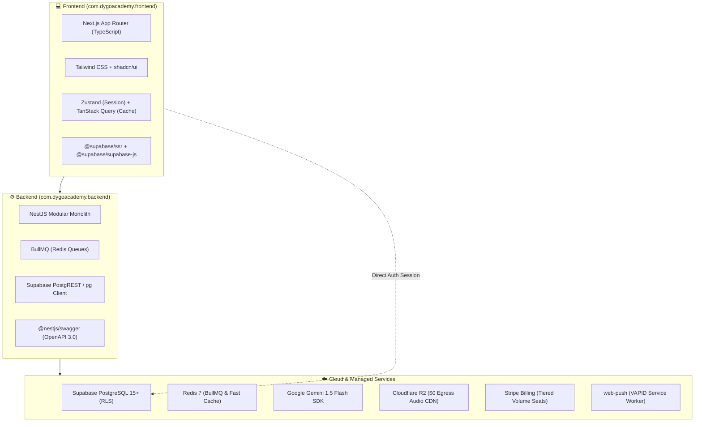

# 🛠️ Dygo Academy: Technical Specification, Tech Stack & Naming Conventions
**Document Version**: 2.1 (Frontend hardening — middleware, guard, scalability layer)  
**Author**: Principal Cloud & SaaS Solutions Advisory  
**Status**: Approved Standard before Phase 1 Development  

**Changelog**
* **2.1** (2026-08-31) — Frontend tree extended past the Phase 0 scaffold: `middleware.ts` (session refresh + edge-side auth guard), `config/env.ts` (zod-validated, fail-fast), `types/` and `constants/` (scalability layer — see §2), `lib/supabase.ts` split into `lib/supabase/{client,server,middleware}.ts` per Supabase's documented App Router pattern, plus `error.tsx`/`loading.tsx`/`not-found.tsx` boundaries. §2 tree and §3.3 updated to match.
* **2.0** — Updated Directory Package Standard (baseline).

---

## 1. Complete Technology Stack Matrix



| Layer | Technology | Version | Purpose & Architectural Justification |
| :--- | :--- | :--- | :--- |
| **Backend Framework** | **NestJS** | `^10.x` | Enterprise TypeScript framework; enforces Clean Architecture, dependency injection, and modular domain encapsulation. |
| **Backend Runtime** | **Node.js** / **TypeScript** | `20 LTS / ^5.x` | High-performance asynchronous non-blocking event loop. |
| **Frontend Framework** | **Next.js** | `^14.x / 15.x` | React App Router; Server-Side Rendering (SSR) for SEO on public topics, Client Components for interactive 3D cards. |
| **Frontend Styling** | **Tailwind CSS + shadcn/ui** | `^3.4 / Radix UI` | Atomic, highly customizable UI design system with dark/light themes. |
| **Client State Management** | **Zustand + TanStack Query** | `^4.x / ^5.x` | `Zustand` for active study session state; `TanStack Query` for server caching, optimistic UI updates, and deduping. |
| **Database & Auth Engine** | **Supabase (PostgreSQL)** | `15+` | Relational integrity, built-in GoTrue JWT authentication, and native Row-Level Security (RLS) policies. |
| **Asynchronous Job Queues** | **BullMQ + Redis** | `^5.x / 7.x` | Offloads heavy AI/TTS tasks in `<50ms`; guarantees at-least-once job delivery and exponential backoff retry. |
| **AI Linguistic Engine** | **Google Gemini 1.5 Flash** | `@google/genai` | Sub-second extraction of dual IPA, CEFR synonyms/antonyms, contextual sentences, and error nuances. |
| **Audio Storage & CDN** | **Cloudflare R2** | `@aws-sdk/client-s3` | S3-compatible object storage with **$0 egress fees**; sub-80ms global audio playback via Cloudflare Edge. |
| **Payment & Billing** | **Stripe API** | `^14.x` | Automated Tiered Volume Seat Subscriptions, checkout sessions, customer portal, and invoice webhooks. |
| **Push Reminders** | **web-push (VAPID)** | `^3.6` | Standardized browser push notifications with 1-tap deep links directly to flashcard review sessions. |

---

## 2. Directory & Workspace Structure

Dygo Academy uses reverse-domain namespace packages for the backend and frontend service repositories:

```
DygoAcademy/
├── .env.example                               # Global environment variable template
├── .env                                       # Local active environment variables
├── .gitignore                                 # Git ignore configuration
├── docker-compose.yml                         # Local Supabase, Redis & MinIO services
├── README.md                                  # Repository overview and setup guide
│
├── database/                                  # Database migrations, RLS & Seed fixtures
│   └── migrations/
│       ├── 001_initial_schema.sql             # Relational tables, types & constraints
│       ├── 002_rls_policies.sql               # Multi-tenant Row-Level Security rules
│       ├── 003_indexes.sql                    # Partial & performance indexes
│       └── 004_seed_data.sql                  # Development fixtures & master topics
│
├── com.dygoacademy.backend/                   # ⚙️ NestJS Backend Service
│   ├── src/
│   │   ├── app.module.ts                      # Root module importing domain features
│   │   ├── main.ts                            # Bootstrap, Swagger at /api/docs, validation pipes
│   │   ├── common/                            # Shared guards, interceptors, filters, decorators
│   │   │   ├── guards/                        # supabase-jwt.guard.ts, roles.guard.ts
│   │   │   ├── interceptors/                  # transform-response.interceptor.ts
│   │   │   ├── filters/                       # http-exception.filter.ts
│   │   │   └── decorators/                    # current-user.decorator.ts, roles.decorator.ts
│   │   ├── config/                            # Environment config service and DTO schema
│   │   ├── database/                          # Supabase/PostgreSQL connection provider
│   │   ├── modules/                           # Domain Feature Modules (Clean Architecture)
│   │   │   ├── topics/                        # Group & Topic management + RBAC
│   │   │   ├── words/                         # Word ingestion & status tracking
│   │   │   ├── srs/                           # Error-adaptive SRS calculation & review queue
│   │   │   ├── billing/                       # Stripe checkout, webhook & seat management
│   │   │   └── notifications/                 # Push subscription & BullMQ cron scheduler
│   │   └── workers/                           # BullMQ Queue Processors
│   │       ├── enrichment.processor.ts        # Gemini AI & TTS audio pipeline
│   │       └── notification.processor.ts       # Timezone push alert dispatcher
│   ├── package.json
│   ├── tsconfig.json
│   ├── nest-cli.json
│   └── Dockerfile
│
└── com.dygoacademy.frontend/                  # 💻 Next.js 14/15 App Router Frontend
    ├── src/
    │   ├── middleware.ts                      # Session refresh + edge-side auth guard (runs before every matched request)
    │   ├── app/                               # App Router pages & layouts
    │   │   ├── (auth)/                        # Login, register, magic link routes
    │   │   ├── (dashboard)/                   # Main authenticated portal — server-checks the session too (defense in depth)
    │   │   │   ├── topics/                    # Topic directory & class views
    │   │   │   ├── study/                     # 3D Flashcard player & Quiz player
    │   │   │   ├── analytics/                 # Retention curves & mistake heatmaps
    │   │   │   ├── settings/                  # Habit scheduling & billing portal
    │   │   │   ├── error.tsx                  # Segment-scoped error boundary
    │   │   │   └── loading.tsx                # Segment-scoped loading UI
    │   │   ├── api/                           # Next.js Route Handlers
    │   │   ├── layout.tsx                     # Root layout with ThemeProvider & QueryClientProvider
    │   │   ├── page.tsx                       # Marketing / Landing page
    │   │   ├── error.tsx                      # Root-level error boundary
    │   │   ├── global-error.tsx               # Catches errors in the root layout itself
    │   │   ├── not-found.tsx                  # 404
    │   │   ├── loading.tsx                    # Default navigation-loading UI
    │   │   └── globals.css                    # Tailwind CSS styles & 3D transform utilities
    │   ├── components/                        # Reusable UI components
    │   │   ├── ui/                            # shadcn/ui primitives (button, card, dialog, etc.)
    │   │   ├── flashcard/                     # 3D Flip Card, Progressive Hint Engine
    │   │   ├── quiz/                          # Cloze, Audio Dictation, Synonym Match widgets
    │   │   └── layout/                        # Navbar, SignOutButton, Sidebar, UserDropdown
    │   ├── config/                            # env.ts — zod-validated NEXT_PUBLIC_* config, fail-fast
    │   ├── constants/                         # routes.ts — single source of truth for path strings
    │   ├── types/                             # Domain types mirroring backend DTOs/enums & DB schema
    │   ├── hooks/                             # Custom React hooks (useSrsQueue, useAudioPlayer)
    │   ├── lib/                               # API client, Supabase clients, utilities
    │   │   ├── api-client.ts                  # Typed Fetch wrapper for NestJS API, unwraps ApiResponse<T>
    │   │   ├── supabase/                      # client.ts (browser) · server.ts (RSC/Route Handlers) · middleware.ts (session refresh)
    │   │   └── utils.ts                       # Class merger (cn) and formatting helpers
    │   └── stores/                            # Zustand stores (useStudySessionStore, useAudioStore)
    ├── package.json
    ├── tailwind.config.ts
    ├── postcss.config.js
    ├── next.config.mjs
    ├── tsconfig.json
    └── Dockerfile
```

---

## 3. Strict Naming Conventions

To maintain code consistency across engineers and AI subagents, all code must adhere to these standard conventions:

### 3.1 Database & SQL Naming
* **Tables & Views**: `snake_case`, plural nouns (e.g., `tenants`, `master_lexicon`, `topic_words`, `user_word_srs`, `review_logs`).
* **Columns**: `snake_case`, descriptive nouns/adjectives (e.g., `purchased_seats`, `stability`, `difficulty`, `is_leech`, `next_due_at`).
* **Primary Keys**: Always `id UUID PRIMARY KEY DEFAULT gen_random_uuid()`.
* **Foreign Keys**: `[singular_table_name]_id` (e.g., `tenant_id`, `topic_id`, `user_id`, `lexicon_id`).
* **Indexes**: `idx_[table]_[columns]_[condition]` (e.g., `idx_srs_due_fast`, `idx_master_lexicon_normalized_word`).
* **Enums**: `snake_case` type names, `UPPERCASE` string literals (e.g., `group_role`: `'ADMIN'`, `'WRITE'`, `'READ'`).

---

### 3.2 Backend (`com.dygoacademy.backend`)
* **Package Name**: `com.dygoacademy.backend` (in `package.json`).
* **File Names**: `kebab-case.[type].ts`
  * Controllers: `topics.controller.ts`, `words.controller.ts`
  * Services: `topics.service.ts`, `srs-calculator.service.ts`
  * DTOs: `create-word.dto.ts`, `rate-card.dto.ts`, `update-topic.dto.ts`
  * Entities/Models: `topic.entity.ts`, `user-srs.entity.ts`
  * Processors: `word-enrichment.processor.ts`, `notification-cron.processor.ts`
  * Guards: `supabase-jwt.guard.ts`, `roles.guard.ts`
* **Classes & Interfaces**: `PascalCase` (e.g., `TopicsController`, `CreateWordDto`, `SrsReviewSession`).
* **Methods & Functions**: `camelCase`, action-verb prefixed (e.g., `getDueCards()`, `enrichWordPayload()`, `calculateNextInterval()`).
* **Constants & Environment Variables**: `UPPER_SNAKE_CASE` (e.g., `MAX_RETRY_ATTEMPTS`, `REDIS_ENRICHMENT_QUEUE`).
* **Enums**: `PascalCase` enum name with `UPPERCASE` properties:
  ```typescript
  export enum SrsRating {
    AGAIN = 'AGAIN',
    HARD = 'HARD',
    GOOD = 'GOOD',
    EASY = 'EASY',
  }
  ```

---

### 3.3 Frontend (`com.dygoacademy.frontend`)
* **Package Name**: `com.dygoacademy.frontend` (in `package.json`).
* **Component Files**: `PascalCase.tsx` (e.g., `FlashcardPlayer.tsx`, `ProgressiveClue.tsx`, `TopicList.tsx`).
* **Utility & Hook Files**: `kebab-case.ts` / `camelCase.ts` with `use` prefix (e.g., `useSrsSession.ts`, `useAudioPlayer.ts`).
* **Component Names**: `PascalCase` matching the file name.
* **CSS Class Names**: Tailwind utility classes; custom classes in `globals.css` must use `kebab-case` (e.g., `.perspective-1000`, `.preserve-3d`).
* **Zustand Stores**: `use[Domain]Store.ts` (e.g., `useStudySessionStore.ts`, `useTopicStore.ts`).
* **Domain Types**: `kebab-case.ts` under `types/`, one file per domain noun (`topic.ts`, `group.ts`, `word.ts`), field casing mirrors the API wire format exactly — the backend does not camelCase its output, so neither do these.
* **Route Constants**: path strings live in `constants/routes.ts`, never hardcoded inline — `src/middleware.ts` and any nav component must agree on what counts as a protected path.

---

### 3.4 API & Routing Conventions
* **REST Endpoints**: `kebab-case`, plural nouns, versioned `/api/v1/...`
  * `POST   /api/v1/words` — Ingest new vocabulary word
  * `GET    /api/v1/topics` — List public/private topics
  * `GET    /api/v1/topics/:topicId/cards/due` — Fetch SRS due cards
  * `POST   /api/v1/srs/rate` — Submit card review rating
  * `POST   /api/v1/billing/checkout` — Create Stripe checkout session
* **Standard API Response Envelope**:
  ```typescript
  export interface ApiResponse<T> {
    success: boolean;
    data: T;
    message?: string;
    meta?: {
      page?: number;
      limit?: number;
      total?: number;
      timestamp: string;
    };
  }
  ```
* **Standard API Error Response Envelope**:
  ```typescript
  export interface ApiErrorResponse {
    success: false;
    statusCode: number;
    error: string;
    message: string | string[];
    timestamp: string;
    path: string;
  }
  ```

---

### 3.5 Asynchronous Queues & Message Schemas
* **Queue Names**: `kebab-case` with `-queue` suffix:
  * `enrichment-queue`: Word AI & audio pipeline jobs
  * `notification-queue`: Push notification dispatch jobs
* **Job Names & Payload Schema Example**:
  ```typescript
  export interface WordEnrichmentJob {
    topicWordId: string;
    word: string;
    languageCode: string;
    targetCEFR?: 'A2' | 'B1' | 'B2' | 'C1';
    triggeredByUserId: string;
  }
  ```

---

## 4. Phase 1 Core Domain Specifications

### 4.1 Module 1: Collaborative Groups & Topics (RBAC)

#### Permission Matrix:
```
Role Hierarchy: ADMIN > WRITE > READ
```
* **`ADMIN` (Owner/Tutor)**: Can rename/delete topic, invite members, assign roles, revoke access, and edit all words.
* **`WRITE` (Editor/Co-Teacher)**: Can add words, trigger re-enrichment, and edit notes. Cannot delete topic or modify member roles.
* **`READ` (Student/Viewer)**: Can browse topic words, flip 3D cards, and take quizzes. **Personal SRS progress is strictly isolated** in `user_word_srs` with zero interference with peers.

---

### 4.2 Module 2: Automated AI Word Enrichment Engine

#### Gemini 1.5 Flash Prompting Specification:
The AI enrichment worker outputs strict, deterministic JSON:
```json
{
  "normalized_word": "ephemeral",
  "language_code": "en",
  "part_of_speech": "adjective",
  "ipa_us": "/ɪˈfem.ər.əl/",
  "ipa_uk": "/ɪˈfem.ər.əl/",
  "cefr_level": "C1",
  "definition_en": "Lasting for a very short time; transitory.",
  "synonyms": [
    { "word": "transient", "level": "C1" },
    { "word": "fleeting", "level": "B2" },
    { "word": "momentary", "level": "B1" },
    { "word": "short-lived", "level": "B1" },
    { "word": "evanescent", "level": "C2" }
  ],
  "antonyms": [
    { "word": "permanent", "level": "B1" },
    { "word": "enduring", "level": "B2" },
    { "word": "eternal", "level": "B2" },
    { "word": "everlasting", "level": "B2" },
    { "word": "perpetual", "level": "C1" }
  ],
  "example_sentences": [
    {
      "sentence": "Fame in the digital age is often ephemeral, fading as quickly as it arrives.",
      "level": "B2",
      "translation_hint": "Lasting only a brief period"
    },
    {
      "sentence": "The ephemeral beauty of cherry blossoms draws millions of visitors each spring.",
      "level": "C1",
      "translation_hint": "Transitory, short-lived"
    }
  ]
}
```

#### Audio & Storage Pipeline:
1. Generate `.mp3` via Neural TTS engine (default: US female, crisp lexical cadence).
2. Save file to Cloudflare R2 path: `/audio/en/us/[normalized_word_md5].mp3`.
3. Store permanent public CDN URL in `master_lexicon.audio_url`.
